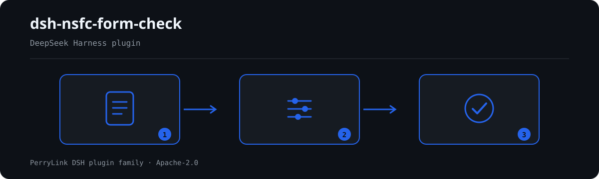

# dsh-nsfc-form-check — NSFC आवेदन की औपचारिक जाँच और संस्था की अपनी सूची के आधार पर पहचान-संकेत की चेतावनी

[English](README.md) · [简体中文](README-zh.md) · [Español](README-es.md) · [Português](README-pt.md) · [हिन्दी](README-hi.md)

```sh
dsh plugin --profile <name> add dsh-nsfc-form-check
```


[](https://dsh.market/)
[](https://dshfind.com/en/plugins/PerryLink/dsh-nsfc-form-check?ref=badge)

`dsh-nsfc-form-check` एक NSFC आवेदन — उसकी मुख्य पंक्तियाँ, इलेक्ट्रॉनिक दस्तावेज़-गुण, और संस्था की अपनी पहचान-शब्द सूची — पढ़ता है और उस सामग्री की जाँच एक संस्करणबद्ध नियम-पैक से करता है: क्या कोई सूची कॉन्फ़िगर है, कॉन्फ़िगर किए गए आवेदक, संस्था और पर्यवेक्षक नाम मुख्य पाठ में तथा निर्धारित पंक्ति-सीमा में कहाँ आते हैं, शीर्षक, लेखक, कंपनी और अंतिम-संशोधन गुणों में क्या दर्ज है, सामग्री उपयोगकर्ता द्वारा तय लंबाई-सीमा के भीतर है या नहीं, कॉन्फ़िगर किए गए औपचारिक जाँच-मद और दोहरा-आवेदन प्रकटीकरण मौजूद हैं या नहीं, पर्यवेक्षक का नाम वार्षिक दिशानिर्देश के अनुसार भरा गया है या नहीं, और कोई कॉन्फ़िगर किया गया गोप्य या संवेदनशील शब्द आता है या नहीं। प्रत्येक निष्कर्ष उस धारा का नाम देता है जिससे वह आया, और बताता है कि वह धारा सीधा प्रावधान है, सिद्धांत है या स्थानीय कॉन्फ़िगरेशन; और जो जाँच नहीं चल सकी वह `skipped` में कारण सहित दर्ज होती है।

## Install

```sh
dsh plugin --profile <name> add dsh-nsfc-form-check
dsh --profile <name> --dump-config | grep 'dsh-nsfc-form-check'
```

## आउटपुट कैसा दिखता है



*कार्यप्रवाह: दस्तावेज़ → नियम → निष्कर्ष। नीचे के उदाहरण वास्तविक कमांड सतह का उपयोग करते हैं।*


इस प्लगइन का अपने ही `NF-009` टेस्ट फ़िक्स्चर पर वास्तविक आउटपुट — कोई नकली चित्र नहीं। नियम-पैक उद्धरण नहीं गढ़ता, इसलिए हर निष्कर्ष लागू किए गए खंड का नाम और यह भी बताता है कि उसका मूल पाठ इस बार प्राप्त नहीं हुआ।

## यह किन सवालों का जवाब देता है

### उदाहरण

नीचे दी गई तालिका उदाहरण-समुच्चय है: पहली पंक्ति विस्तृत केस है, बाकी संक्षिप्त केस हैं।


#### विस्तृत आउटपुट

**उपकरण** `nsfc_form_check`

**इनपुट**

~~~json
{"text":"申请代码：H0301\n项目名称：某信号通路在疾病进展中的作用机制研究","metadata":{},"roster":{"authorNames":[],"institutionNames":[],"advisorNames":[],"allowList":[]}}
~~~
 
**आउटपुट**

~~~json
{
  "id": "dsh-nsfc-form-check.NF-001.811c9dc5",
  "ruleId": "NF-001",
  "severity": "warn",
  "locator": {},
  "found": "未配置任何可核验的身份词（申请人姓名、依托单位名称、导师姓名均为空）",
  "expected": "匿名检查需要名单才能执行；未配置时其余匿名相关检查只能逐条报为未执行"
}
~~~

*स्रोत `dsh-nsfc-form-check/tests/fixtures/NF-001/NF-001-unsafe.json`*

| आपका सवाल | इसका जवाब |
|---|---|
| आवेदक नाम की सूची किसी ने नहीं भरी। तो पहचान की जाँच चुपचाप पास हो जाती है? | नहीं। जब `authorNames`, `institutionNames` और `advisorNames` तीनों खाली हों तो सबसे पहले `NF-001` दर्ज होता है, और जिन पहचान-जाँचों को ये शब्द चाहिए वे सब कारण सहित `skipped` में दर्ज होती हैं। इसलिए निष्कर्ष-सूची खाली होने का अर्थ कभी "कुछ गड़बड़ नहीं" नहीं होता — कोई निष्कर्ष निकालने से पहले `NF-001` और `skipped` की प्रविष्टियाँ देखें। |
| मुख्य पाठ में आवेदक के समान उपनाम वाला एक सह-लेखक आया है। | `NF-002` कॉन्फ़िगर किए गए `authorNames` को पंक्ति-दर-पंक्ति शब्दशः मिलाता है, इसलिए एक ही नाम के दूसरे व्यक्ति, सामान्य उपनाम, या किसी अन्य शोधकर्ता के काम का उद्धरण भी पकड़ में आ सकता है। यह निष्कर्ष केवल तकनीकी चेतावनी है — 《国家自然科学基金条例》(国务院令第796号) 第二十一条 समीक्षकों से गोपनीयता चाहती है और मुख्य पाठ में नाम आने को मना नहीं करती — इसलिए जिस शब्द को आप जाँच चुके हों उसे `allowList` में डाला जा सकता है। |
| दस्तावेज़-गुण में लेखक फ़ील्ड में नाम है। क्या यह दर्ज होगा, और क्या पहले सूची कॉन्फ़िगर करनी होगी? | दर्ज होगा, और सूची की ज़रूरत नहीं। `NF-006` को roster नहीं चाहिए: `authorNames` खाली होने पर भी वह किसी भी भरे लेखक-गुण को दर्ज करता है, और roster कॉन्फ़िगर होने पर बताता है कि मान आवेदक के नाम से मेल खाता है या नहीं। `NF-005`, `NF-007` और `NF-008` को पहचान-शब्द सूची चाहिए और उसके बिना वे `skipped` में जाते हैं। चारों केवल दस्तावेज़-गुण पढ़ते हैं, मुख्य पाठ के बारे में कुछ नहीं कहते। |
| पृष्ठ और शब्द की सीमाएँ मैंने खुद भरी हैं। क्या यह बताएगा कि आवेदन बहुत लंबा है? | केवल आपकी तय की हुई सीमा के भीतर। `NF-010` में `maxLines` और `maxChars` बिना कॉन्फ़िगर के आते हैं और वह `skipped` में जाता है, क्योंकि ये सीमाएँ हर वर्ष और परियोजना-प्रकार के अनुसार बदलती हैं; भरने के बाद वह निकाले गए अनुच्छेदों की संख्या या अक्षर-योग दर्ज करता है जो सीमा से अधिक है। `maxLines` निकाले गए अनुच्छेद गिनता है, छपे हुए पृष्ठ नहीं, इसलिए वह पृष्ठ-संख्या के बराबर नहीं है। |
| हमारे शोध कार्यालय द्वारा माँगी गई सभी औपचारिक जाँच-मदें सामग्री में थीं? | `require` कॉन्फ़िगर होने तक `NF-011` स्वयं को `skipped` में दर्ज करता है, और सूची के बिना वह उसे जानने का दावा नहीं करता। कॉन्फ़िगर होने पर वह आपके `match` वाक्यांशों को शब्दशः मिलाता है और जो नहीं मिलते उन्हें दर्ज करता है। वह देखता है कि वाक्यांश मौजूद है, यह नहीं कि वह कॉलम ठीक भरा है या हस्ताक्षर असली है। |
| हम पिछले वर्ष का आवेदन फिर जमा कर रहे हैं। प्रकटीकरण टिप्पणी ज़रूरी है? | `NF-012` को एक साथ दो चीज़ें चाहिए: `markerPatterns`, जो आपके टेम्पलेट में दोहरे या अगली कड़ी के आवेदन की शब्दावली पहचानते हैं, और `requiredDisclosure`, जो बताता है कि क्या प्रकट करना है। कोई एक भी कॉन्फ़िगर न हो तो वह `skipped` में जाता है; मार्कर कॉन्फ़िगर हों पर घोषणा न मिले तो वह बताता है कि यह नियम लागू नहीं होता। वह प्रकटीकरण की शब्दावली नहीं मान लेता, और यह भी तय नहीं करता कि आवेदन वाकई दोहरा है। |

## यह किन मानकों पर आधारित है

| दस्तावेज़ | संख्यांक | इन्हें उद्धृत करने वाले नियम |
|---|---|---|
| 《国家自然科学基金条例》 | 国务院令第796号 | NF-001, NF-002, NF-003, NF-004, NF-005, NF-006, NF-007, NF-008, NF-009, NF-010, NF-011, NF-012, NF-013, NF-014, NF-015 |
| 《2026 年度国家自然科学基金项目指南·申请规定》 | 2026 年度（逐年更新） | NF-014, NF-015 |

**Boundary:** this plugin checks an **NSFC proposal's text and electronic document properties** and
reports the identity clues it finds, alongside the length and form-review items a deployment
configures. It is not `dsh-rulefile-check` (which audits the legality of a regulatory document), not
`dsh-policy-brief-draft` (which drafts a policy explainer), and not `dsh-review-reply-check` (which
tracks reviewer comments). It reads one proposal and reports literal matches against cited clauses.

> ### ⚠️ Read this before using the anonymity checks
>
> **There is no current national provision that forbids an applicant's name, institution or advisor
> from appearing in an NSFC proposal.** Three independent texts were read in full for this plugin —
> 《国家自然科学基金条例》(国务院令第796号), the 2026 年度《项目指南·申请规定》, and the 2019 年度
> guidelines — and none contains 匿名, 盲审, 活页, or any "must not appear" wording about identity.
> The regulation does not contain the word 匿名 at all. Its **avoidance** clause (第二十条) requires a
> reviewer from the applicant's own legal entity to recuse, which presupposes that the system knows
> the applicant's institution — the opposite of an anonymous process.
>
> So every finding this plugin makes about a name or an institution is a **technical observation for
> a human to weigh**, labelled 身份线索词 and never phrased as a violation. The plugin is useful for a
> research-office self-check, and it is **wrong to use it as a compliance gate**. Two rules go further
> and cite the guidance verbatim: `NF-014` checks that the advisor's name **is** filled in, because the
> yearly guidelines require it, and `NF-015` checks 涉密与敏感信息, which is the one "must not appear"
> requirement that really exists — and its object is classified information, not identity.

## Compatibility

| सतह | स्थिति |
|---|---|
| Harness | peer रेंज `>=0.1.2-rc.1 <0.2.0 \|\| >=0.2.0-0 <0.3.0` — `0.2.0-rc.2` और `0.2.1-rc.2` दोनों को स्वीकार करने के लिए सत्यापित। **`engines.dsh` `>=0.2.1-0 <0.3.0` के रूप में घोषित है** और 0.2.1 से होस्ट इसे लागू करता है |
| Node | `^22.19.0 || >=24.0.0` |
| प्लेटफ़ॉर्म | सभी (शुद्ध ESM; कोई नेटिव कोड नहीं, कोई नेटवर्क नहीं, कोई मॉडल कॉल नहीं) |
| टूल मोड | `native` और `ptc` में काम करता है; पूरे फ़ोल्डर के लिए `ptc` चुनें |

## What it does

नियम-सूची, फ़ील्ड और विस्तृत व्यवहार [README.md](README.md#what-it-does) (अंग्रेज़ी मुख्य संस्करण) में हैं। यह प्लगइन केवल उद्धृत धाराओं के सामने शाब्दिक अंतर सूचीबद्ध करता है और हर न चल पाई जाँच को `skipped` में बताता है।

## Configuration

सभी समायोज्य पैरामीटर `src/config.ts` की Schemastery स्कीमा में हैं, इसलिए कोड बदले बिना `cordis.yml` से बदले जा सकते हैं; प्रति-नियम सीमाएँ `rules/` के नियम-पैक में हैं।

| कुंजी | प्रकार | डिफ़ॉल्ट | विवरण |
|---|---|---|---|
| `rulesFile` | string | `rules/nsfc-form-check.yaml` | नियम-पैक का पथ, पैकेज रूट के सापेक्ष |
| `disabledRules` | string[] | `[]` | बंद करने वाले नियम id; प्रत्येक `skipped` में दिखता है |
| `onlyRules` | string[] | `[]` | केवल ये नियम चलाएँ; खाली होने पर सभी नियम चलते हैं |
| `skipNotes` | string | `""` | हर `skipped` कारण के आगे जोड़ी जाने वाली टिप्पणी |
| `authorNames` | string[] | `[]` | खोजे जाने वाले आवेदक नाम |
| `institutionNames` | string[] | `[]` | खोजे जाने वाले संस्थान और इकाई नाम |
| `advisorNames` | string[] | `[]` | खोजे जाने वाले सलाहकार नाम |
| `allowList` | string[] | `[]` | मेल खाने पर भी अनदेखा किए जाने वाले शब्द |
| `timeoutMs` | number | `120000` | उपकरण का सहकारी समय-सीमा बजट |

## Material format

JSON या YAML स्वीकार्य है। पूरा फ़ील्ड उदाहरण [README.md](README.md#material-format) (अंग्रेज़ी मुख्य संस्करण) में है। पढ़ने की परत में फ़ील्ड वैकल्पिक हैं और जाँच इंजन उन्हें सत्यापित करता है, इसलिए आंशिक निर्यात पर क्रैश के बजाय "अनुपस्थित" श्रेणी के निष्कर्ष मिलते हैं।

## Rule sources

नियम-डेटा कोड से अलग है: प्रत्येक नियम में दस्तावेज़, संख्या, स्रोत की अपनी क्रमांकन-प्रणाली के अनुसार धारा, शब्दशः उद्धरण और स्रोत URL होता है। लोडर लागू करता है कि उद्धरण कम से कम आठ अक्षरों का वास्तविक उद्धरण हो, और जिस जाँच का आधार केवल सामान्य सिद्धांत (`kind: derived-from-principle`, अधिकतम `warn`) या स्थानीय नीति (`kind: institutional-configuration`, अधिकतम `info`) हो, उसे कभी `error` घोषित न किया जाए।

सत्यापित सीमाएँ और जान-बूझकर **न** कहे गए निष्कर्ष [README.md](README.md#rule-sources) (अंग्रेज़ी मुख्य संस्करण) और `rules/evidence/` में हैं।

## Troubleshooting

- **प्लगइन इंस्टॉल हो गया पर टूल दिखता नहीं**: जाँचें कि `main` `lib/index.mjs` पर जाता है और `pnpm run build` ने उसे बनाया है।
- **`dsh plugin add` असंगत बताकर मना करता है**: peer range `0.1.x` और `0.2.x` दोनों को कवर करती है; बाहर होने पर स्पष्ट छूट दें: `dsh plugin --profile <name> allow-version <pkg@ver> --dsh-version <runtime> --accept-risk`।
- **कोई नियम नहीं चला**: `skipped` सरणी देखें।
- **`check` में `manifest-peers` विफल दिखता है**: यह `dsh-plugin-dev` की ज्ञात अपस्ट्रीम समस्या है; रनटाइम इंस्टॉल के समय अनुकूलता लागू करता है।
- **समय खिसका हुआ लगता है**: सारी गणना दिए गए स्ट्रिंग पर वॉल-क्लॉक है।

## Development

```sh
pnpm install
pnpm run typecheck
pnpm test
pnpm run build
node ../scripts/sync-shared.mjs dsh-nsfc-form-check
```

अंतिम कमांड `../_shared` का साझा किट `src/shared/` में कॉपी करता है; हर साझा बदलाव के बाद इसे दोबारा चलाएँ।

## PerryLink DSH Plugin Family

यह प्रोजेक्ट [PerryLink](https://github.com/PerryLink) के DeepSeek Harness प्लगइन परिवार का हिस्सा है। पूरी सूची नीचे संक्षिप्त रखी गई है ताकि हर README की पहली स्क्रीन छोटी रहे; हर पंक्ति और उसकी स्थिति देखने के लिए इसे खोलें।

<details>
<summary>सभी प्लगइन खोलें</summary>

| प्लगइन | स्थिति |
|---|---|
| **[dsh-aqua-input-check](https://github.com/PerryLink/dsh-aqua-input-check)** |  |
| **[dsh-archive-check](https://github.com/PerryLink/dsh-archive-check)** |  |
| **[dsh-auto-review](https://github.com/PerryLink/dsh-auto-review)** |  |
| **[dsh-autotier](https://github.com/PerryLink/dsh-autotier)** |  |
| **[dsh-bid-ca-precheck](https://github.com/PerryLink/dsh-bid-ca-precheck)** |  |
| **[dsh-bid-qual-check](https://github.com/PerryLink/dsh-bid-qual-check)** |  |
| **[dsh-cert-mcp](https://github.com/PerryLink/dsh-cert-mcp)** |  |
| **[dsh-checkpoint-rewind](https://github.com/PerryLink/dsh-checkpoint-rewind)** |  |
| **[dsh-click](https://github.com/PerryLink/dsh-click)** |  |
| **[dsh-composer-history](https://github.com/PerryLink/dsh-composer-history)** |  |
| **[dsh-contract-stance](https://github.com/PerryLink/dsh-contract-stance)** |  |
| **[dsh-customs-doc-check](https://github.com/PerryLink/dsh-customs-doc-check)** |  |
| **[dsh-data-quality](https://github.com/PerryLink/dsh-data-quality)** |  |
| **[dsh-demurrage-ledger](https://github.com/PerryLink/dsh-demurrage-ledger)** |  |
| **[dsh-doublecheck](https://github.com/PerryLink/dsh-doublecheck)** |  |
| **[dsh-drill-script-check](https://github.com/PerryLink/dsh-drill-script-check)** |  |
| **[dsh-eia-guide-check](https://github.com/PerryLink/dsh-eia-guide-check)** |  |
| **[dsh-emergency-plan](https://github.com/PerryLink/dsh-emergency-plan)** |  |
| **[dsh-essay-rubric-check](https://github.com/PerryLink/dsh-essay-rubric-check)** |  |
| **[dsh-evidence-check](https://github.com/PerryLink/dsh-evidence-check)** |  |
| **[dsh-export-ctl-check](https://github.com/PerryLink/dsh-export-ctl-check)** |  |
| **[dsh-fast](https://github.com/PerryLink/dsh-fast)** |  |
| **[dsh-fmea-table-check](https://github.com/PerryLink/dsh-fmea-table-check)** |  |
| **[dsh-forecast-penalty](https://github.com/PerryLink/dsh-forecast-penalty)** |  |
| **[dsh-fund-research](https://github.com/PerryLink/dsh-fund-research)** |  |
| **[dsh-github](https://github.com/PerryLink/dsh-github)** |  |
| **[dsh-gongwen-flow-check](https://github.com/PerryLink/dsh-gongwen-flow-check)** |  |
| **[dsh-gongwen-word-check](https://github.com/PerryLink/dsh-gongwen-word-check)** |  |
| **[dsh-guard-plan-qc](https://github.com/PerryLink/dsh-guard-plan-qc)** |  |
| **[dsh-hazchem-check](https://github.com/PerryLink/dsh-hazchem-check)** |  |
| **[dsh-hazplan-check](https://github.com/PerryLink/dsh-hazplan-check)** |  |
| **[dsh-hidden-risk-map](https://github.com/PerryLink/dsh-hidden-risk-map)** |  |
| **[dsh-hs-classify](https://github.com/PerryLink/dsh-hs-classify)** |  |
| **[dsh-icd-rule-check](https://github.com/PerryLink/dsh-icd-rule-check)** |  |
| **[dsh-industry-research](https://github.com/PerryLink/dsh-industry-research)** |  |
| **[dsh-lawcite-adapter](https://github.com/PerryLink/dsh-lawcite-adapter)** |  |
| **[dsh-laya](https://github.com/PerryLink/dsh-laya)** |  |
| **[dsh-lc-doc-check](https://github.com/PerryLink/dsh-lc-doc-check)** |  |
| **[dsh-learning-gap-check](https://github.com/PerryLink/dsh-learning-gap-check)** |  |
| **[dsh-library](https://github.com/PerryLink/dsh-library)** |  |
| **[dsh-local-ai](https://github.com/PerryLink/dsh-local-ai)** |  |
| **[dsh-lsp-actions](https://github.com/PerryLink/dsh-lsp-actions)** |  |
| **[dsh-mask](https://github.com/PerryLink/dsh-mask)** |  |
| **[dsh-mcp-panel](https://github.com/PerryLink/dsh-mcp-panel)** |  |
| **[dsh-medrec-qc](https://github.com/PerryLink/dsh-medrec-qc)** |  |
| **[dsh-memento](https://github.com/PerryLink/dsh-memento)** |  |
| **[dsh-nsfc-form-check](https://github.com/PerryLink/dsh-nsfc-form-check)** |  |
| **[dsh-nurse-record-check](https://github.com/PerryLink/dsh-nurse-record-check)** |  |
| **[dsh-observe](https://github.com/PerryLink/dsh-observe)** |  |
| **[dsh-origin-rvc-check](https://github.com/PerryLink/dsh-origin-rvc-check)** |  |
| **[dsh-ota-review-check](https://github.com/PerryLink/dsh-ota-review-check)** |  |
| **[dsh-output-styles](https://github.com/PerryLink/dsh-output-styles)** |  |
| **[dsh-paper-doc-adapter](https://github.com/PerryLink/dsh-paper-doc-adapter)** |  |
| **[dsh-permission-rules](https://github.com/PerryLink/dsh-permission-rules)** |  |
| **[dsh-permit-report-check](https://github.com/PerryLink/dsh-permit-report-check)** |  |
| **[dsh-pipeline-check](https://github.com/PerryLink/dsh-pipeline-check)** |  |
| **[dsh-pleading-draft](https://github.com/PerryLink/dsh-pleading-draft)** |  |
| **[dsh-plugin-doctor](https://github.com/PerryLink/dsh-plugin-doctor)** |  |
| **[dsh-plugin-guide](https://github.com/PerryLink/dsh-plugin-guide)** |  |
| **[dsh-plugin-kit](https://github.com/PerryLink/dsh-plugin-kit)** |  |
| **[dsh-plugin-upgrade](https://github.com/PerryLink/dsh-plugin-upgrade)** |  |
| **[dsh-policy-brief-draft](https://github.com/PerryLink/dsh-policy-brief-draft)** |  |
| **[dsh-power-loss-split](https://github.com/PerryLink/dsh-power-loss-split)** |  |
| **[dsh-power-ticket-check](https://github.com/PerryLink/dsh-power-ticket-check)** |  |
| **[dsh-ppap-check](https://github.com/PerryLink/dsh-ppap-check)** |  |
| **[dsh-protest-deadline](https://github.com/PerryLink/dsh-protest-deadline)** |  |
| **[dsh-railway-window](https://github.com/PerryLink/dsh-railway-window)** |  |
| **[dsh-repair-order-qc](https://github.com/PerryLink/dsh-repair-order-qc)** |  |
| **[dsh-research-report](https://github.com/PerryLink/dsh-research-report)** |  |
| **[dsh-review-reply-check](https://github.com/PerryLink/dsh-review-reply-check)** |  |
| **[dsh-rulefile-check](https://github.com/PerryLink/dsh-rulefile-check)** |  |
| **[dsh-safety-brief-check](https://github.com/PerryLink/dsh-safety-brief-check)** |  |
| **[dsh-score](https://github.com/PerryLink/dsh-score)** |  |
| **[dsh-session-sync](https://github.com/PerryLink/dsh-session-sync)** |  |
| **[dsh-site-log-check](https://github.com/PerryLink/dsh-site-log-check)** |  |
| **[dsh-skill-pack-security](https://github.com/PerryLink/dsh-skill-pack-security)** |  |
| **[dsh-soe-decision-check](https://github.com/PerryLink/dsh-soe-decision-check)** |  |
| **[dsh-soilwater-check](https://github.com/PerryLink/dsh-soilwater-check)** |  |
| **[dsh-sop-sync-check](https://github.com/PerryLink/dsh-sop-sync-check)** |  |
| **[dsh-spc-gbt-adapter](https://github.com/PerryLink/dsh-spc-gbt-adapter)** |  |
| **[dsh-talk](https://github.com/PerryLink/dsh-talk)** |  |
| **[dsh-tender-extract](https://github.com/PerryLink/dsh-tender-extract)** |  |
| **[dsh-tender-matrix](https://github.com/PerryLink/dsh-tender-matrix)** |  |
| **[dsh-test-drive](https://github.com/PerryLink/dsh-test-drive)** |  |
| **[dsh-ticktick](https://github.com/PerryLink/dsh-ticktick)** |  |
| **[dsh-translate](https://github.com/PerryLink/dsh-translate)** |  |
| **[dsh-warranty-calc](https://github.com/PerryLink/dsh-warranty-calc)** |  |
| **[dsh-budget](https://github.com/PerryLink/dsh-budget)** | 🧊 फ़्रोज़न — रिपॉज़िटरी README देखें |
| **[dsh-claude-move](https://github.com/PerryLink/dsh-claude-move)** | 🧊 फ़्रोज़न — रिपॉज़िटरी README देखें |
| **[dsh-defend](https://github.com/PerryLink/dsh-defend)** | 🧊 फ़्रोज़न — रिपॉज़िटरी README देखें |
| **[dsh-draw](https://github.com/PerryLink/dsh-draw)** | 🧊 फ़्रोज़न — रिपॉज़िटरी README देखें |
| **[dsh-reach](https://github.com/PerryLink/dsh-reach)** | 🧊 फ़्रोज़न — रिपॉज़िटरी README देखें |
| **[dsh-background-agents](https://github.com/PerryLink/dsh-background-agents)** | 🚫 सेवानिवृत्त — रिपॉज़िटरी README देखें |
| **[dsh-session-pin](https://github.com/PerryLink/dsh-session-pin)** | 🚫 सेवानिवृत्त — रिपॉज़िटरी README देखें |
| **[dsh-team-rooms](https://github.com/PerryLink/dsh-team-rooms)** | 🚫 सेवानिवृत्त — रिपॉज़िटरी README देखें |

</details>

## License

[Apache License 2.0](LICENSE) © 2026 dsh-nsfc-form-check contributors.
