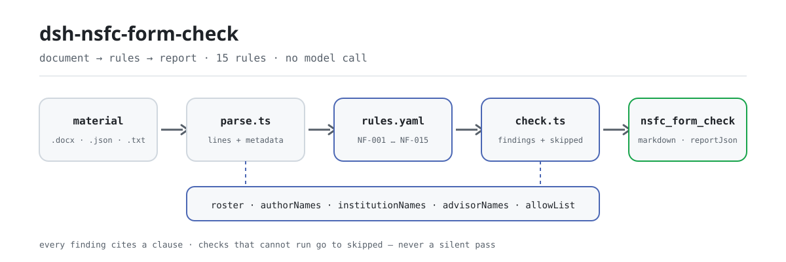

<div align="center">

<picture>
  <source media="(prefers-color-scheme: dark)" srcset="docs/assets/dsh-nsfc-form-check-flow-dark.svg">
  
</picture>

# dsh-nsfc-form-check

**Turn one NSFC proposal into a line-by-line difference list your research office can act on.**

A DeepSeek Harness checker for research administrators: it reads the body lines and electronic document properties, then reports what is off, where, and against which clause — every finding names its basis and its basis kind.

[Install](#three-step-setup) · [Configuration](#configuration) · [FAQ](#faq) · [简体中文](README.md) · [English](README.en.md) · [Español](README.es.md) · [Português](README.pt.md) · [हिन्दी](README.hi.md)

[](LICENSE)
[](#compatibility)
[](https://www.npmjs.com/package/dsh-nsfc-form-check)
[](https://github.com/PerryLink/dsh-nsfc-form-check/actions/workflows/ci.yml)
[](#compatibility)

[](https://github.com/PerryLink/dsh-nsfc-form-check/stargazers)
[](https://www.npmjs.com/package/dsh-nsfc-form-check)
[](https://dshfind.com/plugins/PerryLink/dsh-nsfc-form-check?ref=badge)
[](https://securityscorecards.dev/viewer/?uri=github.com/PerryLink/dsh-nsfc-form-check)
[](https://dsh.market/)
[](https://gitee.com/perrylink/dsh-nsfc-form-check)

```sh
dsh plugin --profile <name> add dsh-nsfc-form-check
```

</div>

<sub>Community plugin, not affiliated with DeepSeek. Canonical repository: <https://github.com/PerryLink/dsh-nsfc-form-check> (Gitee is a mirror).</sub>

## What it is

`dsh-nsfc-form-check` reads one National Natural Science Foundation of China (NSFC) proposal — its body lines, its electronic document properties, and the institution's own lists of applicant, institution and advisor names — and checks that material against a versioned rule pack: whether a roster is configured, where the configured identity terms occur in the body, what the title, author, company and last-modified-by properties carry, whether the material fits the length limit the deployment set, whether the configured form-review items and repeat-application disclosure are present, whether the advisor's name has been filled in as the yearly guidelines require, and whether any configured classified or sensitive term appears.

Every finding names the clause it came from and states whether that clause is a direct requirement, a principle, or a local configuration. Every check that could not run is listed in `skipped` with its reason. An empty finding list therefore never means nothing was wrong — read `NF-001` and the `skipped` entries before drawing any conclusion.

It lists literal differences only: no compliance verdict, no liability finding, no replacement for the reviewer. It accepts `.docx`, `.txt`, `.md`, `.json` and `.yaml`; `.pdf` is not parsed (see "Material format" for why). Plain ESM, no network, no model call, no native code.

```text
proposal.docx ──parse──▶ lines + properties ──check──▶ findings + skipped
                                ▲
                                └── rules/nsfc-form-check.yaml (NF-001…NF-015)
```

## Three-step setup

1. **Install** (pick one channel):

   ```sh
   # git channel (latest main; runs the prepare build)
   dsh plugin --profile <name> add github:PerryLink/dsh-nsfc-form-check
   # npm channel (published release, already built lib/)
   dsh plugin --profile <name> add dsh-nsfc-form-check
   # tarball channel: pnpm pack in this repo, then
   dsh plugin --profile <name> add ./dsh-nsfc-form-check-<version>.tgz
   ```

2. **Minimal config** (put your institution's roster in the profile patch; the list is not shipped with the package):

   ```yaml
   - insert:
       - id: dsh-nsfc-form-check
         name: dsh-nsfc-form-check
         config:
           authorNames: ["Zhang Wei"]
           institutionNames: ["Example University", "Example University First Hospital"]
           advisorNames: ["Li Jianguo"]
   ```

3. **Verify it mounts**:

   ```sh
   dsh --profile <name> --dump-config | grep 'dsh-nsfc-form-check'
   ```

   The repository also ships a reproducible quickstart (run `pnpm install && pnpm run build` first, because the script imports the build output):

   ```sh
   node samples/quickstart/run.mjs --check
   ```

   ```text
   nsfc_form_check: quickstart OK — output matches expected/result.json
   ```

   The expected result is 1 finding and 14 `skipped` entries, recorded in `samples/quickstart/expected/result.json`; the input and screenshot are in `samples/quickstart/input/` and `docs/assets/quickstart.png`.

**Uninstall**: `dsh plugin --profile <name> remove dsh-nsfc-form-check` (or remove the row from the profile patch).

## Core capabilities

- **Roster first; an empty roster is never a pass** — `NF-001` is reported first when all three name lists are empty, and every roster-dependent check enters `skipped` instead of passing silently.
- **Line-level locators** — body matching is literal and line-oriented, so every finding carries a line number; terms shorter than two characters and anything in `allowList` are ignored.
- **Document properties reported separately** — `NF-005` to `NF-008` read the title, author, company and last-modified-by properties without folding them into body findings.
- **Length and form items configured per year** — the thresholds, checklist and disclosure requirements for `NF-010`, `NF-011` and `NF-012` ship empty; unconfigured means `skipped`.
- **The advisor check points the other way** — `NF-014` is the inverse of `NF-004`: the yearly guidelines require the advisor's name, so this rule checks that it *is* filled in.
- **Classified terms kept separate** — `NF-015` is the only rule in the pack that quotes a real "must not appear" requirement, and its object is classified information, not identity.
- **Transparent basis** — every finding carries `document`, `number`, `clause`, a verbatim `excerpt` and a `source`; rules resting only on a principle or on local configuration are severity-capped at load.
- **Differences only** — the report pronounces on nothing; a human reviewer decides.

### Rule list

| Rule | Check | Severity | Basis kind |
|---|---|---|---|
| `NF-001` | a roster is configured, otherwise the identity checks cannot run | warn | principle |
| `NF-002` | the body mentions an applicant name (prompt, not a legal requirement) | warn | principle |
| `NF-003` | the body mentions an institution name (prompt, not a legal requirement) | warn | principle |
| `NF-004` | the body mentions an advisor name (prompt; distinguish the case the yearly guidelines require) | warn | principle |
| `NF-005` | the title property contains an identity clue | info | principle |
| `NF-006` | the author property is non-empty or names the applicant | info | principle |
| `NF-007` | the company property names the institution | info | principle |
| `NF-008` | the last-modified-by property names the applicant | info | principle |
| `NF-009` | identity clues inside a configured line range | info | principle |
| `NF-010` | the material fits the configured length limit | info | local configuration (plus a direct clause) |
| `NF-011` | the material contains the configured form-review items | info | local configuration |
| `NF-012` | a repeat or follow-on application carries the configured disclosure | info | local configuration |
| `NF-013` | identity clues inside a configured scope | info | principle |
| `NF-014` | the advisor's name is present, as the yearly guidelines require | info | local configuration (plus a direct clause) |
| `NF-015` | the material contains no configured classified or sensitive term | info | direct clause |

### Examples

The table below is the example set: the first row is the detailed walkthrough, the remaining rows are short cases.

#### Detailed output

**Tool** `nsfc_form_check`

**Input**

~~~json
{"text":"申请代码：H0301\n项目名称：某信号通路在疾病进展中的作用机制研究","metadata":{},"roster":{"authorNames":[],"institutionNames":[],"advisorNames":[],"allowList":[]}}
~~~

**Output**

~~~json
{
  "id": "dsh-nsfc-form-check.NF-001.811c9dc5",
  "ruleId": "NF-001",
  "severity": "warn",
  "locator": {},
  "found": "未配置任何可核验的身份词（申请人姓名、依托单位名称、导师姓名均为空）",
  "expected": "匿名检查需要名单才能执行；未配置时其余匿名相关检查只能逐条报为未执行"
}
~~~

*Observed from `dsh-nsfc-form-check/tests/fixtures/NF-001/NF-001-unsafe.json`*

| You ask | What it answers |
|---|---|
| Nobody filled in the applicant name list. Does the identity checking just pass? | No. `NF-001` is the first thing reported when `authorNames`, `institutionNames` and `advisorNames` are all empty, and every identity check that needs those terms reports itself in `skipped` with its reason. An empty finding list therefore never means nothing was wrong — read `NF-001` and the `skipped` entries before drawing any conclusion. |
| A co-author with the same surname as the applicant appears in the body text. | `NF-002` matches the configured `authorNames` literally, line by line, so a namesake, a common surname or a citation of another researcher's work can all be reported. The finding is a technical prompt only — the NSFC Regulations (State Council Order No. 796) Article 21 requires confidentiality from reviewers and says nothing that forbids a name in the body — so a term you have already cleared can be added to `allowList`. |
| The author property holds a name. Is that reported, and does it need a configured list? | Yes, and no. `NF-006` does not need a roster: with `authorNames` empty it still reports any non-empty author property, and with a roster configured it says whether the value matches an applicant name. `NF-005`, `NF-007` and `NF-008` do need an identity-term list and enter `skipped` without one. All four only read the properties, so they say nothing about the body text. |
| I filled in the page and word limits myself. Will it tell me the proposal is too long? | Only within the limit you set. `NF-010` ships `maxLines` and `maxChars` unset and enters `skipped`, because those limits change every year and by project type; once you fill them in it reports the extracted paragraph count or the character total that exceeds them. `maxLines` counts extracted paragraphs, not typeset pages, so it is not the same as a page count. |
| Did the material include every form-review item our research office asks for? | `NF-011` reports itself in `skipped` until `require` is configured, and with no checklist the plugin does not pretend to know one. Once configured it matches your `match` phrases literally and reports the ones it cannot find. It checks that the phrase is present, not that the column was filled in correctly or that the signature is genuine. |
| We are re-submitting last year's proposal. Must the disclosure note be there? | `NF-012` needs both `markerPatterns`, which recognise your template's wording for a repeat or follow-on application, and `requiredDisclosure`, which lists what must be disclosed. With either unset it enters `skipped`; when the markers are configured but no declaration is found it reports that this rule does not apply. It never assumes a disclosure wording, and never decides that a proposal really is a repeat. |

## Configuration

Every tunable lives in the Schemastery schema in `src/config.ts`, so `cordis.yml` changes it without touching code; the per-rule thresholds live in the rule pack under `rules/`. An id-targeted override replaces the whole row — restate every key you need.

Most-used keys:

| Key | Type | Default | Meaning |
|---|---|---|---|
| `rulesFile` | string | `rules/nsfc-form-check.yaml` | Rule-pack path, relative to the package root |
| `authorNames` | string[] | `[]` | Applicant names to look for |
| `institutionNames` | string[] | `[]` | Institution and unit names to look for |
| `advisorNames` | string[] | `[]` | Advisor names to look for |
| `allowList` | string[] | `[]` | Terms to ignore even when they match |
| `disabledRules` | string[] | `[]` | Rule ids to stop running; each appears in `skipped` |
| `onlyRules` | string[] | `[]` | Run only these rule ids; empty runs every rule |
| `timeoutMs` | number | `120000` | Cooperative tool timeout budget |

<details>
<summary>Full configuration table (9 keys)</summary>

| Key | Type | Default | Meaning |
|---|---|---|---|
| `rulesFile` | string | `rules/nsfc-form-check.yaml` | Rule-pack path, relative to the package root |
| `disabledRules` | string[] | `[]` | Rule ids to stop running; each appears in `skipped` |
| `onlyRules` | string[] | `[]` | Run only these rule ids; empty runs every rule |
| `skipNotes` | string | `""` | Note appended to every `skipped` reason |
| `authorNames` | string[] | `[]` | Applicant names to look for |
| `institutionNames` | string[] | `[]` | Institution and unit names to look for |
| `advisorNames` | string[] | `[]` | Advisor names to look for |
| `allowList` | string[] | `[]` | Terms to ignore even when they match |
| `timeoutMs` | number | `120000` | Cooperative tool timeout budget |

</details>

Rule-level parameters worth knowing:

- `NF-009` `coverLines` — how many leading lines count as the cover page. Empty means the plugin does not assume any institution's template.
- `NF-010` `maxLines` / `maxChars` — the length limit **for the year and project type you are filing under**. `maxLines` counts extracted paragraphs, which is not the same as typeset pages.
- `NF-011` `require` — your form-review item list, as `[{ label, match }]` pairs.
- `NF-012` `markerPatterns` / `requiredDisclosure` — how a repeat proposal is recognised in your template, and what it must disclose.
- `NF-013` `patchedSections` / `scopeFromLine` / `scopeToLine` — count identity clues over a configured term list and line range.
- `NF-014` `requireMention` + `advisorNames` — the inverse check, off until you enable it for the year.
- `NF-015` `secretTerms` — your confidentiality office's term list. The plugin ships none, because what counts as classified is defined by state secrecy rules, not by this plugin.

Example override in your profile patch:

```yaml
- insert:
    - id: dsh-nsfc-form-check
      name: dsh-nsfc-form-check
      config:
        authorNames: ["Zhang Wei", "Li Na"]
        institutionNames: ["Example University"]
        allowList: ["Zhang"]
        disabledRules: ["NF-009"]
```

## FAQ

<details>
<summary>With no roster, does identity checking silently pass?</summary>

No. `NF-001` is reported first when all three identity-term lists are empty, and every check that needs a roster enters `skipped` with its reason. An empty finding list means "no reportable difference", not "compliant".

</details>

<details>
<summary>Will a namesake co-author or a common surname flood the report?</summary>

It will match, because `NF-002` is literal. A match is a technical prompt, not a violation finding. Add the terms you have already cleared (a common surname, a citation of another researcher's work) to `allowList`; terms shorter than two characters are ignored anyway.

</details>

<details>
<summary>Does it support PDF?</summary>

No. Page-accurate extraction is a different problem, and a wrong page number is worse than none, so the plugin refuses `.pdf` by design. Extract the text with a tool you trust and pass it through `text`, or convert the proposal to `.docx`.

</details>

<details>
<summary>Does it decide whether a proposal is compliant, or replace the reviewer?</summary>

Neither. The report lists literal differences against the cited clauses; the render layer has a wording guard and always carries the disclaimer. Findings about names or institutions are identity-clue prompts only — **using this as a compliance gate is wrong** (see "Security boundaries").

</details>

<details>
<summary>How big is the performance overhead? Where does the data go?</summary>

No network, no model call, no write-back to the source file: the material is read into memory and a report is produced. Cost grows with material length and roster size; `.docx` unpacks the package to read body text and properties, so it is slightly slower than plain text. There is no network request and no persistence.

</details>

## Security boundaries

**Boundary:** this plugin checks an **NSFC proposal's text and electronic document properties** and reports the identity clues it finds, alongside the length and form-review items a deployment configures. It is not `dsh-rulefile-check` (which audits the legality of a regulatory document), not `dsh-policy-brief-draft` (which drafts a policy explainer), and not `dsh-review-reply-check` (which tracks reviewer comments). It reads one proposal and reports literal matches against cited clauses.

> ### ⚠️ Read this before using the anonymity checks
>
> **There is no current national provision that forbids an applicant's name, institution or advisor from appearing in an NSFC proposal.** Three independent texts were read in full for this plugin — the NSFC Regulations (State Council Order No. 796), the 2026 Project Guidelines — Application Rules, and the 2019 guidelines — and none contains *nìmíng* (anonymity), *mángshěn* (blind review), *huóyè* (detached pages), or any "must not appear" wording about identity. The regulation does not contain the term "anonymity" at all. Its **avoidance** clause (Article 20) requires a reviewer from the applicant's own legal entity to recuse, which presupposes that the system knows the applicant's institution — the opposite of an anonymous process.
>
> So every finding this plugin makes about a name or an institution is a **technical observation for a human to weigh**, labelled an identity-clue term and never phrased as a violation. The plugin is useful for a research-office self-check, and it is **wrong to use it as a compliance gate**. Two rules go further and quote the guidance verbatim: `NF-014` checks that the advisor's name **is** filled in, because the yearly guidelines require it, and `NF-015` checks classified and sensitive information, the one "must not appear" requirement that really exists — and its object is classified information, not identity.

## Standards it follows

| Document | Number | Cited by rules |
|---|---|---|
| Regulations on the National Natural Science Foundation of China | State Council Order No. 796 | NF-001, NF-002, NF-003, NF-004, NF-005, NF-006, NF-007, NF-008, NF-009, NF-010, NF-011, NF-012, NF-013, NF-014, NF-015 |
| 2026 NSFC Project Guidelines — Application Rules | 2026 edition (updated yearly) | NF-014, NF-015 |

The Regulations were revised on 2024-11-08 by State Council Order No. 796 and took effect on 2025-01-01, superseding Order No. 487 (2007). The pack cites only the current revision's clause numbers; the superseded order number never appears in it (a test asserts this). Clause-by-clause verification records are in `rules/evidence/clause-verification.md` and `rules/evidence/clause-verification-nsfc-regulation.md`.

## Material format

Point the tool at a `.docx` and it reads the body text and the document properties itself. A `.pdf` is **not** parsed: page-accurate extraction is a different problem with a different failure mode, and a wrong page number is worse than none, so pass the text you extracted with your own tool. `.txt`, `.md`, `.json` and `.yaml` are accepted too; the JSON form carries both parts explicitly.

```json
{
  "lines": ["申请代码：H0301", "一、立项依据与研究内容", "……"],
  "metadata": { "title": "某信号通路机制研究", "author": "", "company": "", "lastModifiedBy": "" }
}
```

Matching is literal and line-oriented, so every finding carries a line number you can jump to. A term shorter than two characters is ignored, and anything in `allowList` is ignored, because a common surname would otherwise flood the report.

## Rule sources

Rule data lives in `rules/nsfc-form-check.yaml`. Every rule carries a document, a document number, a clause in the source's own numbering, a verbatim excerpt and the URL the excerpt was read from. The loader enforces that an excerpt is a real quotation of at least eight characters, and that a check resting only on a general principle or a local policy can never be declared `error`.

Four findings shaped this pack:

1. **The regulation was revised.** The NSFC Regulations are now **State Council Order No. 796** (revised 2024-11-08, in force 2025-01-01), superseding Order No. 487 (2007). Clause numbers moved: the review-confidentiality duty is now Article 21, not the old Article 24. This pack cites only the current revision, and a test asserts that the superseded order number never appears.
2. **Anonymity has no legal basis**, as set out in "Security boundaries". The rules state this in their own notes so a reader of the report sees it without consulting the README.
3. **The advisor's name is *required*, not forbidden.** The yearly guidelines instruct applicants to fill in their graduate and postdoctoral advisor names truthfully. `NF-014` therefore checks the opposite of `NF-004`, and the pack explains why the two coexist.
4. **Yearly policy is configuration, not code.** Page and word limits, the itemised limits on how many proposals may be filed, which project types use a lump-sum budget, and the yearly list of non-acceptance situations all change between years; every one of them ships empty.

The full clause-verification report, including the sources that were checked and rejected, is in `rules/evidence/clause-verification.md`.

## Troubleshooting

- **The plugin installs but the tool never appears.** Check that `main` resolves to `lib/index.mjs` and that `pnpm run build` produced it; a wrong `main` makes the loader skip the entry silently.
- **Every identity check is skipped.** No roster is configured. Fill in `authorNames`, `institutionNames` and `advisorNames`, and `NF-001` will stop reporting.
- **The report is noisy with a common surname.** Add the term to `allowList`; the plugin refuses to guess which matches are meaningful.
- **A `.pdf` is refused.** By design. Extract the text with a tool you trust and pass it through `text`, or convert the proposal to `.docx`.
- **`dsh plugin add` refuses the package as incompatible.** The peer range covers `0.1.x` and `0.2.x`; if your runtime sits outside it, grant an explicit exemption: `dsh plugin --profile <name> allow-version dsh-nsfc-form-check@0.1.0 --dsh-version <runtime> --accept-risk`
- **`check` reports `manifest-peers` as failed.** The static checker compares against a hard-coded peer range that predates the 0.2 line. The runtime enforces peer compatibility at install time, so the declared range is the correct one; this is a known upstream issue in `dsh-plugin-dev`.
- **Timestamps look shifted.** All arithmetic is wall-clock over the submitted strings; no timezone conversion is performed.

## Compatibility

| Surface | Status |
|---|---|
| Harness | Peer range `>=0.1.2-rc.1 <0.2.0 \|\| >=0.2.0-0 <0.3.0` — verified to accept both `0.2.0-rc.2` and `0.2.1-rc.2`. `engines.dsh` is declared as `>=0.2.1-0 <0.3.0` and is enforced by the host since 0.2.1 |
| Node | `^22.19.0 \|\| >=24.0.0` |
| Platforms | All (plain ESM; no native code, no network, no model call) |
| Tool mode | Works in `native` and `ptc`; for a batch of proposals use `ptc` |

## Ecosystem & quality

- [Gitee mirror](https://gitee.com/perrylink/dsh-nsfc-form-check) (sync mirror; GitHub is canonical)
- [dshfind plugin page](https://dshfind.com/plugins/PerryLink/dsh-nsfc-form-check) (installs and ranking)
- [OpenSSF Scorecard report](https://securityscorecards.dev/viewer/?uri=github.com/PerryLink/dsh-nsfc-form-check) (driven by [.github/workflows/scorecard.yml](.github/workflows/scorecard.yml))
- [DSH Market](https://dsh.market/) (listed)
- [Choose a checker by material](https://perrylink.github.io/zh/checkers/choose/) — the family's checker-selection index
- [Ecosystem knowledge base](https://perrylink.github.io/dsh-plugin-guide/) — plugin development guide · selection data · maintenance criteria

## Development

```sh
pnpm install
pnpm run typecheck        # tsc --noEmit
pnpm test                 # vitest; paired fixtures per rule plus a real .docx round trip
pnpm run build            # tsdown -> lib/index.mjs + lib/index.d.mts
pnpm run verify:self-contained
pnpm run check:lockfile
pnpm run check:readmes    # five-language README consistency
pnpm run check:citations  # verbatim citation check for the rule pack
pnpm pack                 # the published tarball
```

`tests/docx-fixture.ts` builds real `.docx` packages in memory (a genuine ZIP with deflated entries), so the docx path is exercised end to end while the fixtures stay reviewable JSON. Quickstart: `node samples/quickstart/run.mjs --check`. The README images are generated programmatically by [`scripts/gen-readme-assets.py`](scripts/gen-readme-assets.py) (Python + Pillow) and are safe to re-run.

| Path | Purpose |
|---|---|
| `src/index.ts` | Function-plugin contract: registers the `nsfc_form_check` tool and resolves the packaged rule pack |
| `src/config.ts` | Schemastery config schema; every tunable lives here |
| `src/check.ts` | The pure check core, `(input, ruleset, options) => Report`; no I/O, clock or model access |
| `src/parse.ts` | Material reader (JSON / YAML / text / docx bytes) |
| `src/view.ts` | Model-facing report projection, mirrored by `output.schema` |
| `src/shared/` | Family shared kit (ruleset loader, report shape, YAML subset, wording guard), copied in so the package stays self-contained |
| `rules/` | 15 rules plus the clause-verification record |
| `tests/` | Compliant/violating fixtures per rule and the docx round trip |

Topics: `deepseek-harness`, `dsh`, `dsh-plugin`, `cordis`, `nsfc`, `form`

## Family & thanks

This project is part of the DeepSeek Harness plugin family from [PerryLink](https://github.com/PerryLink) (all Apache-2.0). If it is useful, **a star helps the next person find it** — nothing is gated behind it.

- [@PerryLink](https://github.com/PerryLink) — creator and maintainer: the rule pack, the check core, and the five-language docs.

<details>
<summary>Expand all plugins</summary>

| Plugin | Status |
|---|---|
| **[dsh-aqua-input-check](https://github.com/PerryLink/dsh-aqua-input-check)** |  |
| **[dsh-archive-check](https://github.com/PerryLink/dsh-archive-check)** |  |
| **[dsh-auto-review](https://github.com/PerryLink/dsh-auto-review)** |  |
| **[dsh-autotier](https://github.com/PerryLink/dsh-autotier)** | 🧊 FROZEN — see the repo README |
| **[dsh-bid-ca-precheck](https://github.com/PerryLink/dsh-bid-ca-precheck)** |  |
| **[dsh-bid-qual-check](https://github.com/PerryLink/dsh-bid-qual-check)** |  |
| **[dsh-cert-mcp](https://github.com/PerryLink/dsh-cert-mcp)** | 🧊 FROZEN — see the repo README |
| **[dsh-checkpoint-rewind](https://github.com/PerryLink/dsh-checkpoint-rewind)** |  |
| **[dsh-click](https://github.com/PerryLink/dsh-click)** |  |
| **[dsh-composer-history](https://github.com/PerryLink/dsh-composer-history)** |  |
| **[dsh-contract-stance](https://github.com/PerryLink/dsh-contract-stance)** |  |
| **[dsh-customs-doc-check](https://github.com/PerryLink/dsh-customs-doc-check)** |  |
| **[dsh-data-quality](https://github.com/PerryLink/dsh-data-quality)** | 🧊 FROZEN — see the repo README |
| **[dsh-demurrage-ledger](https://github.com/PerryLink/dsh-demurrage-ledger)** |  |
| **[dsh-doublecheck](https://github.com/PerryLink/dsh-doublecheck)** |  |
| **[dsh-drill-script-check](https://github.com/PerryLink/dsh-drill-script-check)** |  |
| **[dsh-eia-guide-check](https://github.com/PerryLink/dsh-eia-guide-check)** |  |
| **[dsh-emergency-plan](https://github.com/PerryLink/dsh-emergency-plan)** |  |
| **[dsh-essay-rubric-check](https://github.com/PerryLink/dsh-essay-rubric-check)** |  |
| **[dsh-evidence-check](https://github.com/PerryLink/dsh-evidence-check)** |  |
| **[dsh-export-ctl-check](https://github.com/PerryLink/dsh-export-ctl-check)** |  |
| **[dsh-fast](https://github.com/PerryLink/dsh-fast)** |  |
| **[dsh-fmea-table-check](https://github.com/PerryLink/dsh-fmea-table-check)** |  |
| **[dsh-forecast-penalty](https://github.com/PerryLink/dsh-forecast-penalty)** |  |
| **[dsh-fund-research](https://github.com/PerryLink/dsh-fund-research)** |  |
| **[dsh-github](https://github.com/PerryLink/dsh-github)** |  |
| **[dsh-gongwen-flow-check](https://github.com/PerryLink/dsh-gongwen-flow-check)** |  |
| **[dsh-gongwen-word-check](https://github.com/PerryLink/dsh-gongwen-word-check)** |  |
| **[dsh-guard-plan-qc](https://github.com/PerryLink/dsh-guard-plan-qc)** |  |
| **[dsh-hazchem-check](https://github.com/PerryLink/dsh-hazchem-check)** |  |
| **[dsh-hazplan-check](https://github.com/PerryLink/dsh-hazplan-check)** |  |
| **[dsh-hidden-risk-map](https://github.com/PerryLink/dsh-hidden-risk-map)** |  |
| **[dsh-hs-classify](https://github.com/PerryLink/dsh-hs-classify)** |  |
| **[dsh-icd-rule-check](https://github.com/PerryLink/dsh-icd-rule-check)** |  |
| **[dsh-industry-research](https://github.com/PerryLink/dsh-industry-research)** |  |
| **[dsh-lawcite-adapter](https://github.com/PerryLink/dsh-lawcite-adapter)** |  |
| **[dsh-laya](https://github.com/PerryLink/dsh-laya)** |  |
| **[dsh-lc-doc-check](https://github.com/PerryLink/dsh-lc-doc-check)** |  |
| **[dsh-learning-gap-check](https://github.com/PerryLink/dsh-learning-gap-check)** |  |
| **[dsh-library](https://github.com/PerryLink/dsh-library)** |  |
| **[dsh-local-ai](https://github.com/PerryLink/dsh-local-ai)** |  |
| **[dsh-lsp-actions](https://github.com/PerryLink/dsh-lsp-actions)** |  |
| **[dsh-mask](https://github.com/PerryLink/dsh-mask)** |  |
| **[dsh-mcp-panel](https://github.com/PerryLink/dsh-mcp-panel)** |  |
| **[dsh-medrec-qc](https://github.com/PerryLink/dsh-medrec-qc)** |  |
| **[dsh-memento](https://github.com/PerryLink/dsh-memento)** | 🧊 FROZEN — see the repo README |
| **[dsh-nsfc-form-check](https://github.com/PerryLink/dsh-nsfc-form-check)** |  |
| **[dsh-nurse-record-check](https://github.com/PerryLink/dsh-nurse-record-check)** |  |
| **[dsh-observe](https://github.com/PerryLink/dsh-observe)** |  |
| **[dsh-origin-rvc-check](https://github.com/PerryLink/dsh-origin-rvc-check)** |  |
| **[dsh-ota-review-check](https://github.com/PerryLink/dsh-ota-review-check)** |  |
| **[dsh-output-styles](https://github.com/PerryLink/dsh-output-styles)** |  |
| **[dsh-paper-doc-adapter](https://github.com/PerryLink/dsh-paper-doc-adapter)** |  |
| **[dsh-permission-rules](https://github.com/PerryLink/dsh-permission-rules)** |  |
| **[dsh-permit-report-check](https://github.com/PerryLink/dsh-permit-report-check)** |  |
| **[dsh-pipeline-check](https://github.com/PerryLink/dsh-pipeline-check)** |  |
| **[dsh-pleading-draft](https://github.com/PerryLink/dsh-pleading-draft)** |  |
| **[dsh-plugin-doctor](https://github.com/PerryLink/dsh-plugin-doctor)** | 🚫 RETIRED (repo archived) |
| **[dsh-plugin-guide](https://github.com/PerryLink/dsh-plugin-guide)** |  |
| **[dsh-plugin-kit](https://github.com/PerryLink/dsh-plugin-kit)** | 🚫 RETIRED (repo archived) |
| **[dsh-plugin-upgrade](https://github.com/PerryLink/dsh-plugin-upgrade)** | 🚫 RETIRED (repo archived) |
| **[dsh-policy-brief-draft](https://github.com/PerryLink/dsh-policy-brief-draft)** |  |
| **[dsh-power-loss-split](https://github.com/PerryLink/dsh-power-loss-split)** |  |
| **[dsh-power-ticket-check](https://github.com/PerryLink/dsh-power-ticket-check)** |  |
| **[dsh-ppap-check](https://github.com/PerryLink/dsh-ppap-check)** |  |
| **[dsh-protest-deadline](https://github.com/PerryLink/dsh-protest-deadline)** |  |
| **[dsh-railway-window](https://github.com/PerryLink/dsh-railway-window)** |  |
| **[dsh-repair-order-qc](https://github.com/PerryLink/dsh-repair-order-qc)** |  |
| **[dsh-research-report](https://github.com/PerryLink/dsh-research-report)** |  |
| **[dsh-review-reply-check](https://github.com/PerryLink/dsh-review-reply-check)** |  |
| **[dsh-rulefile-check](https://github.com/PerryLink/dsh-rulefile-check)** |  |
| **[dsh-safety-brief-check](https://github.com/PerryLink/dsh-safety-brief-check)** |  |
| **[dsh-score](https://github.com/PerryLink/dsh-score)** | 🧊 FROZEN — see the repo README |
| **[dsh-session-sync](https://github.com/PerryLink/dsh-session-sync)** |  |
| **[dsh-site-log-check](https://github.com/PerryLink/dsh-site-log-check)** |  |
| **[dsh-skill-pack-security](https://github.com/PerryLink/dsh-skill-pack-security)** |  |
| **[dsh-soe-decision-check](https://github.com/PerryLink/dsh-soe-decision-check)** |  |
| **[dsh-soilwater-check](https://github.com/PerryLink/dsh-soilwater-check)** |  |
| **[dsh-sop-sync-check](https://github.com/PerryLink/dsh-sop-sync-check)** |  |
| **[dsh-spc-gbt-adapter](https://github.com/PerryLink/dsh-spc-gbt-adapter)** |  |
| **[dsh-talk](https://github.com/PerryLink/dsh-talk)** |  |
| **[dsh-tender-extract](https://github.com/PerryLink/dsh-tender-extract)** |  |
| **[dsh-tender-matrix](https://github.com/PerryLink/dsh-tender-matrix)** |  |
| **[dsh-test-drive](https://github.com/PerryLink/dsh-test-drive)** |  |
| **[dsh-ticktick](https://github.com/PerryLink/dsh-ticktick)** | 🚫 RETIRED (repo archived) |
| **[dsh-translate](https://github.com/PerryLink/dsh-translate)** |  |
| **[dsh-warranty-calc](https://github.com/PerryLink/dsh-warranty-calc)** |  |
| **[dsh-budget](https://github.com/PerryLink/dsh-budget)** |  |
| **[dsh-claude-move](https://github.com/PerryLink/dsh-claude-move)** |  |
| **[dsh-defend](https://github.com/PerryLink/dsh-defend)** |  |
| **[dsh-draw](https://github.com/PerryLink/dsh-draw)** | 🧊 FROZEN — see the repo README |
| **[dsh-reach](https://github.com/PerryLink/dsh-reach)** |  |
| **[dsh-background-agents](https://github.com/PerryLink/dsh-background-agents)** | 🚫 RETIRED (repo archived) |
| **[dsh-session-pin](https://github.com/PerryLink/dsh-session-pin)** | 🚫 RETIRED (repo archived) |
| **[dsh-team-rooms](https://github.com/PerryLink/dsh-team-rooms)** | 🚫 RETIRED (repo archived) |

</details>

## License

[LICENSE](LICENSE) (Apache License 2.0) © 2026 dsh-nsfc-form-check contributors

<p align="center"><sub>Apache-2.0 · Community plugin, not affiliated with DeepSeek.</sub></p>
