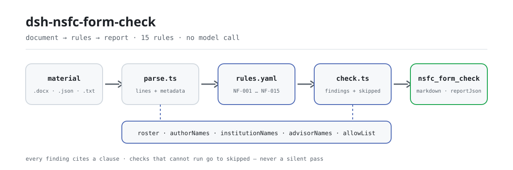

<div align="center">

<picture>
  <source media="(prefers-color-scheme: dark)" srcset="docs/assets/dsh-nsfc-form-check-flow-dark.svg">
  
</picture>

# dsh-nsfc-form-check

**Convierte una solicitud al NSFC en una lista de diferencias línea por línea que su oficina de investigación puede accionar.**

Un verificador de DeepSeek Harness para personal de gestión científica: lee las líneas del cuerpo y las propiedades electrónicas del documento, y reporta qué está mal, dónde y contra qué cláusula — cada hallazgo nombra su base y el tipo de base.

[Instalar](#instalación-en-tres-pasos) · [Configuración](#configuración) · [FAQ](#faq) · [简体中文](README.md) · [English](README.en.md) · [Español](README.es.md) · [Português](README.pt.md) · [हिन्दी](README.hi.md)

[](LICENSE)
[](#compatibilidad)
[](https://www.npmjs.com/package/dsh-nsfc-form-check)
[](https://github.com/PerryLink/dsh-nsfc-form-check/actions/workflows/ci.yml)
[](#compatibilidad)

[](https://github.com/PerryLink/dsh-nsfc-form-check/stargazers)
[](https://www.npmjs.com/package/dsh-nsfc-form-check)
[](https://dshfind.com/plugins/PerryLink/dsh-nsfc-form-check?ref=badge)
[](https://securityscorecards.dev/viewer/?uri=github.com/PerryLink/dsh-nsfc-form-check)
[](https://dsh.market/)
[](https://gitee.com/perrylink/dsh-nsfc-form-check)

```sh
dsh plugin --profile <name> add dsh-nsfc-form-check
```

</div>

<sub>Plugin de la comunidad, no afiliado a DeepSeek. Repositorio canónico: <https://github.com/PerryLink/dsh-nsfc-form-check> (Gitee es un espejo).</sub>

## Qué es

`dsh-nsfc-form-check` lee una solicitud de financiación de la National Natural Science Foundation of China (NSFC) —sus líneas de texto, las propiedades electrónicas del documento y las listas de solicitantes, instituciones y directores de la propia institución— y contrasta ese material con un paquete de reglas versionado: si hay una lista configurada, en qué líneas del cuerpo aparecen los términos de identidad configurados, qué llevan las propiedades de título, autor, empresa y última modificación, si el material cabe en el límite de extensión fijado por el despliegue, si están presentes los elementos de revisión formal y la declaración de solicitud repetida, si el nombre del director está cumplimentado como exigen las guías anuales, y si aparece algún término clasificado o sensible configurado.

Cada hallazgo nombra la cláusula de la que procede e indica si esa cláusula es un requisito directo, un principio o una configuración local. Toda comprobación que no pudo ejecutarse figura en `skipped` con su motivo. Por tanto, una lista de hallazgos vacía nunca significa que no hubiera nada mal: lea `NF-001` y las entradas de `skipped` antes de concluir nada.

Solo enumera diferencias literales: no dictamina cumplimiento, no determina responsabilidades ni sustituye al revisor. Acepta `.docx`, `.txt`, `.md`, `.json` y `.yaml`; `.pdf` no se analiza (el motivo está en «Formato del material»). ESM puro, sin red, sin llamada al modelo y sin código nativo.

```text
proposal.docx ──parse──▶ lines + properties ──check──▶ findings + skipped
                                ▲
                                └── rules/nsfc-form-check.yaml (NF-001…NF-015)
```

## Instalación en tres pasos

1. **Instale** (elija un canal):

   ```sh
   # canal git (último main; ejecuta la compilación prepare)
   dsh plugin --profile <name> add github:PerryLink/dsh-nsfc-form-check
   # canal npm (versión publicada, con lib/ ya compilada)
   dsh plugin --profile <name> add dsh-nsfc-form-check
   # canal tarball: pnpm pack en este repo y luego
   dsh plugin --profile <name> add ./dsh-nsfc-form-check-<version>.tgz
   ```

2. **Configuración mínima** (ponga la lista de su institución en el patch del perfil; la lista no se distribuye con el paquete):

   ```yaml
   - insert:
       - id: dsh-nsfc-form-check
         name: dsh-nsfc-form-check
         config:
           authorNames: ["Zhang Wei"]
           institutionNames: ["Universidad de Ejemplo", "Hospital Universitario de Ejemplo"]
           advisorNames: ["Li Jianguo"]
   ```

3. **Verifique que se monta**:

   ```sh
   dsh --profile <name> --dump-config | grep 'dsh-nsfc-form-check'
   ```

   El repositorio también incluye un quickstart reproducible (ejecute antes `pnpm install && pnpm run build`, porque el script importa el artefacto compilado):

   ```sh
   node samples/quickstart/run.mjs --check
   ```

   ```text
   nsfc_form_check: quickstart OK — output matches expected/result.json
   ```

   El resultado esperado es 1 hallazgo y 14 entradas `skipped`, registrado en `samples/quickstart/expected/result.json`; la entrada y la captura están en `samples/quickstart/input/` y `docs/assets/quickstart.png`.

**Desinstalar**: `dsh plugin --profile <name> remove dsh-nsfc-form-check` (o elimine la fila del patch del perfil).

## Capacidades clave

- **Primero la lista; una lista vacía no es un aprobado** — `NF-001` se informa primero cuando las tres listas de nombres están vacías, y toda comprobación que depende de ellas entra en `skipped` en lugar de pasar en silencio.
- **Localizadores por línea** — la coincidencia en el cuerpo es literal y por líneas, así que cada hallazgo lleva un número de línea; los términos de menos de dos caracteres y lo que esté en `allowList` se ignoran.
- **Propiedades del documento por separado** — `NF-005` a `NF-008` leen las propiedades de título, autor, empresa y última modificación sin mezclarlas con las conclusiones del cuerpo.
- **Extensión y elementos formales configurados por año** — los umbrales, la lista y la declaración de `NF-010`, `NF-011` y `NF-012` salen vacíos; sin configurar, entran en `skipped`.
- **La comprobación del director va en sentido contrario** — `NF-014` es la inversa de `NF-004`: las guías anuales exigen el nombre del director, así que esta regla comprueba que **sí** esté relleno.
- **Términos clasificados aparte** — `NF-015` es la única regla del paquete que cita un requisito real de «no debe aparecer», y su objeto es información clasificada, no identidad.
- **Base transparente** — cada hallazgo lleva `document`, `number`, `clause`, un `excerpt` literal y una `source`; las reglas que solo se apoyan en un principio o en la configuración local tienen el nivel de gravedad limitado al cargar.
- **Solo diferencias** — el informe no dictamina nada; decide una persona revisora.

### Lista de reglas

| Regla | Comprobación | Gravedad | Tipo de base |
|---|---|---|---|
| `NF-001` | hay una lista configurada; si no, las comprobaciones de identidad no pueden ejecutarse | warn | principio |
| `NF-002` | el cuerpo menciona un nombre de solicitante (aviso, no requisito legal) | warn | principio |
| `NF-003` | el cuerpo menciona un nombre de institución (aviso, no requisito legal) | warn | principio |
| `NF-004` | el cuerpo menciona un nombre de director (aviso; distinga el caso que exigen las guías anuales) | warn | principio |
| `NF-005` | la propiedad título contiene un indicio de identidad | info | principio |
| `NF-006` | la propiedad autor no está vacía o nombra al solicitante | info | principio |
| `NF-007` | la propiedad empresa nombra a la institución | info | principio |
| `NF-008` | la propiedad última modificación nombra al solicitante | info | principio |
| `NF-009` | indicios de identidad dentro de un rango de líneas configurado | info | principio |
| `NF-010` | el material cabe en el límite de extensión configurado | info | configuración local (más una cláusula directa) |
| `NF-011` | el material contiene los elementos de revisión formal configurados | info | configuración local |
| `NF-012` | una solicitud repetida o de continuación lleva la declaración configurada | info | configuración local |
| `NF-013` | indicios de identidad dentro de un ámbito configurado | info | principio |
| `NF-014` | el nombre del director está presente, como exigen las guías anuales | info | configuración local (más una cláusula directa) |
| `NF-015` | el material no contiene ningún término clasificado o sensible configurado | info | cláusula directa |

### Ejemplos

La tabla siguiente es el conjunto de ejemplos: la primera fila es el caso detallado y las demás son casos breves.

#### Salida detallada

**Herramienta** `nsfc_form_check`

**Entrada**

~~~json
{"text":"申请代码：H0301\n项目名称：某信号通路在疾病进展中的作用机制研究","metadata":{},"roster":{"authorNames":[],"institutionNames":[],"advisorNames":[],"allowList":[]}}
~~~

**Salida**

~~~json
{
  "id": "dsh-nsfc-form-check.NF-001.811c9dc5",
  "ruleId": "NF-001",
  "severity": "warn",
  "locator": {},
  "found": "未配置任何可核验的身份词（申请人姓名、依托单位名称、导师姓名均为空）",
  "expected": "匿名检查需要名单才能执行；未配置时其余匿名相关检查只能逐条报为未执行"
}
~~~

*Observed from `dsh-nsfc-form-check/tests/fixtures/NF-001/NF-001-unsafe.json`*

| Usted pregunta | Qué responde |
|---|---|
| Nadie rellenó el listado de nombres de solicitantes. ¿La revisión de identidad pasa sin más? | No. `NF-001` es lo primero que se informa cuando `authorNames`, `institutionNames` y `advisorNames` están vacíos, y cada comprobación de identidad que necesita esos términos figura en `skipped` con su motivo. Una lista de hallazgos vacía nunca significa que no hubiera nada mal: lea `NF-001` y las entradas de `skipped` antes de concluir nada. |
| En el cuerpo aparece un coautor con el mismo apellido que el solicitante. | `NF-002` compara literalmente los `authorNames` configurados, línea por línea, así que un homónimo, un apellido común o la cita del trabajo de otro investigador pueden coincidir. El hallazgo es solo un aviso técnico —《国家自然科学基金条例》(国务院令第796号) 第二十一条 exige confidencialidad a los evaluadores y no prohíbe que un nombre aparezca en el cuerpo— por lo que un término ya revisado puede añadirse a `allowList`. |
| La propiedad de autor lleva un nombre. ¿Se informa y hace falta configurar antes un listado? | Sí se informa, y no hace falta listado. `NF-006` no necesita roster: con `authorNames` vacío sigue informando de cualquier propiedad de autor no vacía, y con roster configurado dice si el valor coincide con un nombre de solicitante. `NF-005`, `NF-007` y `NF-008` sí necesitan una lista de términos de identidad y sin ella entran en `skipped`. Las cuatro leen únicamente las propiedades, así que no dicen nada del cuerpo del texto. |
| Los límites de páginas y palabras los puse yo. ¿Me dirá que la solicitud es demasiado larga? | Solo dentro del límite que usted fijó. `NF-010` sale con `maxLines` y `maxChars` sin configurar y entra en `skipped`, porque esos límites cambian cada año y según el tipo de proyecto; una vez rellenados, informa del número de párrafos extraídos o del total de caracteres que los supera. `maxLines` cuenta párrafos extraídos, no páginas maquetadas, así que no equivale a un recuento de páginas. |
| ¿Estaban en el material todos los elementos de revisión formal que pide nuestra oficina de investigación? | `NF-011` se informa en `skipped` hasta que se configure `require`, y sin lista no pretende conocerla. Una vez configurada, compara literalmente sus frases `match` e informa de las que no encuentra. Comprueba que la frase esté presente, no que la casilla esté bien rellenada ni que la firma sea auténtica. |
| Volvemos a presentar la solicitud del año pasado. ¿Debe constar la nota de declaración? | `NF-012` necesita a la vez `markerPatterns`, que reconocen la redacción de su plantilla para una solicitud repetida o de continuación, y `requiredDisclosure`, que enumera lo que debe declararse. Con cualquiera de los dos sin configurar entra en `skipped`; cuando los marcadores están configurados pero no se encuentra la declaración, informa de que esta regla no es aplicable. Nunca supone una redacción de la declaración ni decide que la solicitud sea realmente repetida. |

## Configuración

Todos los parámetros ajustables viven en el esquema Schemastery de `src/config.ts`, por lo que se cambian desde `cordis.yml` sin tocar el código; los umbrales por regla están en el paquete de reglas bajo `rules/`. Una sustitución dirigida por id reemplaza la fila entera: repita todas las claves que necesite.

Claves más usadas:

| Clave | Tipo | Predeterminado | Descripción |
|---|---|---|---|
| `rulesFile` | string | `rules/nsfc-form-check.yaml` | Ruta del paquete de reglas, relativa a la raíz del paquete |
| `authorNames` | string[] | `[]` | Nombres de solicitantes que se buscan |
| `institutionNames` | string[] | `[]` | Nombres de instituciones y unidades que se buscan |
| `advisorNames` | string[] | `[]` | Nombres de directores que se buscan |
| `allowList` | string[] | `[]` | Términos que se ignoran aunque coincidan |
| `disabledRules` | string[] | `[]` | Ids de reglas que se dejan de ejecutar; cada una aparece en `skipped` |
| `onlyRules` | string[] | `[]` | Ejecutar solo estas reglas; vacío ejecuta todas |
| `timeoutMs` | number | `120000` | Presupuesto de tiempo de espera cooperativo de la herramienta |

<details>
<summary>Tabla de configuración completa (9 claves)</summary>

| Clave | Tipo | Predeterminado | Descripción |
|---|---|---|---|
| `rulesFile` | string | `rules/nsfc-form-check.yaml` | Ruta del paquete de reglas, relativa a la raíz del paquete |
| `disabledRules` | string[] | `[]` | Ids de reglas que se dejan de ejecutar; cada una aparece en `skipped` |
| `onlyRules` | string[] | `[]` | Ejecutar solo estas reglas; vacío ejecuta todas |
| `skipNotes` | string | `""` | Nota añadida a cada motivo de `skipped` |
| `authorNames` | string[] | `[]` | Nombres de solicitantes que se buscan |
| `institutionNames` | string[] | `[]` | Nombres de instituciones y unidades que se buscan |
| `advisorNames` | string[] | `[]` | Nombres de directores que se buscan |
| `allowList` | string[] | `[]` | Términos que se ignoran aunque coincidan |
| `timeoutMs` | number | `120000` | Presupuesto de tiempo de espera cooperativo de la herramienta |

</details>

Parámetros por regla que conviene conocer:

- `NF-009` `coverLines` — cuántas líneas iniciales cuentan como portada. Vacío significa que el plugin no asume la plantilla de ninguna institución.
- `NF-010` `maxLines` / `maxChars` — el límite de extensión **del año y del tipo de proyecto con el que presenta**. `maxLines` cuenta párrafos extraídos, no páginas maquetadas.
- `NF-011` `require` — su lista de elementos de revisión formal, como pares `[{ label, match }]`.
- `NF-012` `markerPatterns` / `requiredDisclosure` — cómo se reconoce una solicitud repetida en su plantilla y qué debe declararse.
- `NF-013` `patchedSections` / `scopeFromLine` / `scopeToLine` — contar indicios de identidad sobre una lista de términos y un rango de líneas configurados.
- `NF-014` `requireMention` + `advisorNames` — la comprobación inversa, apagada hasta que la active para el año.
- `NF-015` `secretTerms` — la lista de términos de su oficina de confidencialidad. El plugin no incluye ninguna, porque lo que cuenta como clasificado lo definen las normas estatales de secreto, no este plugin.

Ejemplo de sustitución en el patch del perfil:

```yaml
- insert:
    - id: dsh-nsfc-form-check
      name: dsh-nsfc-form-check
      config:
        authorNames: ["Zhang Wei", "Li Na"]
        institutionNames: ["Universidad de Ejemplo"]
        allowList: ["Zhang"]
        disabledRules: ["NF-009"]
```

## FAQ

<details>
<summary>Sin lista de nombres, ¿la revisión de identidad pasa en silencio?</summary>

No. `NF-001` se informa primero cuando las tres listas de términos de identidad están vacías, y toda comprobación que necesita una lista entra en `skipped` con su motivo. Una lista de hallazgos vacía significa «no hay diferencias que informar», no «cumple».

</details>

<details>
<summary>¿Un coautor homónimo o un apellido común llenará el informe de ruido?</summary>

Coincidirá, porque `NF-002` es literal. Una coincidencia es un aviso técnico, no una conclusión de infracción. Añada a `allowList` los términos que ya haya revisado (un apellido común, la cita del trabajo de otro investigador); los términos de menos de dos caracteres se ignoran de todos modos.

</details>

<details>
<summary>¿Admite PDF?</summary>

No. La extracción exacta por páginas es otro problema y un número de página equivocado es peor que ninguno, así que el plugin rechaza `.pdf` por diseño. Extraiga el texto con una herramienta de confianza y pásolo por `text`, o convierta la solicitud a `.docx`.

</details>

<details>
<summary>¿Decide si una solicitud cumple la normativa o sustituye al revisor?</summary>

Ni lo uno ni lo otro. El informe enumera diferencias literales frente a las cláusulas citadas; la capa de renderizado tiene una guardia de redacción y siempre lleva el descargo de responsabilidad. Los hallazgos sobre nombres o instituciones son solo avisos de indicios de identidad: **usar esto como puerta de cumplimiento es incorrecto** (véase «Límites de seguridad»).

</details>

<details>
<summary>¿Cuánto cuesta en rendimiento? ¿A dónde van los datos?</summary>

Sin red, sin llamada al modelo y sin reescritura del archivo original: el material se lee en memoria y se produce un informe. El coste crece con la longitud del material y el tamaño de las listas; `.docx` descomprime el paquete para leer texto y propiedades, así que es algo más lento que el texto plano. No hay peticiones de red ni persistencia.

</details>

## Límites de seguridad

**Límite:** este plugin comprueba el **texto y las propiedades electrónicas de una solicitud al NSFC** e informa de los indicios de identidad que encuentra, junto con los elementos de extensión y revisión formal que configure el despliegue. No es `dsh-rulefile-check` (que audita la legalidad de un documento normativo), no es `dsh-policy-brief-draft` (que redacta una explicación de políticas) y no es `dsh-review-reply-check` (que sigue los comentarios de los revisores). Lee una solicitud e informa de coincidencias literales con las cláusulas citadas.

> ### ⚠️ Lea esto antes de usar las comprobaciones de anonimato
>
> **No existe ninguna disposición nacional vigente que prohíba que el nombre, la institución o el director del solicitante aparezcan en una solicitud al NSFC.** Para este plugin se leyeron íntegramente tres textos independientes —《国家自然科学基金条例》(国务院令第796号), the 2026 Project Guidelines — Application Rules y las guías de 2019— y ninguno contiene 匿名, 盲审, 活页 ni ninguna fórmula de «no debe aparecer» sobre la identidad. El reglamento no contiene la palabra «anonimato» en absoluto. Su cláusula de **abstención** (artículo 20) exige que se abstenga un evaluador de la misma persona jurídica que el solicitante, lo que presupone que el sistema conoce la institución del solicitante: lo contrario de un proceso anónimo.
>
> Por tanto, cada hallazgo de este plugin sobre un nombre o una institución es una **observación técnica para que una persona la valore**, etiquetada como indicio de identidad y nunca formulada como infracción. El plugin es útil para la autoevaluación de una oficina de investigación, y **usarlo como puerta de cumplimiento es incorrecto**. Dos reglas van más lejos y citan la guía literalmente: `NF-014` comprueba que el nombre del director **sí** esté rellenado, porque las guías anuales lo exigen, y `NF-015` comprueba la información clasificada y sensible, el único requisito real de «no debe aparecer», cuyo objeto es información clasificada, no la identidad.

## Normas que sigue

| Documento | Número | Reglas que lo citan |
|---|---|---|
| Reglamento de la National Natural Science Foundation of China | Orden del Consejo de Estado n.º 796 | NF-001, NF-002, NF-003, NF-004, NF-005, NF-006, NF-007, NF-008, NF-009, NF-010, NF-011, NF-012, NF-013, NF-014, NF-015 |
| Guías de proyectos NSFC 2026 — Reglas de solicitud | Edición 2026 (actualizada cada año) | NF-014, NF-015 |

El reglamento fue revisado el 2024-11-08 por la Orden del Consejo de Estado n.º 796 y entró en vigor el 2025-01-01, sustituyendo la Orden n.º 487 (2007). El paquete cita únicamente los números de cláusula de la revisión vigente; el número de la orden sustituida no aparece nunca (hay una prueba que lo afirma). Los registros de verificación cláusula por cláusula están en `rules/evidence/clause-verification.md` y `rules/evidence/clause-verification-nsfc-regulation.md`.

## Formato del material

Si apunta la herramienta a un `.docx`, lee por sí misma el texto del cuerpo y las propiedades del documento. Un `.pdf` **no** se analiza: la extracción exacta por páginas es otro problema con otro modo de fallo, y un número de página equivocado es peor que ninguno, así que pase el texto que haya extraído con su propia herramienta. También se aceptan `.txt`, `.md`, `.json` y `.yaml`; la forma JSON lleva ambas partes explícitamente.

```json
{
  "lines": ["申请代码：H0301", "一、立项依据与研究内容", "……"],
  "metadata": { "title": "某信号通路机制研究", "author": "", "company": "", "lastModifiedBy": "" }
}
```

La coincidencia es literal y por líneas, así que cada hallazgo lleva un número de línea al que puede saltar. Un término de menos de dos caracteres se ignora, y todo lo que esté en `allowList` se ignora, porque de lo contrario un apellido común inundaría el informe.

## Origen de las reglas

Los datos de las reglas están en `rules/nsfc-form-check.yaml`. Cada regla lleva documento, número, cláusula en la numeración propia de la fuente, extracto literal y URL de origen. El cargador impone que el extracto sea una cita real de al menos ocho caracteres y que una comprobación basada solo en un principio general o en una política local nunca se declare `error`.

Cuatro hallazgos dieron forma a este paquete:

1. **El reglamento fue revisado.** El Reglamento de la NSFC es ahora la **Orden del Consejo de Estado n.º 796** (revisada el 2024-11-08, en vigor desde el 2025-01-01), que sustituye a la Orden n.º 487 (2007). Los números de cláusula cambiaron: el deber de confidencialidad de la revisión es ahora el artículo 21, no el antiguo artículo 24. Este paquete cita solo la revisión vigente, y una prueba afirma que el número de la orden sustituida nunca aparece.
2. **El anonimato no tiene base legal**, como se explica en «Límites de seguridad». Las reglas lo dicen en sus propias notas para que quien lea el informe lo vea sin consultar el README.
3. **El nombre del director es *obligatorio*, no prohibido.** Las guías anuales piden rellenar con veracidad los nombres de los directores de tesis y de posdoctorado. Por eso `NF-014` comprueba lo contrario de `NF-004`, y el paquete explica por qué coexisten.
4. **La política anual es configuración, no código.** Los límites de páginas y palabras, las reglas de límite de solicitudes, qué tipos de proyecto usan presupuesto a tanto alzado y la lista anual de situaciones de no admisión cambian cada año; todos salen vacíos.

El informe completo de verificación de cláusulas, incluidas las fuentes revisadas y descartadas, está en `rules/evidence/clause-verification.md`.

## Solución de problemas

- **El plugin se instala pero la herramienta no aparece**: compruebe que `main` resuelve a `lib/index.mjs` y que `pnpm run build` lo generó; un `main` equivocado hace que el cargador omita la entrada en silencio.
- **Todas las comprobaciones de identidad están en skipped**: no hay lista configurada. Rellene `authorNames`, `institutionNames` y `advisorNames`, y `NF-001` dejará de informar.
- **El informe es ruidoso con un apellido común**: añada el término a `allowList`; el plugin no adivina qué coincidencias son significativas.
- **Se rechaza un `.pdf`**: es el comportamiento previsto. Extraiga el texto con una herramienta de confianza y pásolo por `text`, o convierta la solicitud a `.docx`.
- **`dsh plugin add` rechaza el paquete por incompatibilidad**: el rango de peers cubre `0.1.x` y `0.2.x`; si su runtime queda fuera, conceda una exención explícita: `dsh plugin --profile <name> allow-version dsh-nsfc-form-check@0.1.0 --dsh-version <runtime> --accept-risk`
- **`check` informa `manifest-peers` como fallo**: el verificador estático compara con un rango de peers codificado que es anterior a la línea 0.2. El runtime aplica la compatibilidad de peers al instalar, así que el rango declarado es el correcto; es un problema conocido de `dsh-plugin-dev`.
- **Las marcas de tiempo parecen desplazadas**: toda la aritmética es de reloj de pared sobre las cadenas entregadas; no se hace conversión de zona horaria.

## Compatibilidad

| Superficie | Estado |
|---|---|
| Harness | Rango de peers `>=0.1.2-rc.1 <0.2.0 \|\| >=0.2.0-0 <0.3.0` — verificado para aceptar tanto `0.2.0-rc.2` como `0.2.1-rc.2`. `engines.dsh` se declara como `>=0.2.1-0 <0.3.0` y el host lo aplica desde 0.2.1 |
| Node | `^22.19.0 \|\| >=24.0.0` |
| Plataformas | Todas (ESM puro; sin código nativo, sin red, sin llamada al modelo) |
| Modo de herramienta | Funciona en `native` y `ptc`; para un lote de solicitudes use `ptc` |

## Ecosistema y calidad

- [Espejo en Gitee](https://gitee.com/perrylink/dsh-nsfc-form-check) (espejo sincronizado; GitHub es el canónico)
- [Página del plugin en dshfind](https://dshfind.com/plugins/PerryLink/dsh-nsfc-form-check) (instalaciones y ranking)
- [Informe OpenSSF Scorecard](https://securityscorecards.dev/viewer/?uri=github.com/PerryLink/dsh-nsfc-form-check) (impulsado por [.github/workflows/scorecard.yml](.github/workflows/scorecard.yml))
- [DSH Market](https://dsh.market/) (incluido)
- [Elegir un verificador por material](https://perrylink.github.io/zh/checkers/choose/) — índice de selección de verificadores de la familia
- [Base de conocimiento del ecosistema](https://perrylink.github.io/dsh-plugin-guide/): guía de desarrollo de plugins · datos de selección · criterios de mantenimiento

## Desarrollo

```sh
pnpm install
pnpm run typecheck        # tsc --noEmit
pnpm test                 # vitest; pares de fixtures por regla y un ida y vuelta real de .docx
pnpm run build            # tsdown -> lib/index.mjs + lib/index.d.mts
pnpm run verify:self-contained
pnpm run check:lockfile
pnpm run check:readmes    # consistencia de los README en cinco idiomas
pnpm run check:citations  # verificación literal de las citas del paquete de reglas
pnpm pack                 # tarball de publicación
```

`tests/docx-fixture.ts` construye paquetes `.docx` reales en memoria (un ZIP auténtico con entradas deflate), así que la ruta docx se ejercita de extremo a extremo mientras los fixtures siguen siendo JSON revisables. Quickstart: `node samples/quickstart/run.mjs --check`. Las imágenes del README se generan programáticamente con [`scripts/gen-readme-assets.py`](scripts/gen-readme-assets.py) (Python + Pillow) y se pueden volver a ejecutar sin riesgo.

| Ruta | Propósito |
|---|---|
| `src/index.ts` | Contrato de plugin funcional: registra la herramienta `nsfc_form_check` y resuelve el paquete de reglas |
| `src/config.ts` | Esquema de configuración Schemastery; todos los ajustes viven aquí |
| `src/check.ts` | Núcleo de comprobación puro, `(input, ruleset, options) => Report`; sin E/S, reloj ni modelo |
| `src/parse.ts` | Lector de material (JSON / YAML / texto / bytes docx) |
| `src/view.ts` | Proyección del informe para el modelo, reflejada por `output.schema` |
| `src/shared/` | Kit compartido de la familia (cargador de reglas, forma del informe, subconjunto YAML, guardia de redacción), copiado para que el paquete sea autocontenido |
| `rules/` | 15 reglas y el registro de verificación de cláusulas |
| `tests/` | Fixtures conformes/infractores por regla y el ida y vuelta de docx |

Topics: `deepseek-harness`, `dsh`, `dsh-plugin`, `cordis`, `nsfc`, `form`

## Familia y agradecimientos

Este proyecto forma parte de la familia de plugins de DeepSeek Harness mantenida por [PerryLink](https://github.com/PerryLink) (todos Apache-2.0). Si le resulta útil, **una estrella ayuda a que la siguiente persona lo encuentre**; no desbloquea nada.

- [@PerryLink](https://github.com/PerryLink) — creador y mantenedor: el paquete de reglas, el núcleo de comprobación y la documentación en cinco idiomas.

<details>
<summary>Ver todos los plugins</summary>

| Plugin | Estado |
|---|---|
| **[dsh-aqua-input-check](https://github.com/PerryLink/dsh-aqua-input-check)** |  |
| **[dsh-archive-check](https://github.com/PerryLink/dsh-archive-check)** |  |
| **[dsh-auto-review](https://github.com/PerryLink/dsh-auto-review)** |  |
| **[dsh-autotier](https://github.com/PerryLink/dsh-autotier)** | 🧊 CONGELADO — ver el README del repo |
| **[dsh-bid-ca-precheck](https://github.com/PerryLink/dsh-bid-ca-precheck)** |  |
| **[dsh-bid-qual-check](https://github.com/PerryLink/dsh-bid-qual-check)** |  |
| **[dsh-cert-mcp](https://github.com/PerryLink/dsh-cert-mcp)** | 🧊 CONGELADO — ver el README del repo |
| **[dsh-checkpoint-rewind](https://github.com/PerryLink/dsh-checkpoint-rewind)** |  |
| **[dsh-click](https://github.com/PerryLink/dsh-click)** |  |
| **[dsh-composer-history](https://github.com/PerryLink/dsh-composer-history)** |  |
| **[dsh-contract-stance](https://github.com/PerryLink/dsh-contract-stance)** |  |
| **[dsh-customs-doc-check](https://github.com/PerryLink/dsh-customs-doc-check)** |  |
| **[dsh-data-quality](https://github.com/PerryLink/dsh-data-quality)** | 🧊 CONGELADO — ver el README del repo |
| **[dsh-demurrage-ledger](https://github.com/PerryLink/dsh-demurrage-ledger)** |  |
| **[dsh-doublecheck](https://github.com/PerryLink/dsh-doublecheck)** |  |
| **[dsh-drill-script-check](https://github.com/PerryLink/dsh-drill-script-check)** |  |
| **[dsh-eia-guide-check](https://github.com/PerryLink/dsh-eia-guide-check)** |  |
| **[dsh-emergency-plan](https://github.com/PerryLink/dsh-emergency-plan)** |  |
| **[dsh-essay-rubric-check](https://github.com/PerryLink/dsh-essay-rubric-check)** |  |
| **[dsh-evidence-check](https://github.com/PerryLink/dsh-evidence-check)** |  |
| **[dsh-export-ctl-check](https://github.com/PerryLink/dsh-export-ctl-check)** |  |
| **[dsh-fast](https://github.com/PerryLink/dsh-fast)** |  |
| **[dsh-fmea-table-check](https://github.com/PerryLink/dsh-fmea-table-check)** |  |
| **[dsh-forecast-penalty](https://github.com/PerryLink/dsh-forecast-penalty)** |  |
| **[dsh-fund-research](https://github.com/PerryLink/dsh-fund-research)** |  |
| **[dsh-github](https://github.com/PerryLink/dsh-github)** |  |
| **[dsh-gongwen-flow-check](https://github.com/PerryLink/dsh-gongwen-flow-check)** |  |
| **[dsh-gongwen-word-check](https://github.com/PerryLink/dsh-gongwen-word-check)** |  |
| **[dsh-guard-plan-qc](https://github.com/PerryLink/dsh-guard-plan-qc)** |  |
| **[dsh-hazchem-check](https://github.com/PerryLink/dsh-hazchem-check)** |  |
| **[dsh-hazplan-check](https://github.com/PerryLink/dsh-hazplan-check)** |  |
| **[dsh-hidden-risk-map](https://github.com/PerryLink/dsh-hidden-risk-map)** |  |
| **[dsh-hs-classify](https://github.com/PerryLink/dsh-hs-classify)** |  |
| **[dsh-icd-rule-check](https://github.com/PerryLink/dsh-icd-rule-check)** |  |
| **[dsh-industry-research](https://github.com/PerryLink/dsh-industry-research)** |  |
| **[dsh-lawcite-adapter](https://github.com/PerryLink/dsh-lawcite-adapter)** |  |
| **[dsh-laya](https://github.com/PerryLink/dsh-laya)** |  |
| **[dsh-lc-doc-check](https://github.com/PerryLink/dsh-lc-doc-check)** |  |
| **[dsh-learning-gap-check](https://github.com/PerryLink/dsh-learning-gap-check)** |  |
| **[dsh-library](https://github.com/PerryLink/dsh-library)** |  |
| **[dsh-local-ai](https://github.com/PerryLink/dsh-local-ai)** |  |
| **[dsh-lsp-actions](https://github.com/PerryLink/dsh-lsp-actions)** |  |
| **[dsh-mask](https://github.com/PerryLink/dsh-mask)** |  |
| **[dsh-mcp-panel](https://github.com/PerryLink/dsh-mcp-panel)** |  |
| **[dsh-medrec-qc](https://github.com/PerryLink/dsh-medrec-qc)** |  |
| **[dsh-memento](https://github.com/PerryLink/dsh-memento)** | 🧊 CONGELADO — ver el README del repo |
| **[dsh-nsfc-form-check](https://github.com/PerryLink/dsh-nsfc-form-check)** |  |
| **[dsh-nurse-record-check](https://github.com/PerryLink/dsh-nurse-record-check)** |  |
| **[dsh-observe](https://github.com/PerryLink/dsh-observe)** |  |
| **[dsh-origin-rvc-check](https://github.com/PerryLink/dsh-origin-rvc-check)** |  |
| **[dsh-ota-review-check](https://github.com/PerryLink/dsh-ota-review-check)** |  |
| **[dsh-output-styles](https://github.com/PerryLink/dsh-output-styles)** |  |
| **[dsh-paper-doc-adapter](https://github.com/PerryLink/dsh-paper-doc-adapter)** |  |
| **[dsh-permission-rules](https://github.com/PerryLink/dsh-permission-rules)** |  |
| **[dsh-permit-report-check](https://github.com/PerryLink/dsh-permit-report-check)** |  |
| **[dsh-pipeline-check](https://github.com/PerryLink/dsh-pipeline-check)** |  |
| **[dsh-pleading-draft](https://github.com/PerryLink/dsh-pleading-draft)** |  |
| **[dsh-plugin-doctor](https://github.com/PerryLink/dsh-plugin-doctor)** | 🚫 RETIRADO (repo archivado) |
| **[dsh-plugin-guide](https://github.com/PerryLink/dsh-plugin-guide)** |  |
| **[dsh-plugin-kit](https://github.com/PerryLink/dsh-plugin-kit)** | 🚫 RETIRADO (repo archivado) |
| **[dsh-plugin-upgrade](https://github.com/PerryLink/dsh-plugin-upgrade)** | 🚫 RETIRADO (repo archivado) |
| **[dsh-policy-brief-draft](https://github.com/PerryLink/dsh-policy-brief-draft)** |  |
| **[dsh-power-loss-split](https://github.com/PerryLink/dsh-power-loss-split)** |  |
| **[dsh-power-ticket-check](https://github.com/PerryLink/dsh-power-ticket-check)** |  |
| **[dsh-ppap-check](https://github.com/PerryLink/dsh-ppap-check)** |  |
| **[dsh-protest-deadline](https://github.com/PerryLink/dsh-protest-deadline)** |  |
| **[dsh-railway-window](https://github.com/PerryLink/dsh-railway-window)** |  |
| **[dsh-repair-order-qc](https://github.com/PerryLink/dsh-repair-order-qc)** |  |
| **[dsh-research-report](https://github.com/PerryLink/dsh-research-report)** |  |
| **[dsh-review-reply-check](https://github.com/PerryLink/dsh-review-reply-check)** |  |
| **[dsh-rulefile-check](https://github.com/PerryLink/dsh-rulefile-check)** |  |
| **[dsh-safety-brief-check](https://github.com/PerryLink/dsh-safety-brief-check)** |  |
| **[dsh-score](https://github.com/PerryLink/dsh-score)** | 🧊 CONGELADO — ver el README del repo |
| **[dsh-session-sync](https://github.com/PerryLink/dsh-session-sync)** |  |
| **[dsh-site-log-check](https://github.com/PerryLink/dsh-site-log-check)** |  |
| **[dsh-skill-pack-security](https://github.com/PerryLink/dsh-skill-pack-security)** |  |
| **[dsh-soe-decision-check](https://github.com/PerryLink/dsh-soe-decision-check)** |  |
| **[dsh-soilwater-check](https://github.com/PerryLink/dsh-soilwater-check)** |  |
| **[dsh-sop-sync-check](https://github.com/PerryLink/dsh-sop-sync-check)** |  |
| **[dsh-spc-gbt-adapter](https://github.com/PerryLink/dsh-spc-gbt-adapter)** |  |
| **[dsh-talk](https://github.com/PerryLink/dsh-talk)** |  |
| **[dsh-tender-extract](https://github.com/PerryLink/dsh-tender-extract)** |  |
| **[dsh-tender-matrix](https://github.com/PerryLink/dsh-tender-matrix)** |  |
| **[dsh-test-drive](https://github.com/PerryLink/dsh-test-drive)** |  |
| **[dsh-ticktick](https://github.com/PerryLink/dsh-ticktick)** | 🚫 RETIRADO (repo archivado) |
| **[dsh-translate](https://github.com/PerryLink/dsh-translate)** |  |
| **[dsh-warranty-calc](https://github.com/PerryLink/dsh-warranty-calc)** |  |
| **[dsh-budget](https://github.com/PerryLink/dsh-budget)** |  |
| **[dsh-claude-move](https://github.com/PerryLink/dsh-claude-move)** |  |
| **[dsh-defend](https://github.com/PerryLink/dsh-defend)** |  |
| **[dsh-draw](https://github.com/PerryLink/dsh-draw)** | 🧊 CONGELADO — ver el README del repo |
| **[dsh-reach](https://github.com/PerryLink/dsh-reach)** |  |
| **[dsh-background-agents](https://github.com/PerryLink/dsh-background-agents)** | 🚫 RETIRADO (repo archivado) |
| **[dsh-session-pin](https://github.com/PerryLink/dsh-session-pin)** | 🚫 RETIRADO (repo archivado) |
| **[dsh-team-rooms](https://github.com/PerryLink/dsh-team-rooms)** | 🚫 RETIRADO (repo archivado) |

</details>

## License

[LICENSE](LICENSE) (Apache License 2.0) © 2026 dsh-nsfc-form-check contributors

<p align="center"><sub>Apache-2.0 · Plugin de la comunidad, no afiliado a DeepSeek.</sub></p>
