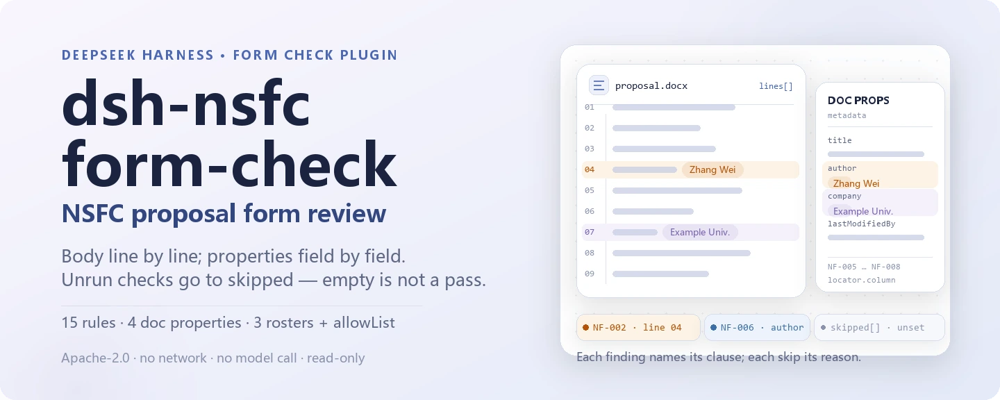
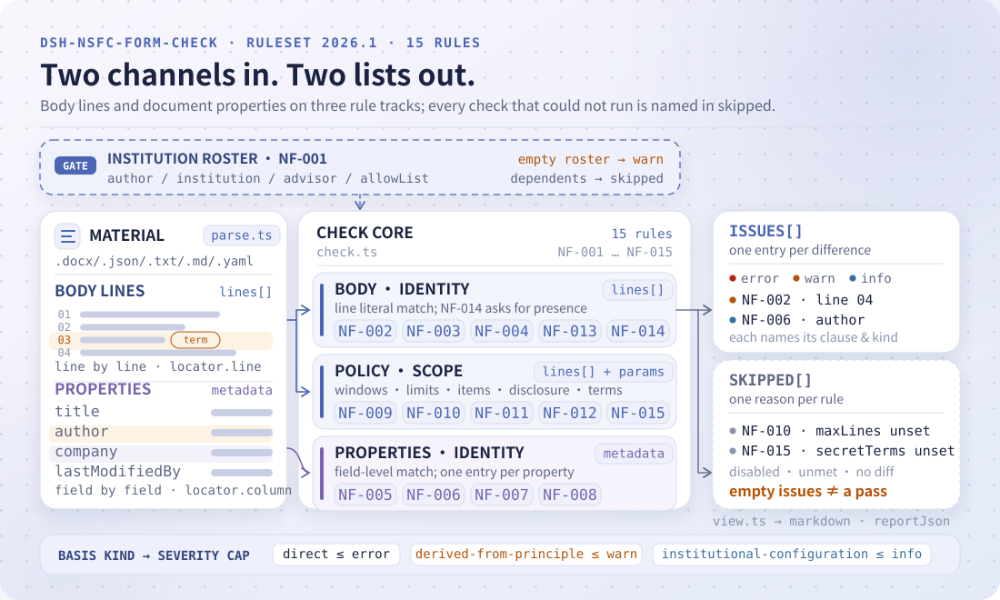

<div align="center">

<picture>
  <source media="(prefers-color-scheme: dark)" srcset="docs/assets/dsh-nsfc-form-check-hero-en-dark.webp">
  
</picture>

# dsh-nsfc-form-check

**एक NSFC आवेदन को पंक्ति-दर-पंक्ति अंतरों की ऐसी सूची में बदलें जिस पर आपका शोध कार्यालय काम कर सके।**

शोध-प्रबंधन टीमों के लिए DeepSeek Harness जाँच प्लगइन: मुख्य पाठ की पंक्तियाँ और दस्तावेज़ के इलेक्ट्रॉनिक गुण पढ़ता है, फिर बताता है कि क्या असंगत है, कहाँ है और किस धारा के सामने — हर निष्कर्ष अपना आधार और आधार का प्रकार बताता है।

[इंस्टॉल](#तीन-चरणों-में-शुरुआत) · [कॉन्फ़िगरेशन](#कॉन्फ़िगरेशन) · [FAQ](#faq) · [简体中文](README.md) · [English](README.en.md) · [Español](README.es.md) · [Português](README.pt.md) · [हिन्दी](README.hi.md)

[](LICENSE)
[](#संगतता)
[](https://www.npmjs.com/package/dsh-nsfc-form-check)
[](https://github.com/PerryLink/dsh-nsfc-form-check/actions/workflows/ci.yml)
[](#संगतता)

[](https://github.com/PerryLink/dsh-nsfc-form-check/stargazers)
[](https://www.npmjs.com/package/dsh-nsfc-form-check)
[](https://dshfind.com/plugins/PerryLink/dsh-nsfc-form-check?ref=badge)
[](https://securityscorecards.dev/viewer/?uri=github.com/PerryLink/dsh-nsfc-form-check)
[](https://dsh.market/)
[](https://gitee.com/perrylink/dsh-nsfc-form-check)

```sh
dsh plugin --profile <name> add dsh-nsfc-form-check
```

</div>

<sub>सामुदायिक प्लगइन, DeepSeek से संबद्ध नहीं। आधिकारिक रेपो: <https://github.com/PerryLink/dsh-nsfc-form-check> (Gitee एक मिरर है)।</sub>

## यह क्या है

`dsh-nsfc-form-check` नेशनल नेचुरल साइंस फ़ाउंडेशन ऑफ़ चाइना (NSFC) का एक आवेदन पढ़ता है — उसकी मुख्य पंक्तियाँ, दस्तावेज़ के इलेक्ट्रॉनिक गुण, और संस्थान की अपनी आवेदक, संस्था व पर्यवेक्षक नाम-सूचियाँ — और उस सामग्री को संस्करणबद्ध नियम-पैक से मिलाता है: क्या कोई सूची कॉन्फ़िगर है, कॉन्फ़िगर किए गए पहचान-शब्द मुख्य पाठ में कहाँ आते हैं, शीर्षक, लेखक, कंपनी और अंतिम-संशोधन गुणों में क्या दर्ज है, सामग्री उपयोगकर्ता द्वारा तय लंबाई-सीमा के भीतर है या नहीं, कॉन्फ़िगर किए गए औपचारिक जाँच-मद और दोहरा-आवेदन प्रकटीकरण मौजूद हैं या नहीं, पर्यवेक्षक का नाम वार्षिक दिशानिर्देश के अनुसार भरा गया है या नहीं, और कोई कॉन्फ़िगर किया गया वर्गीकृत या संवेदनशील शब्द आता है या नहीं।

हर निष्कर्ष उस धारा का नाम देता है जिससे वह आया, और बताता है कि वह धारा सीधा प्रावधान है, सिद्धांत है या स्थानीय कॉन्फ़िगरेशन। जो जाँच नहीं चल सकी वह `skipped` में कारण सहित दर्ज होती है। इसलिए खाली निष्कर्ष-सूची का अर्थ कभी "कुछ गड़बड़ नहीं" नहीं होता — निष्कर्ष निकालने से पहले `NF-001` और `skipped` की प्रविष्टियाँ देखें।

यह केवल शाब्दिक अंतर गिनाता है: अनुपालन का निर्णय नहीं देता, उत्तरदायित्व तय नहीं करता और समीक्षक का विकल्प नहीं है। `.docx`, `.txt`, `.md`, `.json` और `.yaml` स्वीकार्य हैं; `.pdf` नहीं पढ़ा जाता (कारण «सामग्री का प्रारूप» में)। शुद्ध ESM, कोई नेटवर्क नहीं, कोई मॉडल कॉल नहीं, कोई नेटिव कोड नहीं।

```text
proposal.docx ──parse──▶ lines + properties ──check──▶ findings + skipped
                                ▲
                                └── rules/nsfc-form-check.yaml (NF-001…NF-015)
```

<picture>
  <source media="(prefers-color-scheme: dark)" srcset="docs/assets/dsh-nsfc-form-check-flow-v5-dark.svg">
  
</picture>

## तीन चरणों में शुरुआत

1. **इंस्टॉल करें** (एक चैनल चुनें):

   ```sh
   # git चैनल (नवीनतम main; prepare बिल्ड चलाता है)
   dsh plugin --profile <name> add github:PerryLink/dsh-nsfc-form-check
   # npm चैनल (प्रकाशित संस्करण, lib/ पहले से बना हुआ)
   dsh plugin --profile <name> add dsh-nsfc-form-check
   # tarball चैनल: इस रेपो में pnpm pack के बाद
   dsh plugin --profile <name> add ./dsh-nsfc-form-check-<version>.tgz
   ```

2. **न्यूनतम कॉन्फ़िगरेशन** (अपने संस्थान की सूची प्रोफ़ाइल पैच में डालें; सूची पैकेज के साथ नहीं आती):

   ```yaml
   - insert:
       - id: dsh-nsfc-form-check
         name: dsh-nsfc-form-check
         config:
           authorNames: ["Zhang Wei"]
           institutionNames: ["उदाहरण विश्वविद्यालय", "उदाहरण विश्वविद्यालय अस्पताल"]
           advisorNames: ["Li Jianguo"]
   ```

3. **जाँचें कि यह माउंट हुआ**:

   ```sh
   dsh --profile <name> --dump-config | grep 'dsh-nsfc-form-check'
   ```

   रेपो में एक दोहराने योग्य क्विकस्टार्ट भी है (पहले `pnpm install && pnpm run build` चलाएँ, क्योंकि स्क्रिप्ट बिल्ड आउटपुट आयात करता है):

   ```sh
   node samples/quickstart/run.mjs --check
   ```

   ```text
   nsfc_form_check: quickstart OK — output matches expected/result.json
   ```

   अपेक्षित परिणाम 1 निष्कर्ष और 14 `skipped` प्रविष्टियाँ हैं, जो `samples/quickstart/expected/result.json` में दर्ज हैं; इनपुट और स्क्रीनशॉट `samples/quickstart/input/` तथा `docs/assets/quickstart.png` में हैं।

**अनइंस्टॉल**: `dsh plugin --profile <name> remove dsh-nsfc-form-check` (या प्रोफ़ाइल पैच से पंक्ति हटाएँ)।

## मुख्य क्षमताएँ

- **पहले सूची; खाली सूची कभी पास नहीं** — तीनों नाम-सूचियाँ खाली होने पर सबसे पहले `NF-001` दर्ज होता है, और सूची पर निर्भर हर जाँच चुपचाप पास होने के बजाय `skipped` में जाती है।
- **पंक्ति-स्तरीय स्थान** — मुख्य पाठ में मिलान शाब्दिक और पंक्ति-आधारित है, इसलिए हर निष्कर्ष के साथ पंक्ति-संख्या आती है; दो अक्षरों से छोटे शब्द और `allowList` में दिए शब्द छोड़ दिए जाते हैं।
- **दस्तावेज़-गुण अलग-अलग** — `NF-005` से `NF-008` शीर्षक, लेखक, कंपनी और अंतिम-संशोधन गुणों को पढ़ते हैं और उन्हें मुख्य पाठ के निष्कर्षों में नहीं मिलाते।
- **लंबाई और औपचारिक मदें साल-दर-साल कॉन्फ़िगर** — `NF-010`, `NF-011` और `NF-012` की सीमाएँ, सूची और प्रकटीकरण-आवश्यकताएँ खाली आती हैं; कॉन्फ़िगर न होने पर `skipped`।
- **पर्यवेक्षक की जाँच उलटी दिशा में** — `NF-014`, `NF-004` का उलटा है: वार्षिक दिशानिर्देश पर्यवेक्षक का नाम माँगते हैं, इसलिए यह नियम जाँचता है कि नाम **भरा गया है**।
- **वर्गीकृत शब्द अलग** — `NF-015` पैक का एकमात्र नियम है जो वास्तविक "नहीं आना चाहिए" आवश्यकता उद्धृत करता है, और उसका विषय वर्गीकृत जानकारी है, पहचान नहीं।
- **पारदर्शी आधार** — हर निष्कर्ष में `document`, `number`, `clause`, शब्दशः `excerpt` और `source` होते हैं; केवल सिद्धांत या स्थानीय कॉन्फ़िगरेशन पर टिके नियमों की गंभीरता लोड के समय सीमित की जाती है।
- **केवल अंतर** — रिपोर्ट कोई निर्णय नहीं देती; फैसला मानव समीक्षक करता है।

### नियम-सूची

| नियम | जाँच | गंभीरता | आधार का प्रकार |
|---|---|---|---|
| `NF-001` | कोई सूची कॉन्फ़िगर है, अन्यथा पहचान-जाँच नहीं चल सकती | warn | सिद्धांत |
| `NF-002` | मुख्य पाठ में आवेदक का नाम आता है (चेतावनी, कानूनी आवश्यकता नहीं) | warn | सिद्धांत |
| `NF-003` | मुख्य पाठ में संस्था का नाम आता है (चेतावनी, कानूनी आवश्यकता नहीं) | warn | सिद्धांत |
| `NF-004` | मुख्य पाठ में पर्यवेक्षक का नाम आता है (चेतावनी; वार्षिक दिशानिर्देश वाला मामला अलग रखें) | warn | सिद्धांत |
| `NF-005` | शीर्षक गुण में पहचान-संकेत है | info | सिद्धांत |
| `NF-006` | लेखक गुण खाली नहीं है या आवेदक का नाम देता है | info | सिद्धांत |
| `NF-007` | कंपनी गुण संस्था का नाम देता है | info | सिद्धांत |
| `NF-008` | अंतिम-संशोधन गुण आवेदक का नाम देता है | info | सिद्धांत |
| `NF-009` | कॉन्फ़िगर पंक्ति-सीमा के भीतर पहचान-संकेत | info | सिद्धांत |
| `NF-010` | सामग्री कॉन्फ़िगर लंबाई-सीमा के भीतर है | info | स्थानीय कॉन्फ़िगरेशन (साथ में सीधी धारा) |
| `NF-011` | सामग्री में कॉन्फ़िगर औपचारिक जाँच-मदें हैं | info | स्थानीय कॉन्फ़िगरेशन |
| `NF-012` | दोहरे या अगली कड़ी के आवेदन में कॉन्फ़िगर प्रकटीकरण है | info | स्थानीय कॉन्फ़िगरेशन |
| `NF-013` | कॉन्फ़िगर दायरे में पहचान-संकेत | info | सिद्धांत |
| `NF-014` | पर्यवेक्षक का नाम मौजूद है, जैसा वार्षिक दिशानिर्देश माँगते हैं | info | स्थानीय कॉन्फ़िगरेशन (साथ में सीधी धारा) |
| `NF-015` | सामग्री में कोई कॉन्फ़िगर वर्गीकृत या संवेदनशील शब्द नहीं है | info | सीधी धारा |

### उदाहरण

नीचे दी गई तालिका उदाहरण-समुच्चय है: पहली पंक्ति विस्तृत केस है, बाकी संक्षिप्त केस हैं।

#### विस्तृत आउटपुट

**उपकरण** `nsfc_form_check`

**इनपुट**

~~~json
{"text":"申请代码：H0301\n项目名称：某信号通路在疾病进展中的作用机制研究","metadata":{},"roster":{"authorNames":[],"institutionNames":[],"advisorNames":[],"allowList":[]}}
~~~

**आउटपुट**

~~~json
{
  "id": "dsh-nsfc-form-check.NF-001.811c9dc5",
  "ruleId": "NF-001",
  "severity": "warn",
  "locator": {},
  "found": "未配置任何可核验的身份词（申请人姓名、依托单位名称、导师姓名均为空）",
  "expected": "匿名检查需要名单才能执行；未配置时其余匿名相关检查只能逐条报为未执行"
}
~~~

*Observed from `dsh-nsfc-form-check/tests/fixtures/NF-001/NF-001-unsafe.json`*

| आपका सवाल | इसका जवाब |
|---|---|
| आवेदक नाम की सूची किसी ने नहीं भरी। तो पहचान की जाँच चुपचाप पास हो जाती है? | नहीं। जब `authorNames`, `institutionNames` और `advisorNames` तीनों खाली हों तो सबसे पहले `NF-001` दर्ज होता है, और जिन पहचान-जाँचों को ये शब्द चाहिए वे सब कारण सहित `skipped` में दर्ज होती हैं। इसलिए निष्कर्ष-सूची खाली होने का अर्थ कभी "कुछ गड़बड़ नहीं" नहीं होता — कोई निष्कर्ष निकालने से पहले `NF-001` और `skipped` की प्रविष्टियाँ देखें। |
| मुख्य पाठ में आवेदक के समान उपनाम वाला एक सह-लेखक आया है। | `NF-002` कॉन्फ़िगर किए गए `authorNames` को पंक्ति-दर-पंक्ति शब्दशः मिलाता है, इसलिए एक ही नाम के दूसरे व्यक्ति, सामान्य उपनाम, या किसी अन्य शोधकर्ता के काम का उद्धरण भी पकड़ में आ सकता है। यह निष्कर्ष केवल तकनीकी चेतावनी है — 《国家自然科学基金条例》(国务院令第796号) 第二十一条 समीक्षकों से गोपनीयता चाहती है और मुख्य पाठ में नाम आने को मना नहीं करती — इसलिए जिस शब्द को आप जाँच चुके हों उसे `allowList` में डाला जा सकता है। |
| दस्तावेज़-गुण में लेखक फ़ील्ड में नाम है। क्या यह दर्ज होगा, और क्या पहले सूची कॉन्फ़िगर करनी होगी? | दर्ज होगा, और सूची की ज़रूरत नहीं। `NF-006` को roster नहीं चाहिए: `authorNames` खाली होने पर भी वह किसी भी भरे लेखक-गुण को दर्ज करता है, और roster कॉन्फ़िगर होने पर बताता है कि मान आवेदक के नाम से मेल खाता है या नहीं। `NF-005`, `NF-007` और `NF-008` को पहचान-शब्द सूची चाहिए और उसके बिना वे `skipped` में जाते हैं। चारों केवल दस्तावेज़-गुण पढ़ते हैं, मुख्य पाठ के बारे में कुछ नहीं कहते। |
| पृष्ठ और शब्द की सीमाएँ मैंने खुद भरी हैं। क्या यह बताएगा कि आवेदन बहुत लंबा है? | केवल आपकी तय की हुई सीमा के भीतर। `NF-010` में `maxLines` और `maxChars` बिना कॉन्फ़िगर के आते हैं और वह `skipped` में जाता है, क्योंकि ये सीमाएँ हर वर्ष और परियोजना-प्रकार के अनुसार बदलती हैं; भरने के बाद वह निकाले गए अनुच्छेदों की संख्या या अक्षर-योग दर्ज करता है जो सीमा से अधिक है। `maxLines` निकाले गए अनुच्छेद गिनता है, छपे हुए पृष्ठ नहीं, इसलिए वह पृष्ठ-संख्या के बराबर नहीं है। |
| हमारे शोध कार्यालय द्वारा माँगी गई सभी औपचारिक जाँच-मदें सामग्री में थीं? | `require` कॉन्फ़िगर होने तक `NF-011` स्वयं को `skipped` में दर्ज करता है, और सूची के बिना वह उसे जानने का दावा नहीं करता। कॉन्फ़िगर होने पर वह आपके `match` वाक्यांशों को शब्दशः मिलाता है और जो नहीं मिलते उन्हें दर्ज करता है। वह देखता है कि वाक्यांश मौजूद है, यह नहीं कि वह कॉलम ठीक भरा है या हस्ताक्षर असली है। |
| हम पिछले वर्ष का आवेदन फिर जमा कर रहे हैं। प्रकटीकरण टिप्पणी ज़रूरी है? | `NF-012` को एक साथ दो चीज़ें चाहिए: `markerPatterns`, जो आपके टेम्पलेट में दोहरे या अगली कड़ी के आवेदन की शब्दावली पहचानते हैं, और `requiredDisclosure`, जो बताता है कि क्या प्रकट करना है। कोई एक भी कॉन्फ़िगर न हो तो वह `skipped` में जाता है; मार्कर कॉन्फ़िगर हों पर घोषणा न मिले तो वह बताता है कि यह नियम लागू नहीं होता। वह प्रकटीकरण की शब्दावली नहीं मान लेता, और यह भी तय नहीं करता कि आवेदन वाकई दोहरा है। |

## कॉन्फ़िगरेशन

सभी समायोज्य पैरामीटर `src/config.ts` की Schemastery स्कीमा में हैं, इसलिए कोड बदले बिना `cordis.yml` से बदले जा सकते हैं; प्रति-नियम सीमाएँ `rules/` के नियम-पैक में हैं। id के अनुसार ओवरराइड पूरी पंक्ति बदल देता है — ज़रूरी सभी कुंजियाँ दोबारा लिखें।

सबसे अधिक उपयोग होने वाली कुंजियाँ:

| कुंजी | प्रकार | डिफ़ॉल्ट | विवरण |
|---|---|---|---|
| `rulesFile` | string | `rules/nsfc-form-check.yaml` | नियम-पैक का पथ, पैकेज रूट के सापेक्ष |
| `authorNames` | string[] | `[]` | खोजे जाने वाले आवेदक नाम |
| `institutionNames` | string[] | `[]` | खोजे जाने वाले संस्थान और इकाई नाम |
| `advisorNames` | string[] | `[]` | खोजे जाने वाले पर्यवेक्षक नाम |
| `allowList` | string[] | `[]` | मेल खाने पर भी अनदेखा किए जाने वाले शब्द |
| `disabledRules` | string[] | `[]` | बंद करने वाले नियम id; प्रत्येक `skipped` में दिखता है |
| `onlyRules` | string[] | `[]` | केवल ये नियम चलाएँ; खाली होने पर सभी नियम चलते हैं |
| `timeoutMs` | number | `120000` | उपकरण का सहकारी समय-सीमा बजट |

<details>
<summary>पूरी कॉन्फ़िगरेशन तालिका (9 कुंजियाँ)</summary>

| कुंजी | प्रकार | डिफ़ॉल्ट | विवरण |
|---|---|---|---|
| `rulesFile` | string | `rules/nsfc-form-check.yaml` | नियम-पैक का पथ, पैकेज रूट के सापेक्ष |
| `disabledRules` | string[] | `[]` | बंद करने वाले नियम id; प्रत्येक `skipped` में दिखता है |
| `onlyRules` | string[] | `[]` | केवल ये नियम चलाएँ; खाली होने पर सभी नियम चलते हैं |
| `skipNotes` | string | `""` | हर `skipped` कारण के आगे जोड़ी जाने वाली टिप्पणी |
| `authorNames` | string[] | `[]` | खोजे जाने वाले आवेदक नाम |
| `institutionNames` | string[] | `[]` | खोजे जाने वाले संस्थान और इकाई नाम |
| `advisorNames` | string[] | `[]` | खोजे जाने वाले पर्यवेक्षक नाम |
| `allowList` | string[] | `[]` | मेल खाने पर भी अनदेखा किए जाने वाले शब्द |
| `timeoutMs` | number | `120000` | उपकरण का सहकारी समय-सीमा बजट |

</details>

नियम-स्तरीय पैरामीटर जो जानने योग्य हैं:

- `NF-009` `coverLines` — शुरुआती कितनी पंक्तियाँ कवर पेज गिनी जाएँ। खाली का अर्थ है कि प्लगइन किसी संस्थान के टेम्पलेट को नहीं मान लेता।
- `NF-010` `maxLines` / `maxChars` — उस **वर्ष और परियोजना-प्रकार** की लंबाई-सीमा जिसके अंतर्गत आप आवेदन कर रहे हैं। `maxLines` निकाले गए अनुच्छेद गिनता है, जो छपे हुए पृष्ठों के बराबर नहीं है।
- `NF-011` `require` — आपकी औपचारिक जाँच-मद सूची, `[{ label, match }]` युग्मों के रूप में।
- `NF-012` `markerPatterns` / `requiredDisclosure` — आपके टेम्पलेट में दोहरा आवेदन कैसे पहचाना जाए, और उसमें क्या प्रकट करना होगा।
- `NF-013` `patchedSections` / `scopeFromLine` / `scopeToLine` — कॉन्फ़िगर शब्द-सूची और पंक्ति-सीमा पर पहचान-संकेत गिनें।
- `NF-014` `requireMention` + `advisorNames` — उलटी जाँच, जब तक आप उस वर्ष के लिए चालू न करें बंद।
- `NF-015` `secretTerms` — आपके गोपनीयता कार्यालय की शब्द-सूची। प्लगइन कोई सूची नहीं देता, क्योंकि क्या वर्गीकृत है यह राज्य की गोपनीयता नियमावली तय करती है, यह प्लगइन नहीं।

प्रोफ़ाइल पैच में ओवरराइड का उदाहरण:

```yaml
- insert:
    - id: dsh-nsfc-form-check
      name: dsh-nsfc-form-check
      config:
        authorNames: ["Zhang Wei", "Li Na"]
        institutionNames: ["उदाहरण विश्वविद्यालय"]
        allowList: ["Zhang"]
        disabledRules: ["NF-009"]
```

## FAQ

<details>
<summary>नाम-सूची न हो तो पहचान-जाँच चुपचाप पास हो जाती है?</summary>

नहीं। तीनों पहचान-शब्द सूचियाँ खाली होने पर सबसे पहले `NF-001` दर्ज होता है, और जिस भी जाँच को सूची चाहिए वह कारण सहित `skipped` में जाती है। खाली निष्कर्ष-सूची का अर्थ "बताने योग्य कोई अंतर नहीं" है, "अनुपालन है" नहीं।

</details>

<details>
<summary>समान उपनाम वाला सह-लेखक या सामान्य उपनाम रिपोर्ट को शोर से भर देगा?</summary>

मेल खाएगा, क्योंकि `NF-002` शाब्दिक है। मेल एक तकनीकी चेतावनी है, उल्लंघन का निष्कर्ष नहीं। जिन शब्दों की आप समीक्षा कर चुके हैं (सामान्य उपनाम, किसी अन्य शोधकर्ता के काम का उद्धरण) उन्हें `allowList` में डालें; दो अक्षरों से छोटे शब्द वैसे भी छोड़ दिए जाते हैं।

</details>

<details>
<summary>क्या यह PDF स्वीकार करता है?</summary>

नहीं। पृष्ठ-दर-पृष्ठ सटीक निष्कर्षण एक अलग समस्या है, और गलत पृष्ठ-संख्या न होने से बुरी है, इसलिए प्लगइन डिज़ाइन से `.pdf` मना करता है। भरोसेमंद उपकरण से पाठ निकालकर `text` से भेजें, या आवेदन को `.docx` में बदलें।

</details>

<details>
<summary>क्या यह तय करता है कि आवेदन अनुपालन में है, या समीक्षक का विकल्प है?</summary>

दोनों नहीं। रिपोर्ट उद्धृत धाराओं के सामने शाब्दिक अंतर गिनाती है; रेंडर परत में शब्द-संयम की रक्षा है और हमेशा अस्वीकरण रहता है। नाम या संस्था पर निष्कर्ष केवल पहचान-संकेत चेतावनी हैं — **इसे अनुपालन-द्वार की तरह इस्तेमाल करना गलत है** («सुरक्षा सीमाएँ» देखें)।

</details>

<details>
<summary>प्रदर्शन-लागत कितनी है? डेटा कहाँ जाता है?</summary>

कोई नेटवर्क नहीं, कोई मॉडल कॉल नहीं, मूल फ़ाइल में कोई लेखन नहीं: सामग्री स्मृति में पढ़ी जाती है और रिपोर्ट बनती है। लागत सामग्री की लंबाई और सूचियों के आकार के साथ बढ़ती है; `.docx` पैकेज खोलकर पाठ और गुण पढ़ता है, इसलिए सादे पाठ से थोड़ा धीमा है। कोई नेटवर्क अनुरोध नहीं और कोई स्थायी संग्रहण नहीं।

</details>

## सुरक्षा सीमाएँ

**सीमा:** यह प्लगइन **NSFC आवेदन के पाठ और इलेक्ट्रॉनिक दस्तावेज़-गुण** की जाँच करता है और जो पहचान-संकेत मिलते हैं उन्हें, साथ में उपयोगकर्ता द्वारा कॉन्फ़िगर लंबाई व औपचारिक जाँच-मदों को, रिपोर्ट करता है। यह `dsh-rulefile-check` नहीं है (जो नियामक दस्तावेज़ की वैधता जाँचता है), `dsh-policy-brief-draft` नहीं है (जो नीति-व्याख्या का मसौदा बनाता है), और `dsh-review-reply-check` नहीं है (जो समीक्षक टिप्पणियाँ ट्रैक करता है)। यह एक आवेदन पढ़ता है और उद्धृत धाराओं के सामने शाब्दिक मिलान बताता है।

> ### ⚠️ अनामता जाँचों का उपयोग करने से पहले यह पढ़ें
>
> **आज कोई राष्ट्रीय प्रावधान ऐसा नहीं है जो NSFC आवेदन में आवेदक का नाम, संस्था या पर्यवेक्षक आने को मना करे।** इस प्लगइन के लिए तीन स्वतंत्र पाठ पूरे पढ़े गए — 《国家自然科学基金条例》(国务院令第796号), 2026 Project Guidelines — Application Rules और 2019 की दिशानिर्देश — और किसी में भी 匿名, 盲审, 活页 या पहचान के बारे में "नहीं आना चाहिए" जैसी कोई शब्दावली नहीं है। विनियम में "अनामता" शब्द ही नहीं है। उसकी **परिहार** धारा (अनुच्छेद 20) कहती है कि आवेदक की उसी कानूनी इकाई का समीक्षक अलग रहे — जो यह मान लेता है कि सिस्टम आवेदक की संस्था जानता है, यानी अनाम प्रक्रिया के ठीक उलट।
>
> इसलिए नाम या संस्था पर इस प्लगइन का हर निष्कर्ष **मनुष्य के तौलने के लिए तकनीकी अवलोकन** है, उसे पहचान-संकेत चिह्न कहा जाता है और कभी उल्लंघन के रूप में नहीं लिखा जाता। प्लगइन शोध कार्यालय की स्व-जाँच के लिए उपयोगी है, और **इसे अनुपालन-द्वार की तरह इस्तेमाल करना गलत है**। दो नियम आगे जाकर दिशानिर्देश शब्दशः उद्धृत करते हैं: `NF-014` जाँचता है कि पर्यवेक्षक का नाम **भरा गया है**, क्योंकि वार्षिक दिशानिर्देश यह माँगते हैं, और `NF-015` वर्गीकृत व संवेदनशील जानकारी जाँचता है, जो वास्तव में मौजूद एकमात्र "नहीं आना चाहिए" आवश्यकता है — और उसका विषय वर्गीकृत जानकारी है, पहचान नहीं।

## यह किन मानकों पर आधारित है

| दस्तावेज़ | संख्यांक | इन्हें उद्धृत करने वाले नियम |
|---|---|---|
| नेशनल नेचुरल साइंस फ़ाउंडेशन ऑफ़ चाइना का विनियम | राज्य परिषद आदेश संख्या 796 | NF-001, NF-002, NF-003, NF-004, NF-005, NF-006, NF-007, NF-008, NF-009, NF-010, NF-011, NF-012, NF-013, NF-014, NF-015 |
| 2026 NSFC परियोजना दिशानिर्देश — आवेदन नियम | 2026 संस्करण (प्रतिवर्ष अद्यतन) | NF-014, NF-015 |

विनियम 2024-11-08 को राज्य परिषद आदेश संख्या 796 द्वारा संशोधित हुआ और 2025-01-01 से लागू है; उसने आदेश संख्या 487 (2007) का स्थान लिया। नियम-पैक केवल वर्तमान संशोधन की धारा-संख्या उद्धृत करता है; निरस्त आदेश-संख्या कभी नहीं आती (एक परीक्षण इसकी पुष्टि करता है)। धारा-दर-धारा सत्यापन रिकॉर्ड `rules/evidence/clause-verification.md` और `rules/evidence/clause-verification-nsfc-regulation.md` में हैं।

## सामग्री का प्रारूप

उपकरण को `.docx` पर इंगित करें तो वह स्वयं मुख्य पाठ और दस्तावेज़-गुण पढ़ता है। `.pdf` **नहीं** पढ़ा जाता: पृष्ठ-दर-पृष्ठ सटीक निष्कर्षण अलग समस्या है जिसकी विफलता अलग है, और गलत पृष्ठ-संख्या न होने से बुरी है, इसलिए अपने भरोसेमंद उपकरण से निकाला पाठ भेजें। `.txt`, `.md`, `.json` और `.yaml` भी स्वीकार्य हैं; JSON रूप दोनों भाग स्पष्ट रूप से ले जाता है।

```json
{
  "lines": ["申请代码：H0301", "一、立项依据与研究内容", "……"],
  "metadata": { "title": "某信号通路机制研究", "author": "", "company": "", "lastModifiedBy": "" }
}
```

मिलान शाब्दिक और पंक्ति-आधारित है, इसलिए हर निष्कर्ष के साथ ऐसी पंक्ति-संख्या आती है जिस पर आप सीधे जा सकते हैं। दो अक्षरों से छोटा शब्द छोड़ दिया जाता है, और `allowList` में जो भी है वह छोड़ दिया जाता है, क्योंकि अन्यथा एक सामान्य उपनाम पूरी रिपोर्ट को डुबो देगा।

## नियमों के स्रोत

नियम-डेटा `rules/nsfc-form-check.yaml` में है। प्रत्येक नियम में दस्तावेज़, संख्या, स्रोत की अपनी क्रमांकन-प्रणाली के अनुसार धारा, शब्दशः उद्धरण और स्रोत URL होता है। लोडर लागू करता है कि उद्धरण कम से कम आठ अक्षरों का वास्तविक उद्धरण हो, और जिस जाँच का आधार केवल सामान्य सिद्धांत या स्थानीय नीति हो, उसे कभी `error` घोषित न किया जाए।

चार बातों ने इस पैक को आकार दिया:

1. **विनियम संशोधित हुआ।** NSFC विनियम अब **राज्य परिषद आदेश संख्या 796** है (2024-11-08 संशोधित, 2025-01-01 से लागू), जिसने आदेश संख्या 487 (2007) का स्थान लिया। धारा-संख्याएँ बदलीं: समीक्षा-गोपनीयता का दायित्व अब अनुच्छेद 21 है, पुराना अनुच्छेद 24 नहीं। यह पैक केवल वर्तमान संशोधन उद्धृत करता है, और एक परीक्षण पुष्टि करता है कि निरस्त आदेश-संख्या कभी नहीं आती।
2. **अनामता का कोई कानूनी आधार नहीं है**, जैसा «सुरक्षा सीमाएँ» में लिखा है। नियम इसे अपनी टिप्पणियों में कहते हैं ताकि रिपोर्ट पढ़ने वाला README देखे बिना भी इसे देख सके।
3. **पर्यवेक्षक का नाम *अनिवार्य* है, निषिद्ध नहीं।** वार्षिक दिशानिर्देश कहते हैं कि शोध और पोस्टडॉक्टरल पर्यवेक्षकों के नाम सच्चाई से भरें। इसलिए `NF-014`, `NF-004` का उलटा जाँचता है, और पैक बताता है कि दोनों साथ क्यों हैं।
4. **वार्षिक नीति कॉन्फ़िगरेशन है, कोड नहीं।** पृष्ठ और शब्द सीमाएँ, आवेदन-संख्या की सीमाएँ, कौन-से परियोजना-प्रकार एकमुश्त बजट लेते हैं, और वार्षिक अस्वीकृति-स्थितियों की सूची हर वर्ष बदलती है; सब खाली आते हैं।

पूरी धारा-सत्यापन रिपोर्ट, जिनमें जाँचे और अस्वीकार किए गए स्रोत भी हैं, `rules/evidence/clause-verification.md` में है।

## समस्या निवारण

- **प्लगइन इंस्टॉल हो गया पर टूल दिखता नहीं**: जाँचें कि `main` `lib/index.mjs` पर जाता है और `pnpm run build` ने उसे बनाया है; गलत `main` लोडर को प्रविष्टि चुपचाप छोड़ने देता है।
- **सभी पहचान-जाँच skipped हैं**: कोई सूची कॉन्फ़िगर नहीं है। `authorNames`, `institutionNames` और `advisorNames` भरें, फिर `NF-001` रिपोर्ट करना बंद कर देगा।
- **सामान्य उपनाम से रिपोर्ट शोरगुल बन जाती है**: उस शब्द को `allowList` में डालें; प्लगइन अनुमान नहीं लगाता कि कौन-से मेल अर्थपूर्ण हैं।
- **`.pdf` अस्वीकार होता है**: यह डिज़ाइन है। भरोसेमंद उपकरण से पाठ निकालकर `text` से भेजें, या आवेदन को `.docx` में बदलें।
- **`dsh plugin add` पैकेज को असंगत कहकर मना करता है**: peer सीमा `0.1.x` और `0.2.x` दोनों को कवर करती है; यदि आपका रनटाइम उससे बाहर है तो स्पष्ट छूट दें: `dsh plugin --profile <name> allow-version dsh-nsfc-form-check@0.1.0 --dsh-version <runtime> --accept-risk`
- **`check` में `manifest-peers` विफल दिखता है**: स्थिर जाँचकर्ता 0.2 पंक्ति से पुरानी हार्डकोडेड peer सीमा से तुलना करता है। रनटाइम इंस्टॉल के समय peer अनुकूलता लागू करता है, इसलिए घोषित सीमा सही है; यह `dsh-plugin-dev` की ज्ञात अपस्ट्रीम समस्या है।
- **समय खिसका हुआ लगता है**: सारी गणना दिए गए स्ट्रिंग पर वॉल-क्लॉक है; कोई टाइमज़ोन रूपांतरण नहीं होता।

## संगतता

| सतह | स्थिति |
|---|---|
| Harness | peer रेंज `>=0.1.2-rc.1 <0.2.0 \|\| >=0.2.0-0 <0.3.0` — `0.2.0-rc.2` और `0.2.1-rc.2` दोनों को स्वीकार करने के लिए सत्यापित। `engines.dsh` `>=0.2.1-0 <0.3.0` के रूप में घोषित है और 0.2.1 से होस्ट इसे लागू करता है |
| Node | `^22.19.0 \|\| >=24.0.0` |
| प्लेटफ़ॉर्म | सभी (शुद्ध ESM; कोई नेटिव कोड नहीं, कोई नेटवर्क नहीं, कोई मॉडल कॉल नहीं) |
| टूल मोड | `native` और `ptc` में काम करता है; कई आवेदनों के बैच के लिए `ptc` चुनें |

## पारिस्थितिकी और गुणवत्ता

- [Gitee मिरर](https://gitee.com/perrylink/dsh-nsfc-form-check) (सिंक मिरर; GitHub आधिकारिक है)
- [dshfind प्लगइन पृष्ठ](https://dshfind.com/plugins/PerryLink/dsh-nsfc-form-check) (इंस्टॉल और रैंकिंग)
- [OpenSSF Scorecard रिपोर्ट](https://securityscorecards.dev/viewer/?uri=github.com/PerryLink/dsh-nsfc-form-check) ([.github/workflows/scorecard.yml](.github/workflows/scorecard.yml) द्वारा संचालित)
- [DSH Market](https://dsh.market/) (सूचीबद्ध)
- [सामग्री के अनुसार जाँचकर्ता चुनें](https://perrylink.github.io/zh/checkers/choose/) — परिवार का जाँचकर्ता-चयन सूचकांक
- [पारिस्थितिकी ज्ञान-कोश](https://perrylink.github.io/dsh-plugin-guide/): प्लगइन विकास गाइड · चयन डेटा · रखरखाव के मानदंड

## विकास

```sh
pnpm install
pnpm run typecheck        # tsc --noEmit
pnpm test                 # vitest; प्रति नियम फ़िक्स्चर-युग्म और असली .docx राउंड ट्रिप
pnpm run build            # tsdown -> lib/index.mjs + lib/index.d.mts
pnpm run verify:self-contained
pnpm run check:lockfile
pnpm run check:readmes    # पाँच भाषाओं के README की एकरूपता
pnpm run check:citations  # नियम-पैक के उद्धरणों की शब्दशः जाँच
pnpm pack                 # प्रकाशन tarball
```

`tests/docx-fixture.ts` स्मृति में असली `.docx` पैकेज बनाता है (deflate प्रविष्टियों वाला वास्तविक ZIP), इसलिए docx मार्ग अंत-से-अंत चलता है जबकि फ़िक्स्चर समीक्षा-योग्य JSON रहते हैं। क्विकस्टार्ट: `node samples/quickstart/run.mjs --check`। README चित्र [`scripts/gen-readme-assets.py`](scripts/gen-readme-assets.py) से क्रमादेशित रूप से बनते हैं (Python + Pillow) और दोबारा चलाना सुरक्षित है।

| पथ | उद्देश्य |
|---|---|
| `src/index.ts` | फ़ंक्शन-प्लगइन अनुबंध: `nsfc_form_check` टूल पंजीकृत करता है और नियम-पैक का पथ हल करता है |
| `src/config.ts` | Schemastery कॉन्फ़िगरेशन स्कीमा; सभी समायोज्य यहीं |
| `src/check.ts` | शुद्ध जाँच-कोर, `(input, ruleset, options) => Report`; कोई I/O, घड़ी या मॉडल नहीं |
| `src/parse.ts` | सामग्री पाठक (JSON / YAML / पाठ / docx बाइट्स) |
| `src/view.ts` | मॉडल के लिए रिपोर्ट प्रक्षेपण, `output.schema` द्वारा प्रतिबिंबित |
| `src/shared/` | परिवार का साझा किट (नियम-लोडर, रिपोर्ट आकार, YAML उपसमुच्चय, शब्द-संयम रक्षा), पैकेज को आत्मनिर्भर रखने के लिए प्रतिलिपित |
| `rules/` | 15 नियम और धारा-सत्यापन रिकॉर्ड |
| `tests/` | प्रति नियम अनुरूप/उल्लंघन फ़िक्स्चर और docx राउंड ट्रिप |

Topics: `deepseek-harness`, `dsh`, `dsh-plugin`, `cordis`, `nsfc`, `form`

## परिवार और आभार

यह परियोजना [PerryLink](https://github.com/PerryLink) द्वारा अनुरक्षित DeepSeek Harness प्लगइन परिवार का हिस्सा है (सभी Apache-2.0)। अगर यह उपयोगी हो, तो **एक स्टार अगले व्यक्ति को इसे खोजने में मदद करता है** — इससे कोई सुविधा खुलती नहीं।

- [@PerryLink](https://github.com/PerryLink) — निर्माता और अनुरक्षक: नियम-पैक, जाँच-कोर और पाँच-भाषा दस्तावेज़।

<details>
<summary>सभी प्लगइन देखें</summary>

| प्लगइन | स्थिति |
|---|---|
| **[dsh-aqua-input-check](https://github.com/PerryLink/dsh-aqua-input-check)** |  |
| **[dsh-archive-check](https://github.com/PerryLink/dsh-archive-check)** |  |
| **[dsh-auto-review](https://github.com/PerryLink/dsh-auto-review)** |  |
| **[dsh-autotier](https://github.com/PerryLink/dsh-autotier)** | 🧊 फ़्रोज़न — रेपो README देखें |
| **[dsh-bid-ca-precheck](https://github.com/PerryLink/dsh-bid-ca-precheck)** |  |
| **[dsh-bid-qual-check](https://github.com/PerryLink/dsh-bid-qual-check)** |  |
| **[dsh-cert-mcp](https://github.com/PerryLink/dsh-cert-mcp)** | 🧊 फ़्रोज़न — रेपो README देखें |
| **[dsh-checkpoint-rewind](https://github.com/PerryLink/dsh-checkpoint-rewind)** |  |
| **[dsh-click](https://github.com/PerryLink/dsh-click)** |  |
| **[dsh-composer-history](https://github.com/PerryLink/dsh-composer-history)** |  |
| **[dsh-contract-stance](https://github.com/PerryLink/dsh-contract-stance)** |  |
| **[dsh-customs-doc-check](https://github.com/PerryLink/dsh-customs-doc-check)** |  |
| **[dsh-data-quality](https://github.com/PerryLink/dsh-data-quality)** | 🧊 फ़्रोज़न — रेपो README देखें |
| **[dsh-demurrage-ledger](https://github.com/PerryLink/dsh-demurrage-ledger)** |  |
| **[dsh-doublecheck](https://github.com/PerryLink/dsh-doublecheck)** |  |
| **[dsh-drill-script-check](https://github.com/PerryLink/dsh-drill-script-check)** |  |
| **[dsh-eia-guide-check](https://github.com/PerryLink/dsh-eia-guide-check)** |  |
| **[dsh-emergency-plan](https://github.com/PerryLink/dsh-emergency-plan)** |  |
| **[dsh-essay-rubric-check](https://github.com/PerryLink/dsh-essay-rubric-check)** |  |
| **[dsh-evidence-check](https://github.com/PerryLink/dsh-evidence-check)** |  |
| **[dsh-export-ctl-check](https://github.com/PerryLink/dsh-export-ctl-check)** |  |
| **[dsh-fast](https://github.com/PerryLink/dsh-fast)** |  |
| **[dsh-fmea-table-check](https://github.com/PerryLink/dsh-fmea-table-check)** |  |
| **[dsh-forecast-penalty](https://github.com/PerryLink/dsh-forecast-penalty)** |  |
| **[dsh-fund-research](https://github.com/PerryLink/dsh-fund-research)** |  |
| **[dsh-github](https://github.com/PerryLink/dsh-github)** |  |
| **[dsh-gongwen-flow-check](https://github.com/PerryLink/dsh-gongwen-flow-check)** |  |
| **[dsh-gongwen-word-check](https://github.com/PerryLink/dsh-gongwen-word-check)** |  |
| **[dsh-guard-plan-qc](https://github.com/PerryLink/dsh-guard-plan-qc)** |  |
| **[dsh-hazchem-check](https://github.com/PerryLink/dsh-hazchem-check)** |  |
| **[dsh-hazplan-check](https://github.com/PerryLink/dsh-hazplan-check)** |  |
| **[dsh-hidden-risk-map](https://github.com/PerryLink/dsh-hidden-risk-map)** |  |
| **[dsh-hs-classify](https://github.com/PerryLink/dsh-hs-classify)** |  |
| **[dsh-icd-rule-check](https://github.com/PerryLink/dsh-icd-rule-check)** |  |
| **[dsh-industry-research](https://github.com/PerryLink/dsh-industry-research)** |  |
| **[dsh-lawcite-adapter](https://github.com/PerryLink/dsh-lawcite-adapter)** |  |
| **[dsh-laya](https://github.com/PerryLink/dsh-laya)** |  |
| **[dsh-lc-doc-check](https://github.com/PerryLink/dsh-lc-doc-check)** |  |
| **[dsh-learning-gap-check](https://github.com/PerryLink/dsh-learning-gap-check)** |  |
| **[dsh-library](https://github.com/PerryLink/dsh-library)** |  |
| **[dsh-local-ai](https://github.com/PerryLink/dsh-local-ai)** |  |
| **[dsh-lsp-actions](https://github.com/PerryLink/dsh-lsp-actions)** |  |
| **[dsh-mask](https://github.com/PerryLink/dsh-mask)** |  |
| **[dsh-mcp-panel](https://github.com/PerryLink/dsh-mcp-panel)** |  |
| **[dsh-medrec-qc](https://github.com/PerryLink/dsh-medrec-qc)** |  |
| **[dsh-memento](https://github.com/PerryLink/dsh-memento)** | 🧊 फ़्रोज़न — रेपो README देखें |
| **[dsh-nsfc-form-check](https://github.com/PerryLink/dsh-nsfc-form-check)** |  |
| **[dsh-nurse-record-check](https://github.com/PerryLink/dsh-nurse-record-check)** |  |
| **[dsh-observe](https://github.com/PerryLink/dsh-observe)** |  |
| **[dsh-origin-rvc-check](https://github.com/PerryLink/dsh-origin-rvc-check)** |  |
| **[dsh-ota-review-check](https://github.com/PerryLink/dsh-ota-review-check)** |  |
| **[dsh-output-styles](https://github.com/PerryLink/dsh-output-styles)** |  |
| **[dsh-paper-doc-adapter](https://github.com/PerryLink/dsh-paper-doc-adapter)** |  |
| **[dsh-permission-rules](https://github.com/PerryLink/dsh-permission-rules)** |  |
| **[dsh-permit-report-check](https://github.com/PerryLink/dsh-permit-report-check)** |  |
| **[dsh-pipeline-check](https://github.com/PerryLink/dsh-pipeline-check)** |  |
| **[dsh-pleading-draft](https://github.com/PerryLink/dsh-pleading-draft)** |  |
| **[dsh-plugin-doctor](https://github.com/PerryLink/dsh-plugin-doctor)** | 🚫 रिटायर्ड (रेपो संग्रहीत) |
| **[dsh-plugin-guide](https://github.com/PerryLink/dsh-plugin-guide)** |  |
| **[dsh-plugin-kit](https://github.com/PerryLink/dsh-plugin-kit)** | 🚫 रिटायर्ड (रेपो संग्रहीत) |
| **[dsh-plugin-upgrade](https://github.com/PerryLink/dsh-plugin-upgrade)** | 🚫 रिटायर्ड (रेपो संग्रहीत) |
| **[dsh-policy-brief-draft](https://github.com/PerryLink/dsh-policy-brief-draft)** |  |
| **[dsh-power-loss-split](https://github.com/PerryLink/dsh-power-loss-split)** |  |
| **[dsh-power-ticket-check](https://github.com/PerryLink/dsh-power-ticket-check)** |  |
| **[dsh-ppap-check](https://github.com/PerryLink/dsh-ppap-check)** |  |
| **[dsh-protest-deadline](https://github.com/PerryLink/dsh-protest-deadline)** |  |
| **[dsh-railway-window](https://github.com/PerryLink/dsh-railway-window)** |  |
| **[dsh-repair-order-qc](https://github.com/PerryLink/dsh-repair-order-qc)** |  |
| **[dsh-research-report](https://github.com/PerryLink/dsh-research-report)** |  |
| **[dsh-review-reply-check](https://github.com/PerryLink/dsh-review-reply-check)** |  |
| **[dsh-rulefile-check](https://github.com/PerryLink/dsh-rulefile-check)** |  |
| **[dsh-safety-brief-check](https://github.com/PerryLink/dsh-safety-brief-check)** |  |
| **[dsh-score](https://github.com/PerryLink/dsh-score)** | 🧊 फ़्रोज़न — रेपो README देखें |
| **[dsh-session-sync](https://github.com/PerryLink/dsh-session-sync)** |  |
| **[dsh-site-log-check](https://github.com/PerryLink/dsh-site-log-check)** |  |
| **[dsh-skill-pack-security](https://github.com/PerryLink/dsh-skill-pack-security)** |  |
| **[dsh-soe-decision-check](https://github.com/PerryLink/dsh-soe-decision-check)** |  |
| **[dsh-soilwater-check](https://github.com/PerryLink/dsh-soilwater-check)** |  |
| **[dsh-sop-sync-check](https://github.com/PerryLink/dsh-sop-sync-check)** |  |
| **[dsh-spc-gbt-adapter](https://github.com/PerryLink/dsh-spc-gbt-adapter)** |  |
| **[dsh-talk](https://github.com/PerryLink/dsh-talk)** |  |
| **[dsh-tender-extract](https://github.com/PerryLink/dsh-tender-extract)** |  |
| **[dsh-tender-matrix](https://github.com/PerryLink/dsh-tender-matrix)** |  |
| **[dsh-test-drive](https://github.com/PerryLink/dsh-test-drive)** |  |
| **[dsh-ticktick](https://github.com/PerryLink/dsh-ticktick)** | 🚫 रिटायर्ड (रेपो संग्रहीत) |
| **[dsh-translate](https://github.com/PerryLink/dsh-translate)** |  |
| **[dsh-warranty-calc](https://github.com/PerryLink/dsh-warranty-calc)** |  |
| **[dsh-budget](https://github.com/PerryLink/dsh-budget)** |  |
| **[dsh-claude-move](https://github.com/PerryLink/dsh-claude-move)** |  |
| **[dsh-defend](https://github.com/PerryLink/dsh-defend)** |  |
| **[dsh-draw](https://github.com/PerryLink/dsh-draw)** | 🧊 फ़्रोज़न — रेपो README देखें |
| **[dsh-reach](https://github.com/PerryLink/dsh-reach)** |  |
| **[dsh-background-agents](https://github.com/PerryLink/dsh-background-agents)** | 🚫 रिटायर्ड (रेपो संग्रहीत) |
| **[dsh-session-pin](https://github.com/PerryLink/dsh-session-pin)** | 🚫 रिटायर्ड (रेपो संग्रहीत) |
| **[dsh-team-rooms](https://github.com/PerryLink/dsh-team-rooms)** | 🚫 रिटायर्ड (रेपो संग्रहीत) |

</details>

## License

[LICENSE](LICENSE) (Apache License 2.0) © 2026 dsh-nsfc-form-check contributors

<p align="center"><sub>Apache-2.0 · सामुदायिक प्लगइन, DeepSeek से संबद्ध नहीं।</sub></p>
