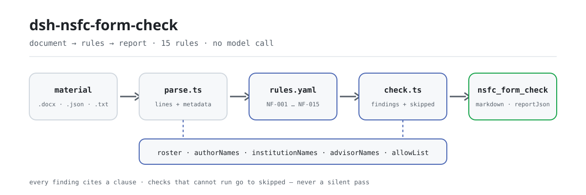

<div align="center">

<picture>
  <source media="(prefers-color-scheme: dark)" srcset="docs/assets/dsh-nsfc-form-check-flow-dark.svg">
  
</picture>

# dsh-nsfc-form-check

**把一份国自然申请书的身份线索、篇幅与形式项，逐条核对成本机构看得懂的差异清单。**

面向科研管理人员的 DeepSeek Harness 检查插件：读取正文行与电子文档属性，按本机构名单和版本化规则库报出「哪条、哪行、差什么」，每条发现都标出所依据的条款与依据类型。

[安装](#三步上手) · [配置](#配置) · [FAQ](#faq) · [简体中文](README.md) · [English](README.en.md) · [Español](README.es.md) · [Português](README.pt.md) · [हिन्दी](README.hi.md)

[](LICENSE)
[](#兼容性)
[](https://www.npmjs.com/package/dsh-nsfc-form-check)
[](https://github.com/PerryLink/dsh-nsfc-form-check/actions/workflows/ci.yml)
[](#兼容性)

[](https://github.com/PerryLink/dsh-nsfc-form-check/stargazers)
[](https://www.npmjs.com/package/dsh-nsfc-form-check)
[](https://dshfind.com/plugins/PerryLink/dsh-nsfc-form-check?ref=badge)
[](https://securityscorecards.dev/viewer/?uri=github.com/PerryLink/dsh-nsfc-form-check)
[](https://dsh.market/)
[](https://gitee.com/perrylink/dsh-nsfc-form-check)

```sh
dsh plugin --profile <name> add dsh-nsfc-form-check
```

</div>

<sub>社区插件，与 DeepSeek 官方无关。唯一仓库：<https://github.com/PerryLink/dsh-nsfc-form-check>（Gitee 为镜像）。</sub>

## 它是什么

`dsh-nsfc-form-check` 读取一份国家自然科学基金申请书——正文行、电子文档属性，以及本机构自己维护的申请人、依托单位与导师名单——再按版本化规则库逐条核对：名单是否配置，配置的身份词在正文的哪一行出现，标题、作者、单位、「最后修改者」四个属性各写了什么，材料是否超出使用方设定的长度限额，形式审查项与重复申请披露说明是否齐备，导师姓名是否已按当年指南要求如实填写，以及是否出现配置的涉密或敏感词。

每一条发现都写出它所依据的条款，并标明该条款是直接规定、原则推论还是本机构配置；每一项无法执行的检查都以 `skipped` 连同原因列出。所以发现列表为空永远不等于没有问题——下结论前先看 `NF-001` 与 `skipped`。

它只列材料与所引条款之间的字面差异，不判合规、不认定责任、不替代审核人。支持 `.docx`、`.txt`、`.md`、`.json`、`.yaml`；`.pdf` 不由本插件解析（原因见「材料格式」）。纯 ESM，无联网、不调用模型、无原生代码。

```text
proposal.docx ──parse──▶ lines + properties ──check──▶ findings + skipped
                                ▲
                                └── rules/nsfc-form-check.yaml (NF-001…NF-015)
```

## 三步上手

1. **安装**（三选一）：

   ```sh
   # git 通道（最新 main；会执行 prepare 构建）
   dsh plugin --profile <name> add github:PerryLink/dsh-nsfc-form-check
   # npm 通道（已发布版本，含构建好的 lib/）
   dsh plugin --profile <name> add dsh-nsfc-form-check
   # tarball 通道：本仓库 pnpm pack 后
   dsh plugin --profile <name> add ./dsh-nsfc-form-check-<version>.tgz
   ```

2. **最小配置**（把本机构的名单填进 profile patch；名单不随包分发）：

   ```yaml
   - insert:
       - id: dsh-nsfc-form-check
         name: dsh-nsfc-form-check
         config:
           authorNames: ["张伟"]
           institutionNames: ["示例大学", "示例大学附属第一医院"]
           advisorNames: ["李建国"]
   ```

3. **验证已生效**：

   ```sh
   dsh --profile <name> --dump-config | grep 'dsh-nsfc-form-check'
   ```

   仓库内还带一份可复核的最小样例（先 `pnpm install && pnpm run build`，因为脚本直接 import 构建产物）：

   ```sh
   node samples/quickstart/run.mjs --check
   ```

   ```text
   nsfc_form_check: quickstart OK — output matches expected/result.json
   ```

   这份样例的期望结果是 1 条发现、14 条 `skipped`，见 `samples/quickstart/expected/result.json`；输入与截图在 `samples/quickstart/input/` 与 `docs/assets/quickstart.png`。

**卸载**：`dsh plugin --profile <name> remove dsh-nsfc-form-check`（或从 profile patch 删掉该行）。

## 核心能力

- **名单先行，空名单不算通过** —— `NF-001` 在三个名单全空时最先报出；所有依赖名单的检查逐条进 `skipped`，不会静默放行。
- **逐行定位** —— 正文匹配是字面、按行的，每条发现都带行号；少于两个字的词与 `allowList` 中的词不参与匹配。
- **文档属性独立成条** —— `NF-005` 到 `NF-008` 分别读标题、作者、单位、最后修改者四个属性，不把它们混入正文结论。
- **篇幅与形式项按年配置** —— `NF-010`、`NF-011`、`NF-012` 的阈值、清单与披露要求全部留空出厂，未配置即进 `skipped`。
- **导师姓名做正向检查** —— `NF-014` 与 `NF-004` 方向相反：年度指南要求如实填写导师姓名，这一条检查「有没有填」。
- **涉密词单列** —— `NF-015` 是规则库中唯一直接引用「不得出现」明文的检查，对象是涉密与敏感信息，不是身份。
- **依据透明** —— 每条发现都带 `document`、`number`、`clause`、逐字 `excerpt` 与 `source`；依据仅为原则或本机构配置的规则在加载期被限制严重级。
- **只列差异** —— 报告不下定性结论，供科研管理部门人工复核。

### 规则清单

| 规则 | 检查内容 | 严重级 | 依据类型 |
|---|---|---|---|
| `NF-001` | 身份线索词名单未配置时，相关检查无法执行 | warn | 原则推论 |
| `NF-002` | 正文中出现申请人姓名（提示，非法定要求） | warn | 原则推论 |
| `NF-003` | 正文中出现依托单位名称（提示，非法定要求） | warn | 原则推论 |
| `NF-004` | 正文中出现导师姓名（提示，且与现行指南要求相反的场景需区分） | warn | 原则推论 |
| `NF-005` | 电子文档属性中的标题含身份线索词 | info | 原则推论 |
| `NF-006` | 电子文档属性中的作者字段非空或含申请人姓名 | info | 原则推论 |
| `NF-007` | 电子文档属性中的单位字段含依托单位名称 | info | 原则推论 |
| `NF-008` | 电子文档属性中的「最后修改者」含申请人姓名 | info | 原则推论 |
| `NF-009` | 按配置的行范围统计身份线索词出现位置 | info | 原则推论 |
| `NF-010` | 材料长度应符合本机构配置的限额 | info | 本机构配置（辅以直接条款） |
| `NF-011` | 材料应包含本机构形式审查清单要求的条目 | info | 本机构配置 |
| `NF-012` | 声明已获得其他资助或重复申请时应包含披露说明 | info | 本机构配置 |
| `NF-013` | 指定行范围内出现身份线索词 | info | 原则推论 |
| `NF-014` | 应如实填写研究生导师和博士后合作导师姓名 | info | 本机构配置（辅以直接条款） |
| `NF-015` | 申请书不得含有涉密或敏感信息 | info | 直接条款 |

### 示例

下表是示例集：第一行是详细走查，其余行是简短案例。

#### 详细输出

**工具** `nsfc_form_check`

**输入**

~~~json
{"text":"申请代码：H0301\n项目名称：某信号通路在疾病进展中的作用机制研究","metadata":{},"roster":{"authorNames":[],"institutionNames":[],"advisorNames":[],"allowList":[]}}
~~~

**输出**

~~~json
{
  "id": "dsh-nsfc-form-check.NF-001.811c9dc5",
  "ruleId": "NF-001",
  "severity": "warn",
  "locator": {},
  "found": "未配置任何可核验的身份词（申请人姓名、依托单位名称、导师姓名均为空）",
  "expected": "匿名检查需要名单才能执行；未配置时其余匿名相关检查只能逐条报为未执行"
}
~~~

*Observed from `dsh-nsfc-form-check/tests/fixtures/NF-001/NF-001-unsafe.json`*

| 你会问 | 它怎么答 |
|---|---|
| 申请人姓名名单没填，匿名检查是不是就直接通过了？ | 不是。`authorNames`、`institutionNames`、`advisorNames` 三项都为空时，最先报出的就是 `NF-001`，其余需要名单的匿名检查逐条以 `skipped` 连同原因列出。所以发现列表为空永远不等于没有问题——下结论前先看 `NF-001` 与 `skipped` 条目。 |
| 正文里出现了一个与申请人同姓的合作者。 | `NF-002` 按行逐字匹配配置的 `authorNames`，因此同姓同名、常见姓氏、引用他人姓名都可能命中。命中只是技术性提示——《国家自然科学基金条例》(国务院令第796号) 第二十一条要求评审方保密，并未禁止正文出现姓名——已经人工确认无需处理的词可以加入 `allowList`。 |
| 文档属性里的作者栏有名字，会报出来吗？需要先配名单吗？ | 会报，且不必先配名单。`NF-006` 在 `authorNames` 为空时也会报出非空的作者字段，配了名单则进一步说明是否命中申请人姓名；`NF-005`、`NF-007`、`NF-008` 需要身份词名单，没有名单即进 `skipped`。这四条都只读文档属性，对正文内容不作任何判断。 |
| 页数和字数限额是我自己填的，它会告诉我材料超长吗？ | 只在你自己填的限额内报。`NF-010` 出厂时 `maxLines` 与 `maxChars` 均未配置，本条进 `skipped`，因为限额逐年变化且按项目类型不同；填好之后，超出配置的段落行数或字数会被报出。`maxLines` 统计的是抽取后的段落行数，不等同于排版页数，不能当页数用。 |
| 本机构科研管理部门要求的形式审查项，材料里都有吗？ | `require` 未配置时 `NF-011` 报自己进 `skipped`，没有清单时它不假装知道清单是什么。配置之后，它按你写的 `match` 字面匹配，把找不到的条目报出。它只核对字样是否存在，不判断该栏是否填写正确，也不判断签字是否真实。 |
| 我们是在去年申请基础上重新提交，必须写披露说明吗？ | `NF-012` 需要两项配置同时到位：`markerPatterns` 用来识别你所在模板对重复申请或延续申请的表述，`requiredDisclosure` 列出必须披露的内容。缺任一项本条进 `skipped`；配了标记但材料中没有该声明时，本条报告为不适用。它不假定披露内容的写法，也不判定这份材料究竟是否属于重复申请。 |

## 配置

全部可调参数都在 `src/config.ts` 的 Schemastery schema 中，只改 `cordis.yml` 即可生效，无需改代码；逐条阈值在 `rules/` 下的规则库文件里。按 id 覆盖会替换整行——请重述所有需要的键。

最常用的键：

| 键 | 类型 | 默认值 | 说明 |
|---|---|---|---|
| `rulesFile` | string | `rules/nsfc-form-check.yaml` | 规则库文件路径，相对插件包根目录 |
| `authorNames` | string[] | `[]` | 要检索的申请人姓名 |
| `institutionNames` | string[] | `[]` | 要检索的依托单位与院系名称 |
| `advisorNames` | string[] | `[]` | 要检索的导师姓名 |
| `allowList` | string[] | `[]` | 即使命中也要忽略的词语 |
| `disabledRules` | string[] | `[]` | 要停用的规则 id 列表；每条都会出现在 `skipped` 中 |
| `onlyRules` | string[] | `[]` | 只执行这些规则 id；留空表示执行全部规则 |
| `timeoutMs` | number | `120000` | 工具协作式超时预算（毫秒） |

<details>
<summary>完整配置表（9 个键）</summary>

| 键 | 类型 | 默认值 | 说明 |
|---|---|---|---|
| `rulesFile` | string | `rules/nsfc-form-check.yaml` | 规则库文件路径，相对插件包根目录 |
| `disabledRules` | string[] | `[]` | 要停用的规则 id 列表；每条都会出现在 `skipped` 中 |
| `onlyRules` | string[] | `[]` | 只执行这些规则 id；留空表示执行全部规则 |
| `skipNotes` | string | `""` | 附加到每条 `skipped` 说明后的备注 |
| `authorNames` | string[] | `[]` | 要检索的申请人姓名 |
| `institutionNames` | string[] | `[]` | 要检索的依托单位与院系名称 |
| `advisorNames` | string[] | `[]` | 要检索的导师姓名 |
| `allowList` | string[] | `[]` | 即使命中也要忽略的词语 |
| `timeoutMs` | number | `120000` | 工具协作式超时预算（毫秒） |

</details>

规则级参数值得知道：

- `NF-009` `coverLines` —— 开头多少行算封面页。留空表示不假定任何机构的模板。
- `NF-010` `maxLines` / `maxChars` —— 你**本年度、本申报类型**适用的篇幅限额。`maxLines` 统计抽取后的段落行数，不等同于排版页数。
- `NF-011` `require` —— 本机构的形式审查项清单，形如 `[{ label, match }]`。
- `NF-012` `markerPatterns` / `requiredDisclosure` —— 你的模板如何识别重复申请，以及必须披露什么。
- `NF-013` `patchedSections` / `scopeFromLine` / `scopeToLine` —— 按指定词表与行范围统计身份线索词。
- `NF-014` `requireMention` + `advisorNames` —— 反向检查，按年度显式开启。
- `NF-015` `secretTerms` —— 本机构保密部门的词表。插件不带任何词表，因为什么算涉密由国家保密规定界定，不由本插件界定。

profile patch 覆盖示例：

```yaml
- insert:
    - id: dsh-nsfc-form-check
      name: dsh-nsfc-form-check
      config:
        authorNames: ["张伟", "李娜"]
        institutionNames: ["示例大学"]
        allowList: ["张"]
        disabledRules: ["NF-009"]
```

## FAQ

<details>
<summary>名单没填时，匿名检查会不会静默通过？</summary>

不会。`NF-001` 会在三个身份词名单全空时最先报出，所有需要名单的检查逐条进 `skipped` 并写明原因。发现列表为空只表示「没有可报的差异」，不表示材料合规。

</details>

<details>
<summary>正文出现同姓合作者或常见姓氏，会不会刷屏？</summary>

会命中，因为 `NF-002` 按字面匹配。命中只是技术性提示，不是违规结论。把已确认无需处理的词（例如常见姓氏、引用他人成果）加进 `allowList`；少于两个字的词本来就会被忽略。

</details>

<details>
<summary>支持 PDF 吗？</summary>

不解析。按页精确抽取文本是另一套问题，抽错页比不抽更糟。请先用你信任的工具把 PDF 转成文本，通过 `text` 传入，或把申请书转成 `.docx`。

</details>

<details>
<summary>它会不会判定「不合规」，或替代审核人？</summary>

不会。报告只列材料与所引条款之间的字面差异；渲染层有措辞守卫，且始终带免责声明。匿名性相关发现只是身份线索词提示，**把它当合规门槛来用是错误的**（详见「安全边界」）。

</details>

<details>
<summary>性能开销多大？数据会去哪里？</summary>

插件不联网、不调用模型、不写回原文件，只在内存中读取材料并生成报告。开销主要随材料长度与名单条数增长；`.docx` 需要解包读取正文与属性，比纯文本略慢。没有任何网络请求，也没有持久化。

</details>

## 安全边界

**边界：** 本插件核对**国家自然科学基金申请书的文本与电子文档属性**，报出它发现的身份线索，以及部署方配置的篇幅与形式审查项。它不是 `dsh-rulefile-check`（后者审查规范性文件的合法性），不是 `dsh-policy-brief-draft`（后者起草政策解读），也不是 `dsh-review-reply-check`（后者跟踪评审意见）。它读取一份申请书，并报出与所引条款之间的字面匹配。

> ### ⚠️ 在使用匿名性检查之前，请先读这一段
>
> **目前没有任何国家规定禁止申请人的姓名、单位或导师出现在国家自然科学基金申请书中。** 为编写本插件，完整阅读了三份独立文本——《国家自然科学基金条例》（国务院令第796号）、2026 年度《项目指南·申请规定》以及 2019 年度指南——其中没有任何一份包含 匿名、盲审、活页，或任何关于身份的「不得出现」表述。该条例中根本没有「匿名」一词。其**回避**条款（第二十条）要求来自申请人同一法人单位的评审专家回避，这恰恰以系统知晓申请人所在单位为前提——与匿名流程正好相反。
>
> 因此，本插件就姓名或单位作出的每一项发现，都只是**供人自行权衡的技术性观察**，标记为 身份线索词，从不表述为违规。本插件可用于科研管理部门的自查，但**把它当作合规门槛来用是错误的**。有两条规则更进一步，逐字引用了指南：`NF-014` 核对导师姓名**已**填写，因为年度指南有此要求；`NF-015` 核对 涉密与敏感信息，这是真正存在的唯一一项「不得出现」要求——而它的对象是涉密信息，不是身份。

## 依据的标准

| 文件 | 文号 | 引用它的规则 |
|---|---|---|
| 《国家自然科学基金条例》 | 国务院令第796号 | NF-001, NF-002, NF-003, NF-004, NF-005, NF-006, NF-007, NF-008, NF-009, NF-010, NF-011, NF-012, NF-013, NF-014, NF-015 |
| 《2026 年度国家自然科学基金项目指南·申请规定》 | 2026 年度（逐年更新） | NF-014, NF-015 |

《国家自然科学基金条例》已于 2024-11-08 由国务院令第796号修订、2025-01-01 施行，取代国务院令第487号（2007）。规则库只按 796 号版本的条号引用；已废止版本的条号不会出现（有测试断言）。逐条核验记录在 `rules/evidence/clause-verification.md` 与 `rules/evidence/clause-verification-nsfc-regulation.md`。

## 材料格式

指向 `.docx` 时，插件自己读取正文与文档属性。`.pdf` **不**解析：按页精确抽取是另一套问题、另一种失败模式，抽错页比不抽更糟，所以请把你自己抽取的文本传进来。`.txt`、`.md`、`.json` 也接受；JSON 形式显式携带正文与属性两部分。

```json
{
  "lines": ["申请代码：H0301", "一、立项依据与研究内容", "……"],
  "metadata": { "title": "某信号通路机制研究", "author": "", "company": "", "lastModifiedBy": "" }
}
```

匹配是字面、按行进行的，因此每条发现都带行号，可直接跳到对应位置。少于两个字的词会被忽略，`allowList` 中的词也会被忽略，否则一个常见姓氏就会淹没整份报告。

## 规则来源

规则数据在 `rules/nsfc-form-check.yaml`。每条规则都带文件名、文号、按原文自身编号体系的条款号、逐字摘录与来源地址。加载器强制：摘录必须是至少八个字符的真实引文；依据仅为一般原则或本机构政策的检查，不得标为 `error`。

有四件事塑造了这个规则库：

1. **条例已修订。** 《国家自然科学基金条例》现为**国务院令第796号**（2024-11-08 修订，2025-01-01 施行），取代国务院令第487号（2007）。条款号随之变化：评审保密义务现在是第二十一条，不再是旧版第二十四条。规则库只引现行版本，并有测试断言已废止令号不会出现。
2. **匿名化没有法律依据**，理由见「安全边界」。规则库把这一点写进每条规则的备注，让读报告的人不必翻 README 也能看到。
3. **导师姓名是「必须填」，不是「不能出现」。** 年度指南要求申请人如实填写研究生导师和博士后合作导师姓名。`NF-014` 因此检查的是 `NF-004` 的反面，规则库解释了二者为何并存。
4. **年度政策是配置，不是代码。** 页数/字数限额、限项细则、包干制范围、年度不予受理情形都逐年变化；它们全部以空配置出厂。

完整核验报告（含已核查并排除的来源）在 `rules/evidence/clause-verification.md`。

## 常见问题排查

- **插件装上了但工具不出现**：确认 `main` 指向 `lib/index.mjs` 且 `pnpm run build` 已生成该文件；`main` 写错会让加载器静默跳过该条目。
- **所有身份检查都是 skipped**：没有配置名单。填入 `authorNames`、`institutionNames` 与 `advisorNames` 后，`NF-001` 会停止报告。
- **常见姓氏让报告很吵**：把该词加入 `allowList`；插件不会替你猜测哪些命中是有意义的。
- **PDF 被拒绝**：这是设计行为。用你信任的工具抽取文本后通过 `text` 传入，或转成 `.docx`。
- **`dsh plugin add` 报版本不兼容**：peer 范围覆盖 `0.1.x` 与 `0.2.x`；若运行时在其之外，可显式豁免：`dsh plugin --profile <name> allow-version dsh-nsfc-form-check@0.1.0 --dsh-version <runtime> --accept-risk`
- **`check` 报 `manifest-peers` 失败**：静态检查器比对的是一份早于 0.2 世代的硬编码 peer 范围；安装期的 peer 校验以运行时为准，因此声明范围是正确的。这是 `dsh-plugin-dev` 的已知上游问题。
- **时间看起来偏移**：全部计算都是对输入字符串做墙上时钟运算，不做时区换算。

## 兼容性

| 项目 | 状态 |
|---|---|
| Harness | 对等版本范围 `>=0.1.2-rc.1 <0.2.0 \|\| >=0.2.0-0 <0.3.0`——已实测同时接受 `0.2.0-rc.2` 与 `0.2.1-rc.2`。`engines.dsh` 声明为 `>=0.2.1-0 <0.3.0`，0.2.1 起由宿主强制 |
| Node | `^22.19.0 \|\| >=24.0.0` |
| 平台 | 全平台（纯 ESM；无原生代码、无联网、不调用模型） |
| 工具模式 | `native` 与 `ptc` 均可；批量核对整个目录时建议 `ptc`，schema 成本只付一次 |

## 生态与质量

- [Gitee 镜像](https://gitee.com/perrylink/dsh-nsfc-form-check)（同步镜像，以 GitHub 为准）
- [dshfind 插件页](https://dshfind.com/plugins/PerryLink/dsh-nsfc-form-check)（安装量与排名）
- [OpenSSF Scorecard 报告](https://securityscorecards.dev/viewer/?uri=github.com/PerryLink/dsh-nsfc-form-check)（由 [.github/workflows/scorecard.yml](.github/workflows/scorecard.yml) 驱动）
- [DSH Market](https://dsh.market/)（已收录）
- [按材料选核查器](https://perrylink.github.io/zh/checkers/choose/)——家族核查器的选型索引
- [生态实测知识库](https://perrylink.github.io/dsh-plugin-guide/)：插件开发指南 · 选型数据 · 维护取舍判据

## 开发

```sh
pnpm install
pnpm run typecheck        # tsc --noEmit
pnpm test                 # vitest；每条规则一对夹具，外加真实 .docx 往返
pnpm run build            # tsdown -> lib/index.mjs + lib/index.d.mts
pnpm run verify:self-contained
pnpm run check:lockfile
pnpm run check:readmes    # 五语 README 一致性
pnpm run check:citations  # 规则库引文逐字核验
pnpm pack                 # 发布 tarball
```

`tests/docx-fixture.ts` 在内存里构造真实的 `.docx` 包（带 deflate 条目的真正 ZIP），所以 docx 路径是端到端跑的，同时夹具仍保持为可审阅的 JSON。快速试跑：`node samples/quickstart/run.mjs --check`。配图由 [`scripts/gen-readme-assets.py`](scripts/gen-readme-assets.py) 程序化生成（Python + Pillow），可重复执行。

| 路径 | 作用 |
|---|---|
| `src/index.ts` | 函数式插件契约：注册 `nsfc_form_check` 工具、解析规则库路径 |
| `src/config.ts` | Schemastery 配置 schema；所有可调项都在这里 |
| `src/check.ts` | 纯检查核心 `(input, ruleset, options) => Report`，无 I/O、无时钟、无模型 |
| `src/parse.ts` | 材料读取（JSON / YAML / 文本 / docx 字节） |
| `src/view.ts` | 面向模型的报告投影，与 `output.schema` 对应 |
| `src/shared/` | 家族共享件（规则库加载、报告结构、YAML 子集、措辞守卫等），复制进来以保持包自包含 |
| `rules/` | 15 条规则与逐条引文核验记录 |
| `tests/` | 每条规则的合规/违规夹具，以及 docx 往返测试 |

Topics：`deepseek-harness`, `dsh`, `dsh-plugin`, `cordis`, `nsfc`, `form`

## 家族与致谢

本项目是 [PerryLink](https://github.com/PerryLink) 维护的 DeepSeek Harness 插件家族成员（全部 Apache-2.0）。如果这个插件帮到了你，**给个 star**——它不解锁任何功能，但会让下一个人更容易找到它。

- [@PerryLink](https://github.com/PerryLink) —— 创建者与维护者：规则库、检查核心、五语文档。

<details>
<summary>展开全部插件</summary>

| 插件 | 状态 |
|---|---|
| **[dsh-aqua-input-check](https://github.com/PerryLink/dsh-aqua-input-check)** |  |
| **[dsh-archive-check](https://github.com/PerryLink/dsh-archive-check)** |  |
| **[dsh-auto-review](https://github.com/PerryLink/dsh-auto-review)** |  |
| **[dsh-autotier](https://github.com/PerryLink/dsh-autotier)** | 🧊 已冻结 — 见仓库 README |
| **[dsh-bid-ca-precheck](https://github.com/PerryLink/dsh-bid-ca-precheck)** |  |
| **[dsh-bid-qual-check](https://github.com/PerryLink/dsh-bid-qual-check)** |  |
| **[dsh-cert-mcp](https://github.com/PerryLink/dsh-cert-mcp)** | 🧊 已冻结 — 见仓库 README |
| **[dsh-checkpoint-rewind](https://github.com/PerryLink/dsh-checkpoint-rewind)** |  |
| **[dsh-click](https://github.com/PerryLink/dsh-click)** |  |
| **[dsh-composer-history](https://github.com/PerryLink/dsh-composer-history)** |  |
| **[dsh-contract-stance](https://github.com/PerryLink/dsh-contract-stance)** |  |
| **[dsh-customs-doc-check](https://github.com/PerryLink/dsh-customs-doc-check)** |  |
| **[dsh-data-quality](https://github.com/PerryLink/dsh-data-quality)** | 🧊 已冻结 — 见仓库 README |
| **[dsh-demurrage-ledger](https://github.com/PerryLink/dsh-demurrage-ledger)** |  |
| **[dsh-doublecheck](https://github.com/PerryLink/dsh-doublecheck)** |  |
| **[dsh-drill-script-check](https://github.com/PerryLink/dsh-drill-script-check)** |  |
| **[dsh-eia-guide-check](https://github.com/PerryLink/dsh-eia-guide-check)** |  |
| **[dsh-emergency-plan](https://github.com/PerryLink/dsh-emergency-plan)** |  |
| **[dsh-essay-rubric-check](https://github.com/PerryLink/dsh-essay-rubric-check)** |  |
| **[dsh-evidence-check](https://github.com/PerryLink/dsh-evidence-check)** |  |
| **[dsh-export-ctl-check](https://github.com/PerryLink/dsh-export-ctl-check)** |  |
| **[dsh-fast](https://github.com/PerryLink/dsh-fast)** |  |
| **[dsh-fmea-table-check](https://github.com/PerryLink/dsh-fmea-table-check)** |  |
| **[dsh-forecast-penalty](https://github.com/PerryLink/dsh-forecast-penalty)** |  |
| **[dsh-fund-research](https://github.com/PerryLink/dsh-fund-research)** |  |
| **[dsh-github](https://github.com/PerryLink/dsh-github)** |  |
| **[dsh-gongwen-flow-check](https://github.com/PerryLink/dsh-gongwen-flow-check)** |  |
| **[dsh-gongwen-word-check](https://github.com/PerryLink/dsh-gongwen-word-check)** |  |
| **[dsh-guard-plan-qc](https://github.com/PerryLink/dsh-guard-plan-qc)** |  |
| **[dsh-hazchem-check](https://github.com/PerryLink/dsh-hazchem-check)** |  |
| **[dsh-hazplan-check](https://github.com/PerryLink/dsh-hazplan-check)** |  |
| **[dsh-hidden-risk-map](https://github.com/PerryLink/dsh-hidden-risk-map)** |  |
| **[dsh-hs-classify](https://github.com/PerryLink/dsh-hs-classify)** |  |
| **[dsh-icd-rule-check](https://github.com/PerryLink/dsh-icd-rule-check)** |  |
| **[dsh-industry-research](https://github.com/PerryLink/dsh-industry-research)** |  |
| **[dsh-lawcite-adapter](https://github.com/PerryLink/dsh-lawcite-adapter)** |  |
| **[dsh-laya](https://github.com/PerryLink/dsh-laya)** |  |
| **[dsh-lc-doc-check](https://github.com/PerryLink/dsh-lc-doc-check)** |  |
| **[dsh-learning-gap-check](https://github.com/PerryLink/dsh-learning-gap-check)** |  |
| **[dsh-library](https://github.com/PerryLink/dsh-library)** |  |
| **[dsh-local-ai](https://github.com/PerryLink/dsh-local-ai)** |  |
| **[dsh-lsp-actions](https://github.com/PerryLink/dsh-lsp-actions)** |  |
| **[dsh-mask](https://github.com/PerryLink/dsh-mask)** |  |
| **[dsh-mcp-panel](https://github.com/PerryLink/dsh-mcp-panel)** |  |
| **[dsh-medrec-qc](https://github.com/PerryLink/dsh-medrec-qc)** |  |
| **[dsh-memento](https://github.com/PerryLink/dsh-memento)** | 🧊 已冻结 — 见仓库 README |
| **[dsh-nsfc-form-check](https://github.com/PerryLink/dsh-nsfc-form-check)** |  |
| **[dsh-nurse-record-check](https://github.com/PerryLink/dsh-nurse-record-check)** |  |
| **[dsh-observe](https://github.com/PerryLink/dsh-observe)** |  |
| **[dsh-origin-rvc-check](https://github.com/PerryLink/dsh-origin-rvc-check)** |  |
| **[dsh-ota-review-check](https://github.com/PerryLink/dsh-ota-review-check)** |  |
| **[dsh-output-styles](https://github.com/PerryLink/dsh-output-styles)** |  |
| **[dsh-paper-doc-adapter](https://github.com/PerryLink/dsh-paper-doc-adapter)** |  |
| **[dsh-permission-rules](https://github.com/PerryLink/dsh-permission-rules)** |  |
| **[dsh-permit-report-check](https://github.com/PerryLink/dsh-permit-report-check)** |  |
| **[dsh-pipeline-check](https://github.com/PerryLink/dsh-pipeline-check)** |  |
| **[dsh-pleading-draft](https://github.com/PerryLink/dsh-pleading-draft)** |  |
| **[dsh-plugin-doctor](https://github.com/PerryLink/dsh-plugin-doctor)** | 🚫 已退役（仓库已归档） |
| **[dsh-plugin-guide](https://github.com/PerryLink/dsh-plugin-guide)** |  |
| **[dsh-plugin-kit](https://github.com/PerryLink/dsh-plugin-kit)** | 🚫 已退役（仓库已归档） |
| **[dsh-plugin-upgrade](https://github.com/PerryLink/dsh-plugin-upgrade)** | 🚫 已退役（仓库已归档） |
| **[dsh-policy-brief-draft](https://github.com/PerryLink/dsh-policy-brief-draft)** |  |
| **[dsh-power-loss-split](https://github.com/PerryLink/dsh-power-loss-split)** |  |
| **[dsh-power-ticket-check](https://github.com/PerryLink/dsh-power-ticket-check)** |  |
| **[dsh-ppap-check](https://github.com/PerryLink/dsh-ppap-check)** |  |
| **[dsh-protest-deadline](https://github.com/PerryLink/dsh-protest-deadline)** |  |
| **[dsh-railway-window](https://github.com/PerryLink/dsh-railway-window)** |  |
| **[dsh-repair-order-qc](https://github.com/PerryLink/dsh-repair-order-qc)** |  |
| **[dsh-research-report](https://github.com/PerryLink/dsh-research-report)** |  |
| **[dsh-review-reply-check](https://github.com/PerryLink/dsh-review-reply-check)** |  |
| **[dsh-rulefile-check](https://github.com/PerryLink/dsh-rulefile-check)** |  |
| **[dsh-safety-brief-check](https://github.com/PerryLink/dsh-safety-brief-check)** |  |
| **[dsh-score](https://github.com/PerryLink/dsh-score)** | 🧊 已冻结 — 见仓库 README |
| **[dsh-session-sync](https://github.com/PerryLink/dsh-session-sync)** |  |
| **[dsh-site-log-check](https://github.com/PerryLink/dsh-site-log-check)** |  |
| **[dsh-skill-pack-security](https://github.com/PerryLink/dsh-skill-pack-security)** |  |
| **[dsh-soe-decision-check](https://github.com/PerryLink/dsh-soe-decision-check)** |  |
| **[dsh-soilwater-check](https://github.com/PerryLink/dsh-soilwater-check)** |  |
| **[dsh-sop-sync-check](https://github.com/PerryLink/dsh-sop-sync-check)** |  |
| **[dsh-spc-gbt-adapter](https://github.com/PerryLink/dsh-spc-gbt-adapter)** |  |
| **[dsh-talk](https://github.com/PerryLink/dsh-talk)** |  |
| **[dsh-tender-extract](https://github.com/PerryLink/dsh-tender-extract)** |  |
| **[dsh-tender-matrix](https://github.com/PerryLink/dsh-tender-matrix)** |  |
| **[dsh-test-drive](https://github.com/PerryLink/dsh-test-drive)** |  |
| **[dsh-ticktick](https://github.com/PerryLink/dsh-ticktick)** | 🚫 已退役（仓库已归档） |
| **[dsh-translate](https://github.com/PerryLink/dsh-translate)** |  |
| **[dsh-warranty-calc](https://github.com/PerryLink/dsh-warranty-calc)** |  |
| **[dsh-budget](https://github.com/PerryLink/dsh-budget)** |  |
| **[dsh-claude-move](https://github.com/PerryLink/dsh-claude-move)** |  |
| **[dsh-defend](https://github.com/PerryLink/dsh-defend)** |  |
| **[dsh-draw](https://github.com/PerryLink/dsh-draw)** | 🧊 已冻结 — 见仓库 README |
| **[dsh-reach](https://github.com/PerryLink/dsh-reach)** |  |
| **[dsh-background-agents](https://github.com/PerryLink/dsh-background-agents)** | 🚫 已退役（仓库已归档） |
| **[dsh-session-pin](https://github.com/PerryLink/dsh-session-pin)** | 🚫 已退役（仓库已归档） |
| **[dsh-team-rooms](https://github.com/PerryLink/dsh-team-rooms)** | 🚫 已退役（仓库已归档） |

</details>

## License

[LICENSE](LICENSE)（Apache License 2.0）© 2026 dsh-nsfc-form-check contributors

<p align="center"><sub>Apache-2.0 · 社区插件，与 DeepSeek 无关。</sub></p>
