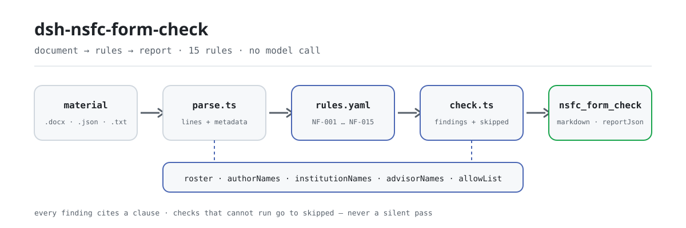

<div align="center">

<picture>
  <source media="(prefers-color-scheme: dark)" srcset="docs/assets/dsh-nsfc-form-check-flow-dark.svg">
  
</picture>

# dsh-nsfc-form-check

**Transforme uma proposta do NSFC em uma lista de diferenças linha a linha que a sua assessoria de pesquisa consegue usar.**

Um verificador do DeepSeek Harness para equipes de gestão científica: lê as linhas do corpo e as propriedades eletrônicas do documento, e relata o que está inconsistente, onde e contra qual cláusula — cada achado nomeia sua base e o tipo de base.

[Instalar](#instalação-em-três-passos) · [Configuração](#configuração) · [FAQ](#faq) · [简体中文](README.md) · [English](README.en.md) · [Español](README.es.md) · [Português](README.pt.md) · [हिन्दी](README.hi.md)

[](LICENSE)
[](#compatibilidade)
[](https://www.npmjs.com/package/dsh-nsfc-form-check)
[](https://github.com/PerryLink/dsh-nsfc-form-check/actions/workflows/ci.yml)
[](#compatibilidade)

[](https://github.com/PerryLink/dsh-nsfc-form-check/stargazers)
[](https://www.npmjs.com/package/dsh-nsfc-form-check)
[](https://dshfind.com/plugins/PerryLink/dsh-nsfc-form-check?ref=badge)
[](https://securityscorecards.dev/viewer/?uri=github.com/PerryLink/dsh-nsfc-form-check)
[](https://dsh.market/)
[](https://gitee.com/perrylink/dsh-nsfc-form-check)

```sh
dsh plugin --profile <name> add dsh-nsfc-form-check
```

</div>

<sub>Plugin da comunidade, não afiliado ao DeepSeek. Repositório canônico: <https://github.com/PerryLink/dsh-nsfc-form-check> (o Gitee é um espelho).</sub>

## O que é

`dsh-nsfc-form-check` lê uma proposta da National Natural Science Foundation of China (NSFC) — suas linhas de texto, as propriedades eletrônicas do documento e as listas de proponentes, instituições e orientadores da própria instituição — e confere esse material contra um pacote de regras versionado: se há uma lista configurada, em quais linhas do corpo aparecem os termos de identidade configurados, o que as propriedades de título, autor, empresa e última modificação carregam, se o material cabe no limite de extensão definido pela implantação, se os itens de revisão formal e a declaração de solicitação repetida estão presentes, se o nome do orientador foi preenchido como exigem as diretrizes anuais, e se aparece algum termo classificado ou sensível configurado.

Cada achado nomeia a cláusula de origem e informa se essa cláusula é um requisito direto, um princípio ou uma configuração local. Toda verificação que não pôde ser executada entra em `skipped` com o motivo. Portanto, uma lista de achados vazia nunca significa que nada estava errado: leia `NF-001` e as entradas de `skipped` antes de concluir qualquer coisa.

Ele apenas lista diferenças literais: não emite juízo de conformidade, não determina responsabilidade e não substitui o revisor. Aceita `.docx`, `.txt`, `.md`, `.json` e `.yaml`; `.pdf` não é analisado (o motivo está em «Formato do material»). ESM puro, sem rede, sem chamada de modelo e sem código nativo.

```text
proposal.docx ──parse──▶ lines + properties ──check──▶ findings + skipped
                                ▲
                                └── rules/nsfc-form-check.yaml (NF-001…NF-015)
```

## Instalação em três passos

1. **Instale** (escolha um canal):

   ```sh
   # canal git (main mais recente; executa a compilação prepare)
   dsh plugin --profile <name> add github:PerryLink/dsh-nsfc-form-check
   # canal npm (versão publicada, com lib/ já compilada)
   dsh plugin --profile <name> add dsh-nsfc-form-check
   # canal tarball: pnpm pack neste repositório e depois
   dsh plugin --profile <name> add ./dsh-nsfc-form-check-<version>.tgz
   ```

2. **Configuração mínima** (coloque a lista da sua instituição no patch do perfil; a lista não acompanha o pacote):

   ```yaml
   - insert:
       - id: dsh-nsfc-form-check
         name: dsh-nsfc-form-check
         config:
           authorNames: ["Zhang Wei"]
           institutionNames: ["Universidade de Exemplo", "Hospital Universitário de Exemplo"]
           advisorNames: ["Li Jianguo"]
   ```

3. **Verifique se monta**:

   ```sh
   dsh --profile <name> --dump-config | grep 'dsh-nsfc-form-check'
   ```

   O repositório também traz um quickstart reproduzível (execute antes `pnpm install && pnpm run build`, porque o script importa o artefato compilado):

   ```sh
   node samples/quickstart/run.mjs --check
   ```

   ```text
   nsfc_form_check: quickstart OK — output matches expected/result.json
   ```

   O resultado esperado é 1 achado e 14 entradas `skipped`, registrado em `samples/quickstart/expected/result.json`; a entrada e a captura estão em `samples/quickstart/input/` e `docs/assets/quickstart.png`.

**Desinstalar**: `dsh plugin --profile <name> remove dsh-nsfc-form-check` (ou remova a linha do patch do perfil).

## Capacidades principais

- **Lista primeiro; lista vazia não é aprovação** — `NF-001` é relatado primeiro quando as três listas de nomes estão vazias, e toda verificação que depende delas entra em `skipped` em vez de passar em silêncio.
- **Localizadores por linha** — a correspondência no corpo é literal e por linhas, então cada achado traz um número de linha; termos com menos de dois caracteres e tudo o que estiver em `allowList` são ignorados.
- **Propriedades do documento em separado** — `NF-005` a `NF-008` leem as propriedades de título, autor, empresa e última modificação sem misturá-las às conclusões do corpo.
- **Extensão e itens formais configurados por ano** — os limites, a lista e a declaração de `NF-010`, `NF-011` e `NF-012` saem vazios; sem configuração, entram em `skipped`.
- **A verificação do orientador aponta no sentido oposto** — `NF-014` é o inverso de `NF-004`: as diretrizes anuais exigem o nome do orientador, então esta regra verifica que ele **está** preenchido.
- **Termos classificados à parte** — `NF-015` é a única regra do pacote que cita um requisito real de «não deve aparecer», e seu objeto é informação classificada, não identidade.
- **Base transparente** — cada achado traz `document`, `number`, `clause`, um `excerpt` literal e uma `source`; regras apoiadas apenas em um princípio ou na configuração local têm a severidade limitada no carregamento.
- **Somente diferenças** — o relatório não emite juízo; quem decide é o revisor humano.

### Lista de regras

| Regra | Verificação | Severidade | Tipo de base |
|---|---|---|---|
| `NF-001` | há uma lista configurada; caso contrário, as verificações de identidade não podem executar | warn | princípio |
| `NF-002` | o corpo menciona um nome de proponente (aviso, não requisito legal) | warn | princípio |
| `NF-003` | o corpo menciona um nome de instituição (aviso, não requisito legal) | warn | princípio |
| `NF-004` | o corpo menciona um nome de orientador (aviso; distinga o caso exigido pelas diretrizes anuais) | warn | princípio |
| `NF-005` | a propriedade título contém um indício de identidade | info | princípio |
| `NF-006` | a propriedade autor não está vazia ou nomeia o proponente | info | princípio |
| `NF-007` | a propriedade empresa nomeia a instituição | info | princípio |
| `NF-008` | a propriedade última modificação nomeia o proponente | info | princípio |
| `NF-009` | indícios de identidade dentro de um intervalo de linhas configurado | info | princípio |
| `NF-010` | o material cabe no limite de extensão configurado | info | configuração local (mais uma cláusula direta) |
| `NF-011` | o material contém os itens de revisão formal configurados | info | configuração local |
| `NF-012` | uma solicitação repetida ou de continuação traz a declaração configurada | info | configuração local |
| `NF-013` | indícios de identidade dentro de um escopo configurado | info | princípio |
| `NF-014` | o nome do orientador está presente, como exigem as diretrizes anuais | info | configuração local (mais uma cláusula direta) |
| `NF-015` | o material não contém nenhum termo classificado ou sensível configurado | info | cláusula direta |

### Exemplos

A tabela abaixo é o conjunto de exemplos: a primeira linha é o caso detalhado e as demais são casos curtos.

#### Saída detalhada

**Ferramenta** `nsfc_form_check`

**Entrada**

~~~json
{"text":"申请代码：H0301\n项目名称：某信号通路在疾病进展中的作用机制研究","metadata":{},"roster":{"authorNames":[],"institutionNames":[],"advisorNames":[],"allowList":[]}}
~~~

**Saída**

~~~json
{
  "id": "dsh-nsfc-form-check.NF-001.811c9dc5",
  "ruleId": "NF-001",
  "severity": "warn",
  "locator": {},
  "found": "未配置任何可核验的身份词（申请人姓名、依托单位名称、导师姓名均为空）",
  "expected": "匿名检查需要名单才能执行；未配置时其余匿名相关检查只能逐条报为未执行"
}
~~~

*Observed from `dsh-nsfc-form-check/tests/fixtures/NF-001/NF-001-unsafe.json`*

| Você pergunta | O que ele responde |
|---|---|
| Ninguém preencheu a lista de nomes de proponentes. A verificação de identidade passa sem mais? | Não. `NF-001` é o primeiro item relatado quando `authorNames`, `institutionNames` e `advisorNames` estão vazios, e toda verificação de identidade que depende desses termos entra em `skipped` com o motivo. Uma lista de achados vazia nunca significa que nada estava errado: leia `NF-001` e as entradas de `skipped` antes de concluir qualquer coisa. |
| No corpo aparece um coautor com o mesmo sobrenome do proponente. | `NF-002` compara literalmente os `authorNames` configurados, linha por linha, então um homônimo, um sobrenome comum ou a citação do trabalho de outro pesquisador podem coincidir. O achado é apenas um aviso técnico —《国家自然科学基金条例》(国务院令第796号) 第二十一条 exige confidencialidade dos avaliadores e não proíbe que um nome apareça no corpo — por isso um termo já revisado pode ser adicionado a `allowList`. |
| A propriedade autor traz um nome. Isso é relatado e exige uma lista configurada antes? | Sim, e não. `NF-006` não precisa de lista: com `authorNames` vazio ele ainda relata qualquer propriedade autor não vazia, e com lista configurada diz se o valor coincide com um nome de proponente. `NF-005`, `NF-007` e `NF-008` precisam de uma lista de termos de identidade e entram em `skipped` sem ela. As quatro leem apenas as propriedades, então não dizem nada sobre o corpo do texto. |
| Os limites de páginas e palavras fui eu que preenchi. Ele vai dizer que a proposta está longa demais? | Somente dentro do limite que você definiu. `NF-010` sai com `maxLines` e `maxChars` sem configuração e entra em `skipped`, porque esses limites mudam a cada ano e por tipo de projeto; depois de preenchidos, ele relata a contagem de parágrafos extraídos ou o total de caracteres que os excede. `maxLines` conta parágrafos extraídos, não páginas diagramadas, então não equivale a uma contagem de páginas. |
| Todos os itens de revisão formal que a nossa assessoria pede estavam no material? | `NF-011` se relata em `skipped` até que `require` seja configurado, e sem lista ele não finge conhecê-la. Depois de configurado, compara literalmente as suas frases `match` e relata as que não encontra. Ele verifica que a frase existe, não que a coluna foi preenchida corretamente nem que a assinatura é autêntica. |
| Estamos reenviando a proposta do ano passado. A nota de declaração precisa estar lá? | `NF-012` precisa das duas coisas: `markerPatterns`, que reconhecem a redação do seu modelo para uma solicitação repetida ou de continuação, e `requiredDisclosure`, que lista o que deve ser declarado. Com qualquer uma sem configuração ele entra em `skipped`; quando os marcadores estão configurados mas nenhuma declaração é encontrada, ele informa que esta regra não se aplica. Ele nunca presume uma redação de declaração e nunca decide que a proposta é realmente repetida. |

## Configuração

Todos os parâmetros ajustáveis vivem no esquema Schemastery de `src/config.ts`, então são alterados pelo `cordis.yml` sem tocar no código; os limites por regra ficam no pacote de regras em `rules/`. Uma substituição por id troca a linha inteira: repita todas as chaves necessárias.

Chaves mais usadas:

| Chave | Tipo | Padrão | Descrição |
|---|---|---|---|
| `rulesFile` | string | `rules/nsfc-form-check.yaml` | Caminho do pacote de regras, relativo à raiz do pacote |
| `authorNames` | string[] | `[]` | Nomes de proponentes a procurar |
| `institutionNames` | string[] | `[]` | Nomes de instituições e unidades a procurar |
| `advisorNames` | string[] | `[]` | Nomes de orientadores a procurar |
| `allowList` | string[] | `[]` | Termos a ignorar mesmo quando coincidem |
| `disabledRules` | string[] | `[]` | Ids de regras a desativar; cada uma aparece em `skipped` |
| `onlyRules` | string[] | `[]` | Executar apenas estas regras; vazio executa todas |
| `timeoutMs` | number | `120000` | Orçamento cooperativo de timeout da ferramenta |

<details>
<summary>Tabela de configuração completa (9 chaves)</summary>

| Chave | Tipo | Padrão | Descrição |
|---|---|---|---|
| `rulesFile` | string | `rules/nsfc-form-check.yaml` | Caminho do pacote de regras, relativo à raiz do pacote |
| `disabledRules` | string[] | `[]` | Ids de regras a desativar; cada uma aparece em `skipped` |
| `onlyRules` | string[] | `[]` | Executar apenas estas regras; vazio executa todas |
| `skipNotes` | string | `""` | Nota acrescentada a cada motivo de `skipped` |
| `authorNames` | string[] | `[]` | Nomes de proponentes a procurar |
| `institutionNames` | string[] | `[]` | Nomes de instituições e unidades a procurar |
| `advisorNames` | string[] | `[]` | Nomes de orientadores a procurar |
| `allowList` | string[] | `[]` | Termos a ignorar mesmo quando coincidem |
| `timeoutMs` | number | `120000` | Orçamento cooperativo de timeout da ferramenta |

</details>

Parâmetros por regra que vale conhecer:

- `NF-009` `coverLines` — quantas linhas iniciais contam como capa. Vazio significa que o plugin não presume o modelo de nenhuma instituição.
- `NF-010` `maxLines` / `maxChars` — o limite de extensão **do ano e do tipo de projeto em que você está concorrendo**. `maxLines` conta parágrafos extraídos, o que não é o mesmo que páginas diagramadas.
- `NF-011` `require` — a sua lista de itens de revisão formal, como pares `[{ label, match }]`.
- `NF-012` `markerPatterns` / `requiredDisclosure` — como uma solicitação repetida é reconhecida no seu modelo e o que ela deve declarar.
- `NF-013` `patchedSections` / `scopeFromLine` / `scopeToLine` — contar indícios de identidade sobre uma lista de termos e um intervalo de linhas configurados.
- `NF-014` `requireMention` + `advisorNames` — a verificação inversa, desligada até você ativá-la para o ano.
- `NF-015` `secretTerms` — a lista de termos do seu setor de sigilo. O plugin não traz nenhuma, porque o que conta como classificado é definido pelas normas estatais de sigilo, não por este plugin.

Exemplo de substituição no patch do perfil:

```yaml
- insert:
    - id: dsh-nsfc-form-check
      name: dsh-nsfc-form-check
      config:
        authorNames: ["Zhang Wei", "Li Na"]
        institutionNames: ["Universidade de Exemplo"]
        allowList: ["Zhang"]
        disabledRules: ["NF-009"]
```

## FAQ

<details>
<summary>Sem lista de nomes, a verificação de identidade passa em silêncio?</summary>

Não. `NF-001` é relatado primeiro quando as três listas de termos de identidade estão vazias, e toda verificação que precisa de uma lista entra em `skipped` com o motivo. Uma lista de achados vazia significa «nenhuma diferença a relatar», não «conforme».

</details>

<details>
<summary>Um coautor homônimo ou um sobrenome comum vai inundar o relatório?</summary>

Vai coincidir, porque `NF-002` é literal. Uma coincidência é um aviso técnico, não uma conclusão de infração. Adicione a `allowList` os termos que você já revisou (um sobrenome comum, a citação do trabalho de outro pesquisador); termos com menos de dois caracteres são ignorados de qualquer forma.

</details>

<details>
<summary>Ele aceita PDF?</summary>

Não. A extração exata por página é outro problema, e um número de página errado é pior do que nenhum, então o plugin recusa `.pdf` por projeto. Extraia o texto com uma ferramenta confiável e passe-o por `text`, ou converta a proposta para `.docx`.

</details>

<details>
<summary>Ele decide se uma proposta está conforme ou substitui o revisor?</summary>

Nenhum dos dois. O relatório lista diferenças literais contra as cláusulas citadas; a camada de renderização tem uma guarda de redação e sempre traz o aviso legal. Achados sobre nomes ou instituições são apenas avisos de indícios de identidade: **usar isto como barreira de conformidade é errado** (veja «Limites de segurança»).

</details>

<details>
<summary>Qual é o custo de desempenho? Para onde vão os dados?</summary>

Sem rede, sem chamada de modelo e sem reescrever o arquivo original: o material é lido em memória e um relatório é produzido. O custo cresce com o comprimento do material e o tamanho das listas; `.docx` descompacta o pacote para ler texto e propriedades, por isso é um pouco mais lento que texto puro. Não há requisições de rede nem persistência.

</details>

## Limites de segurança

**Limite:** este plugin verifica o **texto e as propriedades eletrônicas de uma proposta do NSFC** e relata os indícios de identidade que encontra, junto com os itens de extensão e revisão formal que a implantação configura. Ele não é o `dsh-rulefile-check` (que audita a legalidade de um documento normativo), não é o `dsh-policy-brief-draft` (que redige uma explicação de política) e não é o `dsh-review-reply-check` (que acompanha comentários de revisores). Ele lê uma proposta e relata correspondências literais com as cláusulas citadas.

> ### ⚠️ Leia isto antes de usar as verificações de anonimato
>
> **Não existe nenhuma disposição nacional vigente que proíba o nome, a instituição ou o orientador do proponente de aparecer em uma proposta do NSFC.** Para este plugin, três textos independentes foram lidos na íntegra —《国家自然科学基金条例》(国务院令第796号), the 2026 Project Guidelines — Application Rules e as diretrizes de 2019 — e nenhum contém 匿名, 盲审, 活页 nem qualquer fórmula de «não deve aparecer» sobre identidade. O regulamento não contém a palavra «anonimato». Sua cláusula de **impedimento** (artigo 20) exige que um avaliador da mesma pessoa jurídica do proponente se declare impedido, o que pressupõe que o sistema conhece a instituição do proponente — o oposto de um processo anônimo.
>
> Por isso, cada achado deste plugin sobre um nome ou uma instituição é uma **observação técnica para uma pessoa avaliar**, rotulada como indício de identidade e nunca formulada como infração. O plugin é útil para a autoverificação de uma assessoria de pesquisa, e **usá-lo como barreira de conformidade é errado**. Duas regras vão além e citam a diretriz literalmente: `NF-014` verifica que o nome do orientador **está** preenchido, porque as diretrizes anuais exigem isso, e `NF-015` verifica informação classificada e sensível, o único requisito real de «não deve aparecer», cujo objeto é informação classificada, não identidade.

## Normas seguidas

| Documento | Número | Regras que o citam |
|---|---|---|
| Regulamento da National Natural Science Foundation of China | Ordem do Conselho de Estado nº 796 | NF-001, NF-002, NF-003, NF-004, NF-005, NF-006, NF-007, NF-008, NF-009, NF-010, NF-011, NF-012, NF-013, NF-014, NF-015 |
| Diretrizes de projetos NSFC 2026 — Regras de solicitação | Edição 2026 (atualizada anualmente) | NF-014, NF-015 |

O regulamento foi revisado em 2024-11-08 pela Ordem do Conselho de Estado nº 796 e entrou em vigor em 2025-01-01, substituindo a Ordem nº 487 (2007). O pacote cita apenas os números de cláusula da revisão vigente; o número da ordem substituída nunca aparece (há um teste que afirma isso). Os registros de verificação cláusula por cláusula estão em `rules/evidence/clause-verification.md` e `rules/evidence/clause-verification-nsfc-regulation.md`.

## Formato do material

Aponte a ferramenta para um `.docx` e ela lê o texto do corpo e as propriedades do documento. Um `.pdf` **não** é analisado: a extração exata por página é outro problema com outro modo de falha, e um número de página errado é pior do que nenhum, então passe o texto que você extraiu com a sua própria ferramenta. `.txt`, `.md`, `.json` e `.yaml` também são aceitos; a forma JSON carrega as duas partes explicitamente.

```json
{
  "lines": ["申请代码：H0301", "一、立项依据与研究内容", "……"],
  "metadata": { "title": "某信号通路机制研究", "author": "", "company": "", "lastModifiedBy": "" }
}
```

A correspondência é literal e por linhas, então cada achado traz um número de linha para o qual você pode saltar. Um termo com menos de dois caracteres é ignorado, e tudo o que estiver em `allowList` é ignorado, porque caso contrário um sobrenome comum inundaria o relatório.

## Origem das regras

Os dados das regras ficam em `rules/nsfc-form-check.yaml`. Cada regra traz documento, número, cláusula na numeração própria da fonte, trecho literal e URL de origem. O carregador exige que o trecho seja uma citação real de pelo menos oito caracteres, e que uma verificação apoiada apenas em um princípio geral ou em uma política local nunca seja declarada `error`.

Quatro achados moldaram este pacote:

1. **O regulamento foi revisado.** O Regulamento da NSFC agora é a **Ordem do Conselho de Estado nº 796** (revisada em 2024-11-08, em vigor desde 2025-01-01), substituindo a Ordem nº 487 (2007). Os números de cláusula mudaram: o dever de confidencialidade da revisão agora é o artigo 21, não o antigo artigo 24. Este pacote cita apenas a revisão vigente, e um teste afirma que o número da ordem substituída nunca aparece.
2. **O anonimato não tem base legal**, como exposto em «Limites de segurança». As regras dizem isso nas próprias notas para que quem lê o relatório veja sem consultar o README.
3. **O nome do orientador é *obrigatório*, não proibido.** As diretrizes anuais pedem que se preencham com veracidade os nomes dos orientadores de mestrado/doutorado e de pós-doutorado. Por isso `NF-014` verifica o oposto de `NF-004`, e o pacote explica por que os dois coexistem.
4. **A política anual é configuração, não código.** Limites de páginas e palavras, as regras de limite de propostas, quais tipos de projeto usam orçamento global e a lista anual de situações de não aceitação mudam a cada ano; todos saem vazios.

O relatório completo de verificação de cláusulas, incluindo as fontes verificadas e descartadas, está em `rules/evidence/clause-verification.md`.

## Solução de problemas

- **O plugin instala mas a ferramenta não aparece**: verifique se `main` aponta para `lib/index.mjs` e se `pnpm run build` o gerou; um `main` errado faz o carregador pular a entrada em silêncio.
- **Todas as verificações de identidade estão em skipped**: não há lista configurada. Preencha `authorNames`, `institutionNames` e `advisorNames`, e `NF-001` deixará de ser relatado.
- **O relatório fica ruidoso com um sobrenome comum**: adicione o termo a `allowList`; o plugin não adivinha quais coincidências são significativas.
- **Um `.pdf` é recusado**: é o comportamento previsto. Extraia o texto com uma ferramenta confiável e passe-o por `text`, ou converta a proposta para `.docx`.
- **`dsh plugin add` recusa o pacote por incompatibilidade**: o intervalo de peers cobre `0.1.x` e `0.2.x`; se o seu runtime estiver fora, conceda uma isenção explícita: `dsh plugin --profile <name> allow-version dsh-nsfc-form-check@0.1.0 --dsh-version <runtime> --accept-risk`
- **`check` relata `manifest-peers` como falha**: o verificador estático compara com um intervalo de peers codificado anterior à linha 0.2. O runtime aplica a compatibilidade de peers na instalação, então o intervalo declarado é o correto; é um problema conhecido do `dsh-plugin-dev`.
- **Os horários parecem deslocados**: toda a aritmética é de relógio de parede sobre as strings fornecidas; não há conversão de fuso horário.

## Compatibilidade

| Superfície | Estado |
|---|---|
| Harness | Intervalo de peers `>=0.1.2-rc.1 <0.2.0 \|\| >=0.2.0-0 <0.3.0` — verificado para aceitar tanto `0.2.0-rc.2` quanto `0.2.1-rc.2`. `engines.dsh` é declarado como `>=0.2.1-0 <0.3.0` e é aplicado pelo host desde 0.2.1 |
| Node | `^22.19.0 \|\| >=24.0.0` |
| Plataformas | Todas (ESM puro; sem código nativo, sem rede, sem chamada de modelo) |
| Modo de ferramenta | Funciona em `native` e `ptc`; para um lote de propostas use `ptc` |

## Ecossistema e qualidade

- [Espelho no Gitee](https://gitee.com/perrylink/dsh-nsfc-form-check) (espelho sincronizado; o GitHub é o canônico)
- [Página do plugin no dshfind](https://dshfind.com/plugins/PerryLink/dsh-nsfc-form-check) (instalações e ranking)
- [Relatório OpenSSF Scorecard](https://securityscorecards.dev/viewer/?uri=github.com/PerryLink/dsh-nsfc-form-check) (impulsionado por [.github/workflows/scorecard.yml](.github/workflows/scorecard.yml))
- [DSH Market](https://dsh.market/) (listado)
- [Escolher um verificador por material](https://perrylink.github.io/zh/checkers/choose/) — índice de seleção de verificadores da família
- [Base de conhecimento do ecossistema](https://perrylink.github.io/dsh-plugin-guide/): guia de desenvolvimento de plugins · dados de seleção · critérios de manutenção

## Desenvolvimento

```sh
pnpm install
pnpm run typecheck        # tsc --noEmit
pnpm test                 # vitest; pares de fixtures por regra e uma ida e volta real de .docx
pnpm run build            # tsdown -> lib/index.mjs + lib/index.d.mts
pnpm run verify:self-contained
pnpm run check:lockfile
pnpm run check:readmes    # consistência dos README em cinco idiomas
pnpm run check:citations  # verificação literal das citações do pacote de regras
pnpm pack                 # tarball de publicação
```

`tests/docx-fixture.ts` constrói pacotes `.docx` reais em memória (um ZIP autêntico com entradas deflate), então o caminho docx é exercitado de ponta a ponta enquanto os fixtures continuam sendo JSON revisáveis. Quickstart: `node samples/quickstart/run.mjs --check`. As imagens do README são geradas programaticamente por [`scripts/gen-readme-assets.py`](scripts/gen-readme-assets.py) (Python + Pillow) e podem ser executadas novamente sem risco.

| Caminho | Propósito |
|---|---|
| `src/index.ts` | Contrato de plugin funcional: registra a ferramenta `nsfc_form_check` e resolve o pacote de regras |
| `src/config.ts` | Esquema de configuração Schemastery; todo ajuste vive aqui |
| `src/check.ts` | Núcleo de verificação puro, `(input, ruleset, options) => Report`; sem E/S, relógio ou modelo |
| `src/parse.ts` | Leitor de material (JSON / YAML / texto / bytes docx) |
| `src/view.ts` | Projeção do relatório para o modelo, refletida por `output.schema` |
| `src/shared/` | Kit compartilhado da família (carregador de regras, forma do relatório, subconjunto YAML, guarda de redação), copiado para o pacote continuar autocontido |
| `rules/` | 15 regras e o registro de verificação de cláusulas |
| `tests/` | Fixtures conformes/infratoras por regra e a ida e volta de docx |

Topics: `deepseek-harness`, `dsh`, `dsh-plugin`, `cordis`, `nsfc`, `form`

## Família e agradecimentos

Este projeto faz parte da família de plugins do DeepSeek Harness mantida pela [PerryLink](https://github.com/PerryLink) (todos Apache-2.0). Se ele for útil, **uma estrela ajuda a próxima pessoa a encontrá-lo**; nada fica bloqueado por isso.

- [@PerryLink](https://github.com/PerryLink) — criador e mantenedor: o pacote de regras, o núcleo de verificação e a documentação em cinco idiomas.

<details>
<summary>Ver todos os plugins</summary>

| Plugin | Estado |
|---|---|
| **[dsh-aqua-input-check](https://github.com/PerryLink/dsh-aqua-input-check)** |  |
| **[dsh-archive-check](https://github.com/PerryLink/dsh-archive-check)** |  |
| **[dsh-auto-review](https://github.com/PerryLink/dsh-auto-review)** |  |
| **[dsh-autotier](https://github.com/PerryLink/dsh-autotier)** | 🧊 CONGELADO — ver o README do repo |
| **[dsh-bid-ca-precheck](https://github.com/PerryLink/dsh-bid-ca-precheck)** |  |
| **[dsh-bid-qual-check](https://github.com/PerryLink/dsh-bid-qual-check)** |  |
| **[dsh-cert-mcp](https://github.com/PerryLink/dsh-cert-mcp)** | 🧊 CONGELADO — ver o README do repo |
| **[dsh-checkpoint-rewind](https://github.com/PerryLink/dsh-checkpoint-rewind)** |  |
| **[dsh-click](https://github.com/PerryLink/dsh-click)** |  |
| **[dsh-composer-history](https://github.com/PerryLink/dsh-composer-history)** |  |
| **[dsh-contract-stance](https://github.com/PerryLink/dsh-contract-stance)** |  |
| **[dsh-customs-doc-check](https://github.com/PerryLink/dsh-customs-doc-check)** |  |
| **[dsh-data-quality](https://github.com/PerryLink/dsh-data-quality)** | 🧊 CONGELADO — ver o README do repo |
| **[dsh-demurrage-ledger](https://github.com/PerryLink/dsh-demurrage-ledger)** |  |
| **[dsh-doublecheck](https://github.com/PerryLink/dsh-doublecheck)** |  |
| **[dsh-drill-script-check](https://github.com/PerryLink/dsh-drill-script-check)** |  |
| **[dsh-eia-guide-check](https://github.com/PerryLink/dsh-eia-guide-check)** |  |
| **[dsh-emergency-plan](https://github.com/PerryLink/dsh-emergency-plan)** |  |
| **[dsh-essay-rubric-check](https://github.com/PerryLink/dsh-essay-rubric-check)** |  |
| **[dsh-evidence-check](https://github.com/PerryLink/dsh-evidence-check)** |  |
| **[dsh-export-ctl-check](https://github.com/PerryLink/dsh-export-ctl-check)** |  |
| **[dsh-fast](https://github.com/PerryLink/dsh-fast)** |  |
| **[dsh-fmea-table-check](https://github.com/PerryLink/dsh-fmea-table-check)** |  |
| **[dsh-forecast-penalty](https://github.com/PerryLink/dsh-forecast-penalty)** |  |
| **[dsh-fund-research](https://github.com/PerryLink/dsh-fund-research)** |  |
| **[dsh-github](https://github.com/PerryLink/dsh-github)** |  |
| **[dsh-gongwen-flow-check](https://github.com/PerryLink/dsh-gongwen-flow-check)** |  |
| **[dsh-gongwen-word-check](https://github.com/PerryLink/dsh-gongwen-word-check)** |  |
| **[dsh-guard-plan-qc](https://github.com/PerryLink/dsh-guard-plan-qc)** |  |
| **[dsh-hazchem-check](https://github.com/PerryLink/dsh-hazchem-check)** |  |
| **[dsh-hazplan-check](https://github.com/PerryLink/dsh-hazplan-check)** |  |
| **[dsh-hidden-risk-map](https://github.com/PerryLink/dsh-hidden-risk-map)** |  |
| **[dsh-hs-classify](https://github.com/PerryLink/dsh-hs-classify)** |  |
| **[dsh-icd-rule-check](https://github.com/PerryLink/dsh-icd-rule-check)** |  |
| **[dsh-industry-research](https://github.com/PerryLink/dsh-industry-research)** |  |
| **[dsh-lawcite-adapter](https://github.com/PerryLink/dsh-lawcite-adapter)** |  |
| **[dsh-laya](https://github.com/PerryLink/dsh-laya)** |  |
| **[dsh-lc-doc-check](https://github.com/PerryLink/dsh-lc-doc-check)** |  |
| **[dsh-learning-gap-check](https://github.com/PerryLink/dsh-learning-gap-check)** |  |
| **[dsh-library](https://github.com/PerryLink/dsh-library)** |  |
| **[dsh-local-ai](https://github.com/PerryLink/dsh-local-ai)** |  |
| **[dsh-lsp-actions](https://github.com/PerryLink/dsh-lsp-actions)** |  |
| **[dsh-mask](https://github.com/PerryLink/dsh-mask)** |  |
| **[dsh-mcp-panel](https://github.com/PerryLink/dsh-mcp-panel)** |  |
| **[dsh-medrec-qc](https://github.com/PerryLink/dsh-medrec-qc)** |  |
| **[dsh-memento](https://github.com/PerryLink/dsh-memento)** | 🧊 CONGELADO — ver o README do repo |
| **[dsh-nsfc-form-check](https://github.com/PerryLink/dsh-nsfc-form-check)** |  |
| **[dsh-nurse-record-check](https://github.com/PerryLink/dsh-nurse-record-check)** |  |
| **[dsh-observe](https://github.com/PerryLink/dsh-observe)** |  |
| **[dsh-origin-rvc-check](https://github.com/PerryLink/dsh-origin-rvc-check)** |  |
| **[dsh-ota-review-check](https://github.com/PerryLink/dsh-ota-review-check)** |  |
| **[dsh-output-styles](https://github.com/PerryLink/dsh-output-styles)** |  |
| **[dsh-paper-doc-adapter](https://github.com/PerryLink/dsh-paper-doc-adapter)** |  |
| **[dsh-permission-rules](https://github.com/PerryLink/dsh-permission-rules)** |  |
| **[dsh-permit-report-check](https://github.com/PerryLink/dsh-permit-report-check)** |  |
| **[dsh-pipeline-check](https://github.com/PerryLink/dsh-pipeline-check)** |  |
| **[dsh-pleading-draft](https://github.com/PerryLink/dsh-pleading-draft)** |  |
| **[dsh-plugin-doctor](https://github.com/PerryLink/dsh-plugin-doctor)** | 🚫 APOSENTADO (repo arquivado) |
| **[dsh-plugin-guide](https://github.com/PerryLink/dsh-plugin-guide)** |  |
| **[dsh-plugin-kit](https://github.com/PerryLink/dsh-plugin-kit)** | 🚫 APOSENTADO (repo arquivado) |
| **[dsh-plugin-upgrade](https://github.com/PerryLink/dsh-plugin-upgrade)** | 🚫 APOSENTADO (repo arquivado) |
| **[dsh-policy-brief-draft](https://github.com/PerryLink/dsh-policy-brief-draft)** |  |
| **[dsh-power-loss-split](https://github.com/PerryLink/dsh-power-loss-split)** |  |
| **[dsh-power-ticket-check](https://github.com/PerryLink/dsh-power-ticket-check)** |  |
| **[dsh-ppap-check](https://github.com/PerryLink/dsh-ppap-check)** |  |
| **[dsh-protest-deadline](https://github.com/PerryLink/dsh-protest-deadline)** |  |
| **[dsh-railway-window](https://github.com/PerryLink/dsh-railway-window)** |  |
| **[dsh-repair-order-qc](https://github.com/PerryLink/dsh-repair-order-qc)** |  |
| **[dsh-research-report](https://github.com/PerryLink/dsh-research-report)** |  |
| **[dsh-review-reply-check](https://github.com/PerryLink/dsh-review-reply-check)** |  |
| **[dsh-rulefile-check](https://github.com/PerryLink/dsh-rulefile-check)** |  |
| **[dsh-safety-brief-check](https://github.com/PerryLink/dsh-safety-brief-check)** |  |
| **[dsh-score](https://github.com/PerryLink/dsh-score)** | 🧊 CONGELADO — ver o README do repo |
| **[dsh-session-sync](https://github.com/PerryLink/dsh-session-sync)** |  |
| **[dsh-site-log-check](https://github.com/PerryLink/dsh-site-log-check)** |  |
| **[dsh-skill-pack-security](https://github.com/PerryLink/dsh-skill-pack-security)** |  |
| **[dsh-soe-decision-check](https://github.com/PerryLink/dsh-soe-decision-check)** |  |
| **[dsh-soilwater-check](https://github.com/PerryLink/dsh-soilwater-check)** |  |
| **[dsh-sop-sync-check](https://github.com/PerryLink/dsh-sop-sync-check)** |  |
| **[dsh-spc-gbt-adapter](https://github.com/PerryLink/dsh-spc-gbt-adapter)** |  |
| **[dsh-talk](https://github.com/PerryLink/dsh-talk)** |  |
| **[dsh-tender-extract](https://github.com/PerryLink/dsh-tender-extract)** |  |
| **[dsh-tender-matrix](https://github.com/PerryLink/dsh-tender-matrix)** |  |
| **[dsh-test-drive](https://github.com/PerryLink/dsh-test-drive)** |  |
| **[dsh-ticktick](https://github.com/PerryLink/dsh-ticktick)** | 🚫 APOSENTADO (repo arquivado) |
| **[dsh-translate](https://github.com/PerryLink/dsh-translate)** |  |
| **[dsh-warranty-calc](https://github.com/PerryLink/dsh-warranty-calc)** |  |
| **[dsh-budget](https://github.com/PerryLink/dsh-budget)** |  |
| **[dsh-claude-move](https://github.com/PerryLink/dsh-claude-move)** |  |
| **[dsh-defend](https://github.com/PerryLink/dsh-defend)** |  |
| **[dsh-draw](https://github.com/PerryLink/dsh-draw)** | 🧊 CONGELADO — ver o README do repo |
| **[dsh-reach](https://github.com/PerryLink/dsh-reach)** |  |
| **[dsh-background-agents](https://github.com/PerryLink/dsh-background-agents)** | 🚫 APOSENTADO (repo arquivado) |
| **[dsh-session-pin](https://github.com/PerryLink/dsh-session-pin)** | 🚫 APOSENTADO (repo arquivado) |
| **[dsh-team-rooms](https://github.com/PerryLink/dsh-team-rooms)** | 🚫 APOSENTADO (repo arquivado) |

</details>

## License

[LICENSE](LICENSE) (Apache License 2.0) © 2026 dsh-nsfc-form-check contributors

<p align="center"><sub>Apache-2.0 · Plugin da comunidade, não afiliado ao DeepSeek.</sub></p>
